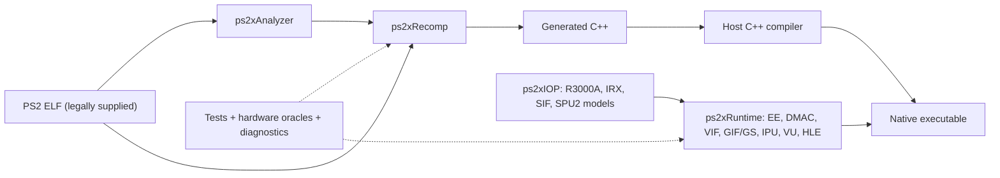
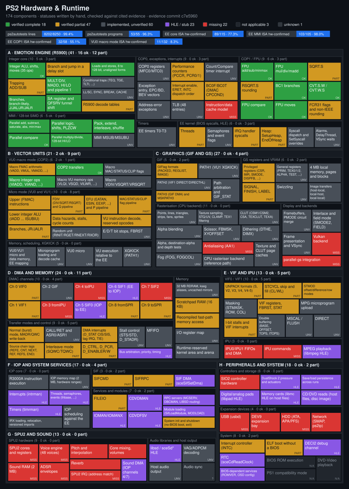
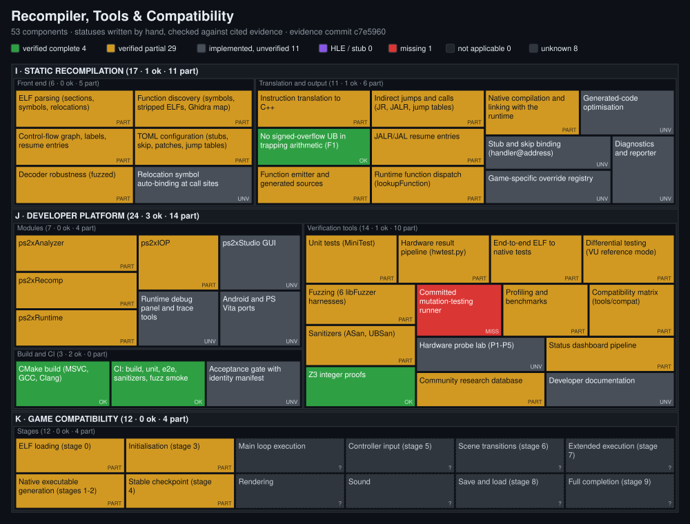

# Zmbor

<p align="center"><strong>PlayStation 2 static recompilation • hardware-aware native runtime • evidence-first engineering</strong></p>

<p align="center">
  <a href="https://github.com/m7kor/Zmbor/actions/workflows/build.yml"></a>
  <a href="LICENSE"></a>
  
  
</p>

**Zmbor** is an experimental open-source **PlayStation 2 static recompiler and native runtime**.
It translates **Emotion Engine (R5900)** ELF functions into host C++, which can be compiled
and linked against a runtime providing PS2-like memory, VU/VIF, DMA, graphics, IOP services,
SPU2 modelling and higher-level libraries. It continues
[ran-j/PS2Recomp](https://github.com/ran-j/PS2Recomp) under **GPL-3.0**.

> [!IMPORTANT]
> **This is an engineering framework, not a turnkey PS2 emulator or universal game-porting tool.**
> Compiling an ELF or passing unit tests does not mean a commercial game is playable. Zmbor
> does **not** ship BIOS files, commercial game assets or generated commercial-game code.
> Game-specific experiments are separate compatibility projects; reusable fixes belong in Zmbor.

**Latest merged checkpoint — 4 November 2026:** the
[Prosanity engineering integration, PR #13](https://github.com/m7kor/Zmbor/pull/13),
is in `main` at [`6c624951`](https://github.com/m7kor/Zmbor/commit/6c6249519badcb16d1da2e46cfcba0a790736fcd).
All **six GitHub CI jobs** passed for that merge. The subsequent
[RPC memory-safety review, PR #16](https://github.com/m7kor/Zmbor/pull/16),
contains an additional range-validation fix and test but is **not part of `main`**.
The review's first test failed to compile due to a missing header; the
[declaration-include repair](https://github.com/m7kor/Zmbor/commit/597b54e07e98b742da8b42c51e915c2137dbb4bc)
was pushed. Do not imply that the new regression or the reviewed patch passed CI until the
final commit's checks finish.

**Navigation:** [Architecture](#architecture) · [Current features](#current-capabilities-and-constraints) ·
[Prosanity integration](#november-2026-prosanity-integration) ·
[Hardware dashboard](#component-status-dashboard) · [Validation](#test-evidence-and-acceptance) ·
[Build](#build-and-install) · [Usage](#analyze-recompile-and-build-a-game-project) ·
[Diagnostics](#diagnostics-and-profiling) · [Roadmap](#roadmap-and-blockers) ·
[Documentation](#documentation-and-repository-layout).

## Architecture



The recompiler translates the **EE program ahead of time**. **IOP R3000A** and
**VU microprograms** execute using interpreter paths, and numerous PS2 libraries and
peripherals still use **HLE** (high-level emulation). Zmbor is not a replacement BIOS
and does not directly turn arbitrary ISO files into fully working host executables.

| Module | Responsibility | Evidence boundary |
|:--|:--|:--|
| [`ps2xAnalyzer`](ps2xAnalyzer/) | ELF analysis, function identification, TOML configuration, Ghidra integration | Stripped and indirect code discovery is incomplete |
| [`ps2xRecomp`](ps2xRecomp/) | R5900/MMI/COP translation, control flow, native C++ emission | Not all guest functions, dynamic jumps or instructions are resolved |
| [`ps2xRuntime`](ps2xRuntime/) | Guest memory, DMAC, VIF/GIF/GS, VU, IPU, scheduling, HLE and host output | Hybrid hardware models; incomplete cycle timing and peripherals |
| [`ps2xIOP`](ps2xIOP/) | Emulated IOP CPU, kernel, IRX modules, RPC, CDVD and SPU2 services | Hardware-accuracy and full-service coverage remain limited |
| [`ps2xStudio`](ps2xStudio/) | Experimental desktop developer and debugger UI | Optional; not required for the CLI |
| [`ps2xTest`](ps2xTest/) | Unit, generated-code, synthetic E2E and subsystem tests | A passing synthetic program is not retail gameplay |
| [`tools`](tools/) | Hardware reference comparison, fuzzing, Z3, dashboards, benchmarks and diagnostics | Tests depend on the exact toolchain and selected fixtures |

## Current capabilities and constraints

The matrix describes **present implementation**, not a percentage of PS2 emulation completeness.

| Area | Implemented in the merged code | Known limits |
|:--|:--|:--|
| **EE / R5900 / MMI / COP1** | Static instruction translation, arithmetic and overflow handling, additional COP0 exception safety, generated-code checks | RSQRT rounding mismatch; incomplete guest TLB/cache and timing semantics |
| **ELF / indirect control flow** | Conservative discovery for stripped ELFs, selected vtables and JALR targets, Ghidra-assisted function maps | Some leaf functions, dynamic targets and data-only references are not discoverable automatically |
| **VU0 / VU1 / VIF** | Micro-interpreters, VU0 macro operations, VIF transfers, MSCAL/MSCNT paths and targeted regression tests | Pipeline and FMAC flags, D/T interrupts, VIF/GIF scheduling and asynchronous VU timing remain incomplete |
| **DMAC / SIF / IOP RPC** | DMA/SIF1 models, opt-in bounded SIF0 path, IOP client↔EE server RPC bridging, IRX services and completion handling | SIF0 default transport is incomplete; the PR #16 EE-buffer safety patch is pending |
| **GS / rendering** | Software GS backend, GIF handling, CLUT and raw-GIF tests, display snapshots | Many blending/edge cases and GPU correctness still open |
| **paraLLEl-GS (Phase 18)** | Experimental Vulkan adapter behind `PS2X_ENABLE_PARALLEL_GS=ON` | **Off by default**; Stage E2 differential tests found triangle-edge and bilinear discrepancies, so no verified GPU speed/accuracy claim |
| **IPU / MPEG** | IPU command models, MPEG video/HLE paths, optional FFmpeg decoding, stream/DMA/callback refinements | PS2-specific decoder semantics, EOF and all retail video transitions not fully validated |
| **SPU2 / audio** | Register and sound-RAM models; ADPCM voices, envelopes, pitch, per-core mixing, optional reverb/ADMA models | Native SPU2 audio sink, complete guest work-area wiring, refill and hardware timing are incomplete |
| **CDVD / memory card / input** | Virtual disc/file lookup, HLE service paths, scripted PAD playback and selected save-card behaviours | Not an exact hardware CDVD/SIO2/USB/network/HDD implementation; some games use unsupported services |
| **Runtime diagnostics** | Opt-in trace summary, guest termination reasons, frame capture series, bounded host-run deadlines | Instrumentation is not hardware verification and can slow execution |
| **Build / research** | Out-of-tree generated-game target, optional sccache, pinned Windows FFmpeg download, Ghidra headless analyses, fuzz/Z3 tests | Experimental workflows may require manual game-specific integration |

### Development before Prosanity

- **Phases 0–7:** correctness, EE hardware-output tests, VU interpretation and performance,
  guarded DMA/ELF handling, fuzzers, sanitizers, compatibility gates and an evidence-backed dashboard.
- **Phases 8–11:** SPU2 ADSR, pitch, Gaussian interpolation, mixed stereo, model reverb and ADMA,
  plus VIF/VU0 and DMA/SIF improvements. The model-level outputs were not a complete native audio solution.
- **Phases 12–16:** stripped-ELF and indirect-target discovery, safer unknown-syscall handling,
  COP0 fault handling and the initial GS raw-GIF backend separation.
- **Phases 18–20 and stabilization Gates A–G:** opt-in paraLLEl-GS groundwork; Ghidra 12
  headless extraction; root-scoped optional `sccache`; MSVC/header, SLTIU/TLB, CLUT and test-infrastructure fixes.
  The GPU differential gap remains explicitly **open**. See
  [PR #12](https://github.com/m7kor/Zmbor/pull/12) and the
  [evidence ledger](docs/engineering/STABILIZATION_GATE_A_BASELINE.md).

Phase numbers are development batches, **not completion percentages**. Historical test counts are
recorded in [CHANGELOG.md](CHANGELOG.md); they are not interchangeable with newer build results.

## November 2026 Prosanity integration

[Prosanity](https://github.com/m7kor/prosanity) continued Zmbor engineering with a practical
**Crash Twinsanity** compatibility workload. On **4 November 2026**,
[Zmbor PR #13](https://github.com/m7kor/Zmbor/pull/13) integrated **77 changed paths**
from Prosanity source commit
[`798d807`](https://github.com/m7kor/prosanity/commit/798d80701a977cc0dcecef373d39d145a84f9525).
The import copied an audited **source-tree snapshot**; Prosanity's **21 original commit objects**
remain in the original repository rather than being recreated in Zmbor history.

| Integrated workstream | Main improvement | What it does **not** establish |
|:--|:--|:--|
| **EE / IOP RPC** | Two-way SIF binding/call and server execution; test IRX for blocking and deferred replies | Complete SIF timing or all SDK RPC variants |
| **CDVD / VFS** | Safer guest result spans, directory/filename indexing and virtual sector read diagnostics | Full physical-drive/ISO9660 emulation |
| **Recompiler discovery** | Extra function/vtable candidate rules, synthetic ELF regressions and runtime missing-target reports | Automatic recovery of all stripped retail functions |
| **MPEG / IPU / FFmpeg** | Improved movie decoding, guest callback/refill handling, DMA input and format checks | All codecs, the full MPEG EOF lifecycle or seamless gameplay transitions |
| **PAD and diagnostics** | Deterministic scripted input, frame series, structured trace and truthful exit reasons | Deterministic whole-game execution or real controller hardware verification |
| **Tooling and tests** | Build generated game sources outside the repository, Windows FFmpeg integrity pin, extra E2E/IOP tests and external profiling | Retail gameplay, performance and audio quality without real tests |

**Current retail-game observation:** the source work reported **native startup and both
introductory videos of Crash Twinsanity**, including later Crash/Cortex visuals.
**Interactive gameplay is not verified.** These observations belong to that
particular game build and test setup, not a universal Zmbor compatibility claim.
See the [dated game continuation report](docs/engineering/CRASH_TWINSANITY_CONTINUATION.md).
RE4 results belong to its separate compatibility client and are **not** automatically
validated by this import.

**Post-merge review:** [PR #16](https://github.com/m7kor/Zmbor/pull/16) fixes a
potential bulk `memcpy` span overrun in the IOP→EE RPC path and adds a regression
for end-of-RAM and KSEG1 aliasing. An initial revision did **not compile** because
the test lacked the `Syscalls/RPC.h` declaration include; the include was corrected
in [`597b54e`](https://github.com/m7kor/Zmbor/commit/597b54e07e98b742da8b42c51e915c2137dbb4bc).
That patch remains **outside the published `main`** and must pass its own CI
and functional tests. The successful `main` CI predates this follow-up.

Zmbor remains the **single canonical, general-purpose framework**. Game-specific
addresses, scripts and data must not silently become generic runtime behaviours.
See [source provenance and integration policy](docs/engineering/PROSANITY_INTEGRATION.md).

## Component status dashboard

**Formal inventory: 227 components** — 174 PS2 hardware/runtime items and 53 framework,
recompiler, tool and compatibility items. This is a *reviewed evidence inventory*, not
a live code-coverage meter and not a claim of PS2 hardware completion.

The following visuals and table are generated from
[`docs/status/components.json`](docs/status/components.json).
A green component means its **explicitly enumerated verification contract** passed,
not that all behaviour of its larger subsystem is perfect.
**Do not edit this block by hand**: change the evidence inventory, then run
`python tools/status/generate_dashboard.py` and the dashboard validator.

<!-- status-dashboard:begin (generated by tools/status/generate_dashboard.py; do not edit) -->

<p align="center"></p>

<p align="center"></p>

| status | PS2 Hardware & Runtime | Recompiler, Tools & Compatibility |
|---|---|---|
| verified complete | 18 | 4 |
| verified partial | 52 | 29 |
| implemented, unverified | 66 | 11 |
| HLE / stub | 20 | 0 |
| missing | 14 | 1 |
| not applicable | 3 | 0 |
| unknown | 1 | 8 |
| **total** | **174** | **53** |

Every component, its evidence and the method are listed in [docs/status](docs/status/README.md). Colours are statuses written by hand and checked against cited evidence; they are not code coverage.

### Verified hardware results

The [ps2autotests](https://github.com/unknownbrackets/ps2autotests) programs (ISC) print results that were captured on a real PS2. Zmbor recompiles each program to native code and compares its output line by line with the unmodified `.expected` file (evidence commit `c7e5960`):

| area | programs exact | output lines matching |
|---|---|---|
| `cpu/ee` | 6 / 6 | 1798 / 1798 (100.0%) |
| `cpu/ee_cop0` | 1 / 1 | 13 / 13 (100.0%) |
| `cpu/ee_fpu` | 8 / 9 | 1061 / 1068 (99.3%) |
| `cpu/ee_simd` | 6 / 6 | 2768 / 2768 (100.0%) |
| `cpu/vu0_macro` | 2 / 2 | 154 / 154 (100.0%) |
| `dma/dmac` | 2 / 2 | 18 / 18 (100.0%) |
| `dma/spr` | 3 / 3 | 690 / 690 (100.0%) |
| `dma/vif` | 6 / 6 | 735 / 735 (100.0%) |
| `gs` | 2 / 2 | 8 / 8 (100.0%) |
| `kernel/ee` | 10 / 10 | 151 / 151 (100.0%) |
| `memory/ee` | 1 / 1 | 13 / 13 (100.0%) |
| `vu/games` | 1 / 1 | 5 / 5 (100.0%) |
| `vu/lower` | 4 / 5 | 756 / 797 (94.8%) |
| `vu/upper` | 1 / 1 | 32 / 32 (100.0%) |
| **all** | **53 / 55** | **8202 / 8250** (**99.4%**) |

Crashes: 0. Timeouts: 0. Hardware-confirmed instructions per decoded class: EE core (R5900 base ISA) 89/115, EE MMI (128-bit SIMD) 103/105, EE COP1 (FPU) 32/58, VU0 macro mode (COP2) 11/132.

Programs that do not match yet:

- `cpu_ee_fpu_sqrt`: 59 / 66 lines. RSQRT.S rounding: Needs new hardware rows: probe P3 run on a physical PS2
- `vu_lower_efu`: 182 / 223 lines. EFU (EATAN, ESIN, EEXP, ...) and P pipeline: Exact term rounding unknown; needs an EFU probe run on hardware

<!-- status-dashboard:end -->

## Test evidence and acceptance

Measurements have **different sources and scopes**. A GitHub build job, an IOP
reference-program match, a synthetic E2E result and a verified commercial-game stage
answer different questions.

| Evidence | Last reported / verified result | Limit |
|:--|:--|:--|
| **`main` build matrix on merge `6c624951`** | [6/6 jobs successful](https://github.com/m7kor/Zmbor/actions/runs/41856422558): Linux GCC, Clang, Clang ASan+UBSan, fuzz smoke, dashboard, Windows MSVC | Verifies the imported commit's configured build/test jobs, **not** PS2 hardware fidelity |
| **Prosanity source unit run** | **697/697** tests, reported on its native development tree | Contributor-reported; not an independently rerun main-branch test count |
| **EE real-PS2 reference output** | **53/55** programs exactly matching; **8,202/8,250** output lines | Historical `ps2autotests` acceptance snapshot; not rerun against every later commit |
| **IOP real-PS2 reference output** | **23/23** programs exactly matching; **1,306/1,306** lines | Historical/reference comparisons on specifically cited versions |
| **Crash Twinsanity source session** | Title/logo, memory-card sequence and introductory videos observed | **No verified interactive gameplay**; not a completion or framerate result |
| **PR #16 RPC hardening** | Static fix and boundary regression proposed; missing test header repaired | **Final-head CI and merge pending** at this README checkpoint |

The two EE programs with known output differences are
`cpu_ee_fpu_sqrt` (RSQRT/SQRT rounding) and
`vu_lower_efu` (EFU last bits and pipeline behaviour).
Matching 8,202 lines does **not** imply 99.4% of PS2 games or hardware is implemented.
The reference `.expected` fixtures must **never** be changed merely to make a test green.

### Reproduce the test layers

```bash
# After a configured and built local tree:
./build/ps2xTest/ps2x_tests
ctest --test-dir build --output-on-failure

# Synthetic ELF -> ps2_recomp -> native runtime (requires the E2E targets):
ctest --test-dir build/ps2xTest -L e2e --output-on-failure

# Dashboard and evidence consistency:
python3 -I tools/status/validate_dashboard.py
python3 -I tools/status/generate_dashboard.py --check
```

For **headless Linux** E2E/GUI-dependent tests, run CTest under
`xvfb-run -a`. Test selection varies with build configuration and optional
dependencies; a skipped Z3 test must be reported as skipped, not passed.
Hardware-vector tests require separately prepared, legally obtained
[`ps2autotests`](https://github.com/unknownbrackets/ps2autotests) fixtures and
[tools/hwtest](tools/hwtest/) runners. Do not mistake a model-based test for a
new measurement on a physical PS2.

Standalone IOP test executables are disabled by default in the root build:

```bash
cmake -S ps2xIOP -B build-iop -DPS2X_IOP_BUILD_TESTS=ON
cmake --build build-iop --parallel
ctest --test-dir build-iop --output-on-failure
```

Before accepting a new release or claiming a performance gain, record the source
commit, compiler, build mode, dependencies, hardware fixture revision, failures
and skips, and comparable workload traces. See [TESTING.md](TESTING.md) and the
[acceptance gate](docs/architecture/acceptance-gate.md).

## Build and install

**Prerequisites:** Git, CMake **3.21+**, a **C++20** compiler (GCC/Clang or Visual
Studio 2022), and any platform libraries enabled by the selected components.
Ninja is recommended. The x86-64 native SIMD path requires SSE4.1; ARM paths may
use `sse2neon`. CMake uses FetchContent, so first configuration may fetch
dependencies. The GUI/GS runtime can require an OpenGL environment.

### Linux — CLI development

```bash
git clone https://github.com/m7kor/Zmbor.git
cd Zmbor
cmake -S . -B build -G Ninja -DCMAKE_BUILD_TYPE=Release \
  -DPS2X_BUILD_STUDIO=OFF -DPS2X_ENABLE_FFMPEG=OFF
cmake --build build --parallel
./build/ps2xTest/ps2x_tests
xvfb-run -a ctest --test-dir build --output-on-failure
```

`xvfb-run` is only required for headless environments that cannot open a real
graphics display. To enable video decoding, install the FFmpeg development
packages and set `-DPS2X_ENABLE_FFMPEG=ON`.
See the exact dependency packages in
[GitHub CI](.github/workflows/build.yml).

### Windows — Visual Studio / PowerShell

```powershell
git clone https://github.com/m7kor/Zmbor.git
cd Zmbor
cmake -S . -B build -DPS2X_BUILD_STUDIO=OFF -DPS2X_ENABLE_FFMPEG=OFF
cmake --build build --config Release
.\build\ps2xTest\Release\ps2x_tests.exe
ctest --test-dir build -C Release --output-on-failure
```

The test executable path depends on the generator: Visual Studio normally
uses a per-configuration `Release` folder; Ninja normally does not.
Some builds link or copy FFmpeg DLLs into the output directory.

**FFmpeg:** desktop CMake configurations currently default to enabled unless
explicitly disabled. When enabled on Windows, a specific **FFmpeg 7.1 x64 LGPL**
prebuilt archive is SHA-256-pinned. You can supply the matching downloaded file
using `PS2X_FFMPEG_ARCHIVE`; the checksum is checked either way.
The archive's license/configuration must still be reviewed for redistribution.
`PS2X_ENABLE_FFMPEG=OFF` is an intentional **decoder-disabled configuration**,
not a test of the real movie path.

| CMake setting | Purpose |
|:--|:--|
| `PS2X_BUILD_RECOMP`, `PS2X_BUILD_ANALYZER`, `PS2X_BUILD_RUNTIME` | Build recompiler, analyzer and runtime |
| `PS2X_BUILD_TEST` | Build the main unit/integration test targets |
| `PS2X_BUILD_STUDIO` | Optional desktop development UI |
| `PS2X_ENABLE_FFMPEG` | FFmpeg-backed MPEG decoding (desktop default ON) |
| `PS2X_FFMPEG_ARCHIVE` | Optional local copy of the pinned Windows FFmpeg archive |
| `PS2X_ENABLE_PARALLEL_GS` | **Experimental, default OFF** Vulkan paraLLEl-GS adapter |
| `PS2X_ENABLE_SCCACHE` | Optional root-scoped compiler cache; falls back if unavailable |
| `PS2X_GAME_GENERATED_DIR` | Recompiler-generated C++ directory for an out-of-tree `ps2x_game` target |
| `PS2X_GAME_OPTIMIZE` | Optimize generated game code; can increase build time |
| `PS2X_ENABLE_AGRESSIVE_LOGS` | Very verbose per-function diagnostics; default OFF |
| `PS2X_SANITIZE` | `address` or `address,undefined` where supported |
| `PS2X_BUILD_FUZZERS` | Optional parser/transfer fuzz harnesses |

The graphics Vulkan adapter has unresolved differential-correctness cases.
Setting its option ON only activates an experimental path; it is not equivalent
to a verified fully accelerated renderer.

## Analyze, recompile and build a game project

Use your **own legally obtained** PS2 ELF and configuration. Function discovery
and the generated output need inspection and may require a game-specific
project for missing library functions and runtime bindings.

```bash
# 1. Optional discovery: output an initial TOML configuration.
./build/ps2xAnalyzer/ps2_analyzer /path/to/program.elf config.toml

# 2. Review config.toml, then emit C++.
./build/ps2xRecomp/ps2_recomp config.toml

# 3. Point the host build at an existing directory of generated C++/headers.
cmake -S . -B build-game -G Ninja -DPS2X_BUILD_STUDIO=OFF \
  -DPS2X_ENABLE_FFMPEG=OFF \
  -DPS2X_GAME_GENERATED_DIR=/absolute/path/to/generated
cmake --build build-game --target ps2x_game --parallel
```

For symbol-poor titles, consider the project's
[Ghidra function exporter](ps2xRecomp/tools/ghidra/ExportPS2Functions.java)
and inspect the resulting function map. The newer headless exporter is
conservative: a plausible address is **not** proof that it is executable code.
A wrong start, missing callback or guessed SDK binding can make a compiled
game fail at runtime. Avoid blindly enabling `ret0`, `ret1` or `reta0`
temporary stubs in a production configuration.

`PS2X_GAME_GENERATED_DIR` expects recompiler output files including
`ps2_recompiled_functions.h`, `ps2_recompiled_stubs.h` and generated C++.
It builds the `ps2x_game` executable using the shared runtime **without**
copying generated commercial-game sources into the Zmbor repository.
The current desktop runner still needs a compatible guest ELF/disc directory,
working input, graphics/audio dependencies and any game-specific glue.
**A native executable that links is not necessarily playable.**

## Diagnostics and profiling

Diagnostics are **opt-in** and should never be confused with gameplay speed
or new physical-hardware measurements.

| Feature | Configuration | Important caveat |
|:--|:--|:--|
| HLE / syscall / file I/O / GS traces | `ZMBOR_TRACE_HLE=1`, `ZMBOR_TRACE_SYSCALL=1`, `ZMBOR_TRACE_IO=1`, `ZMBOR_TRACE_GS=1` | `ZMBOR_TRACE_ALL=1` enables them all; tracing adds overhead |
| Trace output | `ZMBOR_SUMMARY_FILE=path/to/report.txt` | Summarizes observed execution, not all guest paths |
| Host runtime limit | `ZMBOR_RUN_SECONDS=N` | Ends a bounded experiment; **timeout is not guest success** |
| Frame series | `ZMBOR_FRAME_SERIES=directory` | PPM captures; `ZMBOR_FRAME_SERIES_MS` controls the interval |
| Scripted input | `ZMBOR_PAD_SCRIPT=path/to/script.txt` | Two ports, slot 0; guest must actually poll the pad |
| External Windows stack profiler | [Profiler guide](tools/profiling/README.md) | Wall-time stack samples are **not CPU-time attribution** |
| Recompiler/build performance | [Benchmarks](BENCHMARKS.md) / [build evidence](docs/engineering/BUILD_PERFORMANCE_EVIDENCE.md) | Benchmark matched native workloads without instrumentation |

[PAD playback format](tools/game_pipeline/PAD_PLAYBACK.md) supports scheduled
button, stick and release states. The historic
[Crash Twinsanity test pipeline](tools/game_pipeline/README.md) is a
**machine-specific compatibility example**, not a portable build command.
It should not be used as the generic Zmbor workflow.

## Roadmap and blockers

1. **Protect the integrated baseline.** Complete review and CI for
   [PR #16](https://github.com/m7kor/Zmbor/pull/16); repeat the EE/IOP
   hardware-reference suite with unchanged expected output, then run
   cross-game regressions before accepting semantic changes.
2. **Make static recompilation less manual.** Improve stripped ELF recovery,
   dynamic JALR/JR function discovery, callback entry points, generated-code
   correctness, safe failure diagnostics and build performance.
3. **Improve hardware timing and observability.** Address VU execution
   concurrency, VIF stalls, GIF ordering, SIF/IOP notifications, EE/IOP
   scheduling and cycle interactions without inventing unmeasured registers.
4. **Close major GS/IPU/SPU2 gaps.** Differentially verify graphics
   rendering, final MPEG callback/EOF semantics, SPU2 work-area and DMA
   behaviour and a real audio sink before claiming full subsystem support.
5. **Run real game acceptance tests.** With owned assets, verify input,
   interactive scene transitions, save/load, audio and performance in repeatable
   setups. A logo or introductory movie is not an interactive gameplay gate.
6. **Only then optimize and expand.** Profile equivalent guest workloads,
   preserve portable generic APIs, and improve developer UX/Studio and
   tested host platforms. Keep game-specific work out of core heuristics.

Outstanding hardware-output cases are `cpu_ee_fpu_sqrt` and `vu_lower_efu`.
Physical-PS2 timing probes remain missing for much of the system. See the
[roadmap](ROADMAP.md), [component gap matrix](docs/engineering/PS2_COMPONENT_GAP_MATRIX.md),
and [implementation decisions](docs/engineering/PS2_IMPLEMENTATION_DECISIONS.md).

## Documentation and repository layout

| Resource | Role |
|:--|:--|
| [Status inventory](docs/status/README.md) / [data](docs/status/components.json) | Evidence classification for all 227 declared components |
| [Hardware comparison guide](docs/hwtest/README.md) / [TESTING.md](TESTING.md) | EE and IOP reference programs, test commands and provenance |
| [Prosanity integration notes](docs/engineering/PROSANITY_INTEGRATION.md) | Source SHA, code import method and scope limitations |
| [Post-merge RPC audit](docs/engineering/PROSANITY_POSTMERGE_REVIEW.md) | Reviewed EE/IOP memory issue, regression scope and remaining gates; code fix remains in PR #16 |
| [Crash Twinsanity continuation](docs/engineering/CRASH_TWINSANITY_CONTINUATION.md) | Historical independent game-specific evidence, **not** Zmbor core acceptance |
| [Ghidra exporter](ps2xRecomp/tools/ghidra/ExportPS2Functions.java) | Generated function maps for stripped PS2 binaries |
| [Architecture and acceptance](docs/architecture/) | Contracts, E2E gates, fuzzing, benchmarks and research |
| [Hardware requirements](docs/engineering/PS2_HARDWARE_REQUIREMENTS.json) | Detailed system requirements and evidence references |
| [Test and status tooling](tools/) | Fuzzers, coverage, formal checks, hardware and pipeline tools |
| [Research](research/) / [technology assessments](docs/research/) | Explicitly experimental references, not production implementations |
| [Historical handoffs](docs/archive/handoffs/README.md) | Dated assistant/session notes preserved outside the repository root |
| [CHANGELOG.md](CHANGELOG.md) / [ROADMAP.md](ROADMAP.md) | Timeline and forward engineering priorities |
| [GitHub Actions](.github/workflows/build.yml) | Actual current CI and cross-platform status |

### Repository cleanup and evidence preservation

Old top-level agent handoffs and one-off resume prompts are archived at
[`docs/archive/handoffs/`](docs/archive/handoffs/), not treated as current
instructions. Two copies of Windows-specific `env.ps1` and `configure.ps1`
have been removed from `tools/game_pipeline/`: they hardcoded the author's
private `D:\Project\Testing` checkout and ignored `work/scripts/` files,
rather than offering portable project configuration. Portable source/tools,
hardware-vector evidence, dashboard inputs, game investigation reports and
known build/runtime dependencies are retained. Git history still holds
the old script contents if a specific historical reproduction requires them.

Never commit BIOS images, commercial game data, user keys, local build
directories, game-specific generated C++, captured screenshots or private
diagnostic logs. Keep the [GPL-3.0 license](LICENSE) and original
PS2Recomp attribution.

## Dependencies, attribution and license

The project uses CMake-managed components such as
[ELFIO](https://github.com/serge1/ELFIO),
[rabbitizer](https://github.com/Decompollaborate/rabbitizer),
[libdwarf](https://github.com/davea42/libdwarf-code),
[fmt](https://github.com/fmtlib/fmt),
[toml11](https://github.com/ToruNiina/toml11),
[nlohmann/json](https://github.com/nlohmann/json) and
[raylib](https://github.com/raysan5/raylib), with optional
FFmpeg, Ghidra analyses, Z3 and paraLLEl-GS. Their licenses are independent:
always review the particular dependency and configuration before binary
redistribution, especially FFmpeg.

Zmbor builds on [ran-j/PS2Recomp](https://github.com/ran-j/PS2Recomp)
and the work of its original contributors. Real-PS2 expected output is
drawn from the separately licensed
[ps2autotests](https://github.com/unknownbrackets/ps2autotests).
The source code remains **GPL-3.0**, as described in [LICENSE](LICENSE).

---

## PS2Recomp: PlayStation 2 Static Recompiler (Experimental) — upstream documentation

[](https://discord.gg/JQ8mawxUEf)

Also check the upstream [WIKI](https://github.com/ran-j/PS2Recomp/wiki)


This project statically recompiles PS2 ELF binaries into C++ and provides a runtime to execute the generated code.

### Modules

* `ps2xAnalyzer`: scans ELF/functions and writes TOML config (`stubs`, `skip`, instruction patches).
* `ps2xRecomp`: reads TOML + ELF, decodes R5900 instructions, and generates C++ output.
* `ps2xRuntime`: hosts memory, function registration, syscall dispatch, and hardware stubs.
* `ps2xIOP`: R3000A IRX execution, a virtual IOP kernel, and generic HLE fallbacks.

### Features

* Translates MIPS R5900 instructions to C++ code
* PS2-specific MMI and VU0 macro support.
* Single-file or multi-file output.
* Configurable stubs, skips, and instruction patches.
* Instruction-driven syscall handling.

### How It Works
PS2Recomp works by:

* Parsing a PS2 ELF file to extract functions, symbols, and relocations
* Decoding the MIPS R5900 instructions in each function
* Translating those instructions to equivalent C++ code
* Generating a runtime that can execute the recompiled code

The translated code is very literal, with each MIPS instruction mapping to a C++ operation. For example, `addiu $r4, $r4, 0x20` becomes `ctx->r4 = ADD32(ctx->r4, 0X20);`.

### Current Behavior

* `stubs` entries generate wrappers that call known runtime syscall/stub handlers by name.
* `stubs` also supports address bindings with `handler@0xADDRESS` for stripped games (for example `sceCdRead@0x00123456`).
* Address bindings also support generic return handlers for triage: `ret0`, `ret1`, `reta0`.
* Recompiler now tries relocation-symbol auto-binding at callsites (`J/JAL`) before raw address dispatch; when relocation symbol is known (for example `sceCdRead`), it can call runtime handlers without manual address mapping.
* Recompiler discovers additional internal static entry targets and emits `entry_...` wrappers for those addresses.
* For unresolved static `J/JAL` sites, generated code falls back to `runtime->lookupFunction(0x...)`.
* `skip` entries are not recompiled and generate explicit `ps2_stubs::TODO_NAMED(...)` wrappers.
* Recompiled `SYSCALL` now calls `runtime->handleSyscall(...)` with the encoded syscall immediate.
* Runtime syscall dispatch tries encoded syscall ID first, then falls back to `$v1`.

### Requirements

* CMake 3.20+
* C++20 compiler (currently tested mainly with MSVC)
* SSE4/AVX host support for some vector paths

### Build

```bash
git clone --recurse-submodules https://github.com/ran-j/PS2Recomp.git
cd PS2Recomp

cmake -S . -B out/build
cmake --build out/build --config Debug
```

### Usage

Preferred workflow for retail or stripped games:

1. Open the ELF in Ghidra.
2. Run `ps2xRecomp/tools/ghidra/ExportPS2Functions.java`.
3. Use the exported TOML and CSV map.
4. Recompile with the exported TOML:

```bash
./ps2_recomp config.toml
```

Fallback workflow for quick local experiments or ELFs with debug symbol :

```bash
./ps2_analyzer your_game.elf config.toml
```

See the [Ghidra Workflow](ps2xAnalyzer/Readme.md#3-ghidra-integration-for-retail-and-stripped-games-preferred) for ghdira instructions.

Then build generated output and link with `ps2xRuntime`.

### Configuration

Main fields in `config.toml`:

* `general.input`: source ELF path.
* `general.ghidra_output`: recommended function map CSV exported from Ghidra.
* `general.output`: generated C++ output folder.
* `general.single_file_output`: one combined cpp or one file per function.
* `general.low_memory_mode`: reduce peak output-generation memory by avoiding retained disassembly strings and forcing serial output generation. Generated instruction comments are still emitted; disassembly text is produced while writing each output file instead of being kept in memory.
* `general.output_worker_threads`: number of output-generation workers (clamped to nproc * 2). A positive value uses exactly that many workers. `0` uses `nproc - 1` when at least two hardware threads are available, otherwise serial output generation. `1` forces serial output generation.
* `general.patch_syscalls`: apply configured patches to `SYSCALL` instructions (`false` recommended).
* `general.patch_cop0`: apply configured patches to COP0 instructions.
* `general.patch_cache`: apply configured patches to CACHE instructions.
* `general.stubs`: names to force as stubs. Also accepts `handler@0xADDRESS` to bind a stripped function address directly to a runtime syscall/stub handler. Includes generic handlers `ret0`, `ret1`, `reta0`.
* `general.skip`: names to force as skipped wrappers.
* `patches.instructions`: raw instruction replacements by address.

Address binding for stripped ELFs:

* Use `handler@0xADDRESS` inside `general.stubs` to map a stripped function start directly to a runtime handler.
* Example: `sceCdRead@0x00123456` binds function start `0x00123456` to `ps2_stubs::sceCdRead(...)`.
* Generic temporary handlers are available: `ret0@0xADDR`, `ret1@0xADDR`, `reta0@0xADDR`.
* Before manual binding, prefer recompilation from a Ghidra-exported TOML/CSV first. The extra boundaries and synthetic entry points are usually more important than manual early triage.
* The address must be the function start in that exact ELF build.
* Addresses are not portable across different games/regions/builds.
* The handler name must exist in runtime call lists (`PS2_SYSCALL_LIST` or `PS2_STUB_LIST`).

Example:

```toml
# stripped function binding by address:
stubs = ["sceCdRead@0x00123456", "SifLoadModule@0x00127890"]
# temporary return handlers:
stubs = ["ret0@0x001D9410", "ret1@0x001D5BC8", "reta0@0x0024B7C0"]
# mixed example:
stubs = ["printf", "sceCdRead@0x00123456", "SifLoadModule@0x00127890"] 
```

### Runtime

To execute the recompiled code.

`ps2xRuntime` currently provides:

* Guest memory model and function dispatch table.
* Some syscall dispatcher with common kernel IDs.
* Basic GS/VU/file/system stubs.
* Foundation to expand and port your game.
* `ps2xIOP` execution of original IRX modules with generic HLE fallbacks.

See [IOP emulation](ps2xIOP/README.md) for module execution and the service boundary.

### Game Override Hooks

Game overrides are runtime-side, build-scoped patch modules.

A game override is C++ code that runs during `loadELF` and can replace EE function bindings by address for one specific game build. IOP RPC/DMA behavior is handled by the `ps2xIOP` emulator and its runtime transport. This is separate from recompilation output and separate from global runtime stubs/syscalls.

API:

* Header: `ps2xRuntime/include/game_overrides.h`
* Register macro: `PS2_REGISTER_GAME_OVERRIDE(name, elfName, entry, crc32, applyFn)`
* Direct bind helper: `ps2_game_overrides::bindAddressHandler(runtime, addr, "handler")`

Use Game Override modules when:

* You need per-game/per-build routing or patches without polluting global behavior.
* You need to bind many addresses, or install custom replacement logic for a specific title.

#### Recommended Iteration Loop

1. Run with minimal config and no aggressive skipping.
2. Fix hard blockers first (`function not found`, syscall TODO, critical IO stubs).
3. Use temporary return stubs only to classify call importance.
4. Promote temporary fixes to real implementations.
5. Move per-game hacks into game overrides keyed by ELF metadata.
6. Re-test from cold boot after each batch.

### Describing Your Game Project

A game project built with PS2Recomp can describe itself in a `.recomp.json` file at the root of its repository. Lists of recomp and decomp projects, such as [recomp.board](https://recomp.fyi), read that file instead of guessing the game, system and status from the README.

> [!NOTE]
> This file is optional: PS2Recomp does not read it and works the same without it. `.recomp.json` and recomp.board are third-party projects; the PS2Recomp developers have no ties to them.

Starter file:

```json
{
  "$schema": "https://recomp.fyi/schema/v1.json",
  "game": "<title as it shipped>",
  "system": "PS2",
  "type": "recomp",
  "toolchain": "PS2Recomp",
  "status": "in-progress",
  "original": { "region": "USA", "serial": "SLUS-20312" }
}
```

* `original` is the release a user must own. On retail discs the ELF is named after the serial (`SLUS_203.12` is `SLUS-20312`), and the prefix gives the region: `SLUS`/`SCUS` USA, `SLES`/`SCES` Europe, `SLPS`/`SLPM`/`SCPS` Japan.
* `status` is one of `exploring`, `in-progress`, `playable`, `released`, `complete`, `paused`. Edit it when the project moves on: a stale status is worse than none.
* Never put a game file, or a link to one, in the file.

Other fields (Wikidata item, target platforms, maintainers, links, what help is wanted) and the JSON Schema are in the [specification](https://recomp.fyi/spec).

### Limitations
 
* Performance is very bad for VU and GS
* Hardware emulation is partial and many paths are stubbed.

###  Acknowledgments

* Inspired by N64Recomp
* Uses ELFIO for ELF parsing
* Uses toml11 for TOML parsing
* Uses fmt for string formatting
* Reference for runtime PCSX2
