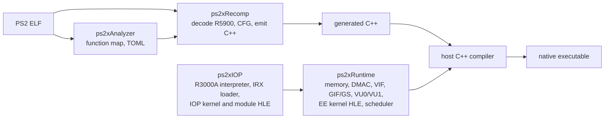

# Zmbor

**A PlayStation 2 static recompilation framework with an evidence-based hardware runtime**

Zmbor translates PS2 ELF binaries into C++ and runs the result natively against a runtime that models the Emotion
Engine, VU0/VU1, VIF, GIF/GS, DMAC and IOP. Its accuracy work is measured against output captured on a real PS2,
and every claim about a component cites the test, proof or hardware program behind it.

> [!IMPORTANT]
> Compatibility with commercial PS2 games has **not** been verified: no commercial game has been run end to end.
> The measurements below come from hardware test programs, unit tests, proofs and synthetic end-to-end programs.
> Zmbor ships no game data and no BIOS; you must supply your own legally obtained software.

## Overview

Zmbor is built on [ran-j/PS2Recomp](https://github.com/ran-j/PS2Recomp), forked at `eb8688b` with upstream #384
merged. It keeps PS2Recomp's Git history, module layout, target names and GPL-3.0 license, and adds a long
engineering effort on accuracy, verification and integration (the "PS2Recomp Ultimate" phases in
[CHANGELOG.md](CHANGELOG.md)). The upstream documentation is preserved at the end of this file and still applies.

Static recompilation means the guest's EE code is translated ahead of time; it is not an interpreter or JIT for the
EE. The vector units and the IOP are executed by interpreters inside the runtime, and many system libraries (audio,
pads, memory cards, CD/DVD, MPEG) are replaced at call level by high-level emulation (HLE). The dashboard below shows
which is which.

## Architecture



| module | role |
|---|---|
| `ps2xAnalyzer` | scans an ELF, classifies SDK functions, writes the TOML configuration (stubs, skips, patches) |
| `ps2xRecomp` | parses the ELF, decodes R5900 instructions, builds control flow and emits C++ |
| `ps2xRuntime` | guest memory, DMAC, VIF0/VIF1, GIF and the GS (CPU rasteriser), VU0/VU1 interpreters, EE kernel and library HLE |
| `ps2xIOP` | R3000A interpreter for physical IRX modules, IOP kernel and generic HLE services, SIF transport |
| `ps2xStudio` | desktop GUI for inspecting recompilation (experimental) |
| `ps2xTest` | unit tests, end-to-end ELF-to-native tests, hardware result tests, GS cache tests |
| `tools/` | hardware result pipeline, acceptance gate, compatibility matrix, probe lab, fuzzers, Z3 proofs, status dashboard |

## Status

<!-- status-dashboard:begin (generated by tools/status/generate_dashboard.py; do not edit) -->

<p align="center"></p>

<p align="center"></p>

| status | PS2 Hardware & Runtime | Recompiler, Tools & Compatibility |
|---|---|---|
| verified complete | 18 | 4 |
| verified partial | 47 | 29 |
| implemented, unverified | 58 | 11 |
| HLE / stub | 23 | 0 |
| missing | 24 | 1 |
| not applicable | 3 | 0 |
| unknown | 1 | 8 |
| **total** | **174** | **53** |

Every component, its evidence and the method are listed in [docs/status](docs/status/README.md). Colours are statuses written by hand and checked against cited evidence; they are not code coverage.

### Verified hardware results

The [ps2autotests](https://github.com/unknownbrackets/ps2autotests) programs (ISC) print results that were captured on a real PS2. Zmbor recompiles each program to native code and compares its output line by line with the unmodified `.expected` file (evidence commit `c7e5960`):

| area | programs exact | output lines matching |
|---|---|---|
| `cpu/ee` | 6 / 6 | 1798 / 1798 (100.0%) |
| `cpu/ee_cop0` | 1 / 1 | 13 / 13 (100.0%) |
| `cpu/ee_fpu` | 8 / 9 | 1061 / 1068 (99.3%) |
| `cpu/ee_simd` | 6 / 6 | 2768 / 2768 (100.0%) |
| `cpu/vu0_macro` | 2 / 2 | 154 / 154 (100.0%) |
| `dma/dmac` | 2 / 2 | 18 / 18 (100.0%) |
| `dma/spr` | 3 / 3 | 690 / 690 (100.0%) |
| `dma/vif` | 6 / 6 | 735 / 735 (100.0%) |
| `gs` | 2 / 2 | 8 / 8 (100.0%) |
| `kernel/ee` | 10 / 10 | 151 / 151 (100.0%) |
| `memory/ee` | 1 / 1 | 13 / 13 (100.0%) |
| `vu/games` | 1 / 1 | 5 / 5 (100.0%) |
| `vu/lower` | 4 / 5 | 756 / 797 (94.8%) |
| `vu/upper` | 1 / 1 | 32 / 32 (100.0%) |
| **all** | **53 / 55** | **8202 / 8250** (**99.4%**) |

Crashes: 0. Timeouts: 0. Hardware-confirmed instructions per decoded class: EE core (R5900 base ISA) 89/115, EE MMI (128-bit SIMD) 103/105, EE COP1 (FPU) 32/58, VU0 macro mode (COP2) 11/132.

Programs that do not match yet:

- `cpu_ee_fpu_sqrt`: 59 / 66 lines. RSQRT.S rounding: Needs new hardware rows: probe P3 run on a physical PS2
- `vu_lower_efu`: 182 / 223 lines. EFU (EATAN, ESIN, EEXP, ...) and P pipeline: Exact term rounding unknown; needs an EFU probe run on hardware

<!-- status-dashboard:end -->

## Current limitations

* No commercial or homebrew game has been run; every game-level stage (main loop, rendering, input, sound, saves,
  extended play, completion) is **unknown**, not failed.
* Only GS SIGNAL/LABEL behaviour has hardware results. The rest of the GS (rasterisation, texturing, blending,
  CLUT) is tested against the GS manual, not against hardware output.
* There is no SPU2 model: audio libraries are replaced at call level and VAG clips are played on the host.
* The IPU, MFIFO, DMAC stall control, dithering, antialiasing, TLB translation and the EE caches are not emulated.
* Peripherals (pads, memory cards, CD/DVD) are library-level HLE; USB, DEV9, HDD and network are not emulated.
* The IOP CPU has no hardware results yet (ps2autotests `cpu/iop/*` exists and is not run).
* Performance has no gate; the VU1 interpreter was made 2x faster on a synthetic workload in Phase 6; no whole-game timing exists.

## Development history

Phases are engineering milestones of this fork, not levels of PS2 completeness. Numbers are the gate results each
phase recorded in [CHANGELOG.md](CHANGELOG.md).

| phase | focus | hardware programs exact (lines) | unit tests |
|---|---|---|---|
| 0 | recompiler and runtime correctness, community integration, VU1/VIF fixes | not yet measured | 445 → 480 |
| 1 | first ELF-to-native tests, MMI HI/LO family; a third-party God of War port analysed (not run here) | not yet measured | 486 |
| 2 | hardware result pipeline over the 55 ps2autotests programs | 6/54 (5346/8240) → 32/55 (6627/8250) | 507 |
| 3 | VU microcode, VIF, scratchpad and DMAC | 47/55 (8172/8250) | 519 |
| 4 | hardware accuracy: delay-slot branches, heap, COP0 counters, MUL.S, VU0 vi24 | 53/55 (8202/8250) | 526 |
| 5 | shared VU FMAC contract, SSE2 lowering, floating-point build guard, probe lab | 53/55 (8202/8250) | 541 |
| 6 | VU1 interpreter 2x, acceptance gate with identity manifest, compatibility matrix | 53/55 (8202/8250) | 545 |
| 7 | sanitizers, six fuzzers, Z3 integer proofs; three defects fixed (signed-overflow UB, looping DMA chains, ELF null dereference) | 53/55 (8202/8250) | 551 (550 on Linux: one Windows-only test) |

## Roadmap (Phase 8)

[docs/architecture/phase8-roadmap.md](docs/architecture/phase8-roadmap.md) lists the next work with its evidence,
blockers and acceptance criteria:

1. RSQRT.S and EFU hardware probe specifications (results need a physical PS2).
2. GS / parallel-gs feasibility spike with trace capture; the CPU rasteriser stays the reference.
3. A minimal SPU2 architecture (registers, sound RAM, ADPCM voices, ADSR, mixer).
4. SIF/IOP scheduling and synchronisation tests.
5. Homebrew compatibility stages 5–9 with recorded evidence.
6. Performance and stability gates.

The longer-term direction is in [ROADMAP.md](ROADMAP.md).

## Build

Requirements: CMake 3.21+, a C++20 compiler (MSVC 2022, GCC or Clang), Ninja recommended, SSE4.1 on x86-64.

```bash
git clone https://github.com/m7kor/Zmbor.git
cd Zmbor
cmake -S . -B build -G Ninja -DCMAKE_BUILD_TYPE=Release -DPS2X_BUILD_STUDIO=OFF -DPS2X_ENABLE_FFMPEG=OFF -DPS2X_IOP_BUILD_TESTS=ON
cmake --build build
```

CI builds Windows (MSVC), Linux GCC and Linux Clang on every push. Local release gates use Windows 11 with MSVC 14.44.

## Usage

```bash
./build/ps2xAnalyzer/ps2_analyzer your_game.elf config.toml   # optional: generate a starting configuration
./build/ps2xRecomp/ps2_recomp config.toml                      # recompile to C++
```

Then build the generated sources with `ps2xRuntime`. The configuration fields, stub binding by address, the Ghidra
workflow and game override hooks are described in the upstream documentation below.

## Testing and validation

| level | command | evidence it gives |
|---|---|---|
| unit tests | `build/ps2xTest/ps2x_tests` (from the repository root) | behaviour against documented or hardware-derived expectations |
| ctest | `ctest --test-dir build/ps2xTest -LE hwtest` | research DB, GS cache, probe lab, compat matrix, Z3 proofs, e2e |
| IOP | `ctest --test-dir build/ps2xIOP` | IOP emulator and module tests |
| hardware results | `tools/hwtest/hwtest.py` with a local ps2autotests clone ([TESTING.md](TESTING.md), level 5) | output compared with real-PS2 `.expected` files |
| acceptance gate | `tools/acceptance/gate.ps1` ([acceptance-gate.md](docs/architecture/acceptance-gate.md)) | all of the above on one commit, with a binary identity manifest |
| sanitizers, fuzzing | `-DPS2X_SANITIZE=address[,undefined]`, `-DPS2X_BUILD_FUZZERS=ON` ([fuzzing.md](docs/architecture/fuzzing.md)) | memory errors, undefined behaviour, robustness of input parsers |
| status dashboard | `python tools/status/validate_dashboard.py` | inventory evidence links, measurements and generated files are consistent |

A passing unit or end-to-end test says nothing about commercial game compatibility; that needs the game to be run.

## Dependencies and credits

| dependency | use | license |
|---|---|---|
| [ELFIO](https://github.com/serge1/ELFIO) | ELF parsing | MIT |
| [fmt](https://github.com/fmtlib/fmt) | formatting | MIT |
| [toml11](https://github.com/ToruNiina/toml11) | configuration | MIT |
| [rabbitizer](https://github.com/Decompollaborate/rabbitizer) | MIPS disassembly | MIT |
| [libdwarf](https://github.com/davea42/libdwarf-code) | DWARF symbols | LGPL-2.1 (library) |
| [nlohmann/json](https://github.com/nlohmann/json) | JSON | MIT |
| [raylib](https://github.com/raysan5/raylib) | window, input, audio | zlib |
| [Dear ImGui](https://github.com/ocornut/imgui), [rlImGui](https://github.com/raylib-extras/rlImGui) | debug UI | MIT, zlib |
| FFmpeg (optional, `PS2X_ENABLE_FFMPEG`) | MPEG video decoding | LGPL/GPL depending on the build |
| [ps2autotests](https://github.com/unknownbrackets/ps2autotests) (not vendored) | real-PS2 reference output | ISC |
| [Z3](https://github.com/Z3Prover/z3) (test tool) | integer proofs | MIT |

Zmbor builds on PS2Recomp by ran-j and its contributors (see the upstream acknowledgments below). Hardware reference
results come from ps2autotests by unknownbrackets and contributors. PCSX2 was consulted as a behaviour reference only;
no PCSX2 code was copied. Evaluated tools and their licenses: [phase7-tool-evaluation.md](docs/architecture/phase7-tool-evaluation.md).

## Contributing

* Every behaviour fix comes with a test that fails when the fix is reverted. Name the source of the expected value
  in the test: real-PS2 output first, then the hardware manual or PCSX2 source.
* Never edit ps2autotests `.expected` files and never commit game data, BIOS images or SDK binaries.
* A component's status changes only by editing `docs/status/components.json` with the evidence that justifies it,
  then running `python tools/status/generate_dashboard.py`. CI fails if the inventory, its evidence links or the
  generated files disagree. Passing tests never upgrade a status by themselves.
* Run the acceptance gate before proposing a release; report regressions rather than updating baselines.

## Documentation

* [docs/status](docs/status/README.md): component inventory, methodology, measurements
* [TESTING.md](TESTING.md), [BENCHMARKS.md](BENCHMARKS.md), [CHANGELOG.md](CHANGELOG.md), [HANDOFF.md](HANDOFF.md), [ROADMAP.md](ROADMAP.md)
* [docs/architecture](docs/architecture): acceptance gate, evidence register, hardware probes, VU/EE arithmetic
  semantics, fuzzing, gap matrix, Phase 8 roadmap
* [docs/hwtest](docs/hwtest/README.md): hardware result dashboard
* [docs/INTEGRATION_MATRIX.md](docs/INTEGRATION_MATRIX.md): upstream and community changes considered

## License

GPL-3.0, as upstream PS2Recomp. See [LICENSE](LICENSE).

---

## PS2Recomp: PlayStation 2 Static Recompiler (Experimental) — upstream documentation

[](https://discord.gg/JQ8mawxUEf)

Also check the upstream [WIKI](https://github.com/ran-j/PS2Recomp/wiki)


This project statically recompiles PS2 ELF binaries into C++ and provides a runtime to execute the generated code.

### Modules

* `ps2xAnalyzer`: scans ELF/functions and writes TOML config (`stubs`, `skip`, instruction patches).
* `ps2xRecomp`: reads TOML + ELF, decodes R5900 instructions, and generates C++ output.
* `ps2xRuntime`: hosts memory, function registration, syscall dispatch, and hardware stubs.
* `ps2xIOP`: R3000A IRX execution, a virtual IOP kernel, and generic HLE fallbacks.

### Features

* Translates MIPS R5900 instructions to C++ code
* PS2-specific MMI and VU0 macro support.
* Single-file or multi-file output.
* Configurable stubs, skips, and instruction patches.
* Instruction-driven syscall handling.

### How It Works
PS2Recomp works by:

* Parsing a PS2 ELF file to extract functions, symbols, and relocations
* Decoding the MIPS R5900 instructions in each function
* Translating those instructions to equivalent C++ code
* Generating a runtime that can execute the recompiled code

The translated code is very literal, with each MIPS instruction mapping to a C++ operation. For example, `addiu $r4, $r4, 0x20` becomes `ctx->r4 = ADD32(ctx->r4, 0X20);`.

### Current Behavior

* `stubs` entries generate wrappers that call known runtime syscall/stub handlers by name.
* `stubs` also supports address bindings with `handler@0xADDRESS` for stripped games (for example `sceCdRead@0x00123456`).
* Address bindings also support generic return handlers for triage: `ret0`, `ret1`, `reta0`.
* Recompiler now tries relocation-symbol auto-binding at callsites (`J/JAL`) before raw address dispatch; when relocation symbol is known (for example `sceCdRead`), it can call runtime handlers without manual address mapping.
* Recompiler discovers additional internal static entry targets and emits `entry_...` wrappers for those addresses.
* For unresolved static `J/JAL` sites, generated code falls back to `runtime->lookupFunction(0x...)`.
* `skip` entries are not recompiled and generate explicit `ps2_stubs::TODO_NAMED(...)` wrappers.
* Recompiled `SYSCALL` now calls `runtime->handleSyscall(...)` with the encoded syscall immediate.
* Runtime syscall dispatch tries encoded syscall ID first, then falls back to `$v1`.

### Requirements

* CMake 3.20+
* C++20 compiler (currently tested mainly with MSVC)
* SSE4/AVX host support for some vector paths

### Build

```bash
git clone --recurse-submodules https://github.com/ran-j/PS2Recomp.git
cd PS2Recomp

cmake -S . -B out/build
cmake --build out/build --config Debug
```

### Usage

Preferred workflow for retail or stripped games:

1. Open the ELF in Ghidra.
2. Run `ps2xRecomp/tools/ghidra/ExportPS2Functions.java`.
3. Use the exported TOML and CSV map.
4. Recompile with the exported TOML:

```bash
./ps2_recomp config.toml
```

Fallback workflow for quick local experiments or ELFs with debug symbol :

```bash
./ps2_analyzer your_game.elf config.toml
```

See the [Ghidra Workflow](ps2xAnalyzer/Readme.md#3-ghidra-integration-for-retail-and-stripped-games-preferred) for ghdira instructions.

Then build generated output and link with `ps2xRuntime`.

### Configuration

Main fields in `config.toml`:

* `general.input`: source ELF path.
* `general.ghidra_output`: recommended function map CSV exported from Ghidra.
* `general.output`: generated C++ output folder.
* `general.single_file_output`: one combined cpp or one file per function.
* `general.low_memory_mode`: reduce peak output-generation memory by avoiding retained disassembly strings and forcing serial output generation. Generated instruction comments are still emitted; disassembly text is produced while writing each output file instead of being kept in memory.
* `general.output_worker_threads`: number of output-generation workers (clamped to nproc * 2). A positive value uses exactly that many workers. `0` uses `nproc - 1` when at least two hardware threads are available, otherwise serial output generation. `1` forces serial output generation.
* `general.patch_syscalls`: apply configured patches to `SYSCALL` instructions (`false` recommended).
* `general.patch_cop0`: apply configured patches to COP0 instructions.
* `general.patch_cache`: apply configured patches to CACHE instructions.
* `general.stubs`: names to force as stubs. Also accepts `handler@0xADDRESS` to bind a stripped function address directly to a runtime syscall/stub handler. Includes generic handlers `ret0`, `ret1`, `reta0`.
* `general.skip`: names to force as skipped wrappers.
* `patches.instructions`: raw instruction replacements by address.

Address binding for stripped ELFs:

* Use `handler@0xADDRESS` inside `general.stubs` to map a stripped function start directly to a runtime handler.
* Example: `sceCdRead@0x00123456` binds function start `0x00123456` to `ps2_stubs::sceCdRead(...)`.
* Generic temporary handlers are available: `ret0@0xADDR`, `ret1@0xADDR`, `reta0@0xADDR`.
* Before manual binding, prefer recompilation from a Ghidra-exported TOML/CSV first. The extra boundaries and synthetic entry points are usually more important than manual early triage.
* The address must be the function start in that exact ELF build.
* Addresses are not portable across different games/regions/builds.
* The handler name must exist in runtime call lists (`PS2_SYSCALL_LIST` or `PS2_STUB_LIST`).

Example:

```toml
# stripped function binding by address:
stubs = ["sceCdRead@0x00123456", "SifLoadModule@0x00127890"]
# temporary return handlers:
stubs = ["ret0@0x001D9410", "ret1@0x001D5BC8", "reta0@0x0024B7C0"]
# mixed example:
stubs = ["printf", "sceCdRead@0x00123456", "SifLoadModule@0x00127890"] 
```

### Runtime

To execute the recompiled code.

`ps2xRuntime` currently provides:

* Guest memory model and function dispatch table.
* Some syscall dispatcher with common kernel IDs.
* Basic GS/VU/file/system stubs.
* Foundation to expand and port your game.
* `ps2xIOP` execution of original IRX modules with generic HLE fallbacks.

See [IOP emulation](ps2xIOP/README.md) for module execution and the service boundary.

### Game Override Hooks

Game overrides are runtime-side, build-scoped patch modules.

A game override is C++ code that runs during `loadELF` and can replace EE function bindings by address for one specific game build. IOP RPC/DMA behavior is handled by the `ps2xIOP` emulator and its runtime transport. This is separate from recompilation output and separate from global runtime stubs/syscalls.

API:

* Header: `ps2xRuntime/include/game_overrides.h`
* Register macro: `PS2_REGISTER_GAME_OVERRIDE(name, elfName, entry, crc32, applyFn)`
* Direct bind helper: `ps2_game_overrides::bindAddressHandler(runtime, addr, "handler")`

Use Game Override modules when:

* You need per-game/per-build routing or patches without polluting global behavior.
* You need to bind many addresses, or install custom replacement logic for a specific title.

#### Recommended Iteration Loop

1. Run with minimal config and no aggressive skipping.
2. Fix hard blockers first (`function not found`, syscall TODO, critical IO stubs).
3. Use temporary return stubs only to classify call importance.
4. Promote temporary fixes to real implementations.
5. Move per-game hacks into game overrides keyed by ELF metadata.
6. Re-test from cold boot after each batch.

### Describing Your Game Project

A game project built with PS2Recomp can describe itself in a `.recomp.json` file at the root of its repository. Lists of recomp and decomp projects, such as [recomp.board](https://recomp.fyi), read that file instead of guessing the game, system and status from the README.

> [!NOTE]
> This file is optional: PS2Recomp does not read it and works the same without it. `.recomp.json` and recomp.board are third-party projects; the PS2Recomp developers have no ties to them.

Starter file:

```json
{
  "$schema": "https://recomp.fyi/schema/v1.json",
  "game": "<title as it shipped>",
  "system": "PS2",
  "type": "recomp",
  "toolchain": "PS2Recomp",
  "status": "in-progress",
  "original": { "region": "USA", "serial": "SLUS-20312" }
}
```

* `original` is the release a user must own. On retail discs the ELF is named after the serial (`SLUS_203.12` is `SLUS-20312`), and the prefix gives the region: `SLUS`/`SCUS` USA, `SLES`/`SCES` Europe, `SLPS`/`SLPM`/`SCPS` Japan.
* `status` is one of `exploring`, `in-progress`, `playable`, `released`, `complete`, `paused`. Edit it when the project moves on: a stale status is worse than none.
* Never put a game file, or a link to one, in the file.

Other fields (Wikidata item, target platforms, maintainers, links, what help is wanted) and the JSON Schema are in the [specification](https://recomp.fyi/spec).

### Limitations
 
* Performance is very bad for VU and GS
* Hardware emulation is partial and many paths are stubbed.

###  Acknowledgments

* Inspired by N64Recomp
* Uses ELFIO for ELF parsing
* Uses toml11 for TOML parsing
* Uses fmt for string formatting
* Reference for runtime PCSX2