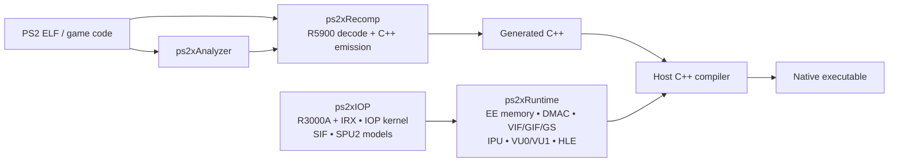

# Zmbor

**Prosanity integration (4 November 2026):** [PR #13](https://github.com/m7kor/Zmbor/pull/13)
incorporated Prosanity's runtime, recompiler, tests and compatibility engineering into Zmbor while
preserving the Zmbor identity, GPL-3.0 license, [PS2Recomp](https://github.com/ran-j/PS2Recomp)
attribution and compatible module names. See the [integration record](docs/engineering/PROSANITY_INTEGRATION.md)
and [independent post-merge review](docs/engineering/PROSANITY_POSTMERGE_REVIEW.md).

**Verified integration scope:** Zmbor's imported code passed six GitHub CI jobs on PR #13,
including MSVC, GCC, Clang, sanitizers, fuzz smoke and dashboard checks. The Prosanity source reports
697/697 local unit tests and 23/23 IOP hardware-output comparisons (1306/1306 lines).
Native Crash Twinsanity startup and two introductory videos were observed in the source development
sessions; **interactive gameplay is not verified**. These results must not be interpreted as
universal PS2 compatibility or fresh physical-hardware verification. See the
[Crash Twinsanity continuation report](docs/engineering/CRASH_TWINSANITY_CONTINUATION.md)
for configurations, limits and remaining validation work. No game files, BIOS, generated
commercial-game code, private diagnostic captures or screenshots are included.

<p align="center"><strong>PlayStation 2 static recompilation • hardware-aware native runtime • evidence-first engineering</strong></p>

<p align="center">
  <a href="https://github.com/m7kor/Zmbor/actions/workflows/build.yml"></a>
  <a href="LICENSE"></a>
  
  
  
</p>

Zmbor translates PlayStation 2 **Emotion Engine (R5900)** ELF code into native C++ and links it against a runtime modelling PS2 memory, vector processors, graphics, DMA, IOP services and sound hardware. It is an experimental **static recompiler and runtime framework**, not a turnkey PS2 emulator, BIOS replacement, game downloader or proven universal game porting solution.

**Previous milestone (3 November 2026, before the Prosanity merge):** Phase 10b and Phases 12–16 extend the [Phase 11 integration](https://github.com/m7kor/Zmbor/pull/9) with guest-driven SPU2 reverb registers, stripped-ELF and indirect-control-flow discovery, loud failures for unsupported syscalls, COP0 exception fixes, and the first CPU-only raw-GIF GS backend seam. The **GPU adapter and differential GS harness are not yet implemented**. This update does not include a hardware-confirmed ADMA guest-enable address or a native SPU2 output sink.

> [!IMPORTANT]
> **Experimental / work in progress.** Passing unit tests, synthetic ELF tests or historical hardware-output comparisons does not mean a commercial PS2 game is playable. No complete commercial-game run has been verified by Zmbor's published acceptance gate. You must provide your own legally obtained game software; the repository includes neither BIOS images nor copyrighted game data.

**Start here:** [latest integration](#november-2026-prosanity-integration-and-review) · [architecture](#architecture) · [visual hardware dashboard](#status) · [implementation snapshot](#implementation-snapshot--phase-11) · [build](#build) · [testing](#testing-and-validation) · [roadmap](#roadmap) · [contributing](#contributing)

## November 2026: Prosanity integration and review

Zmbor is the **canonical PS2 static-recompilation framework**. Experimental game pipelines should be
separate compatibility consumers; reusable improvements should return to Zmbor with regression tests.
The [Prosanity engineering continuation](https://github.com/m7kor/prosanity) was integrated in
[PR #13](https://github.com/m7kor/Zmbor/pull/13), merge commit
[`6c624951`](https://github.com/m7kor/Zmbor/commit/6c6249519badcb16d1da2e46cfcba0a790736fcd)
on **4 November 2026**. The imported change set covered **77 paths**, including portable code, test
infrastructure, and Crash Twinsanity development reports. The original Prosanity commit history remains
available in that repository; the Zmbor merge imported a source-tree snapshot, not the source's 21
original commit objects.

| Area | Integrated engineering | Boundary of evidence |
|:--|:--|:--|
| **IOP / SIF RPC / CDVD** | IOP client calls into EE RPC servers, bind/call completion, virtual disc diagnostics and additional IRX tests | Partial models and HLE, not a complete cycle-accurate SIF/CDVD implementation |
| **ELF and recompiler** | Additional conservative stripped-ELF and vtable leaf-method discovery, generated-code diagnostics and tested analysis helpers | Game-dependent unresolved functions, control flow and SDK bindings remain |
| **MPEG / IPU / FFmpeg** | MPEG demux/decoder callback sequencing, input span checks, DMA-fed IPU handling and FFmpeg parser input padding | Commercial-game movie end-of-stream and interactive transitions still need real-run verification |
| **Runtime and GS** | Guest termination reporting, opt-in HLE/syscall/I/O/GS tracing, frame-series captures and bounded harness runs | Diagnostic output is not proof of hardware fidelity or full graphical accuracy |
| **Input / profiling** | Scripted two-port PAD replay and opt-in Windows stack sampler | Replay requires guest pad polling; wall-time stack samples are not CPU-time attribution |
| **Build and tests** | Out-of-tree generated-game CMake target, pinned Windows FFmpeg archive hash, synthetic E2E and subsystem regressions | Compiling a generated executable does not prove that a retail title works |

### Verification ledger (4 November 2026)

| Checkpoint | Evidence | Interpretation |
|:--|:--|:--|
| **Merged `main` / PR #13** | [Six GitHub CI jobs passed](https://github.com/m7kor/Zmbor/actions/runs/41856422558): Windows MSVC, Linux GCC, Linux Clang, ASan/UBSan, fuzz smoke and dashboard | The exact merged import built and passed its hosted checks |
| **Prosanity source** | Source team reported **697/697** local unit tests and **23/23** IOP reference programs (**1,306/1,306** output lines) | Source-side historical results; not newly reproduced on a physical PS2 by this merge |
| **EE real-hardware reference corpus** | Last recorded **53/55** exact programs, **8,202/8,250** output lines | Historical baseline; never describe this as a percentage of all PS2 compatibility |
| **Post-merge audit / PR #16** | [RPC memory-boundary fix and regression](https://github.com/m7kor/Zmbor/pull/16); the first review version failed to compile because a test header was missing; [the header fix](https://github.com/m7kor/Zmbor/commit/597b54e07e98b742da8b42c51e915c2137dbb4bc) was pushed | **Review patch is not in `main`**; current-head CI must pass before merge |
| **Game acceptance** | Crash Twinsanity native startup and introductory movies reported; RE4 has earlier separate project-level evidence | **Neither complete gameplay nor a whole-game Zmbor acceptance pass is established** |

The review found that a new IOP→EE RPC path checked the first and last mapped bytes before
`memcpy` without proving the *whole destination span* was contiguous. [PR #16](https://github.com/m7kor/Zmbor/pull/16)
adds a complete EE-guest-range check, bounds reply reads, and tests RAM-boundary and KSEG1-alias
cases. It also cleans documentation inherited from machine-specific test pipelines. **Do not count
these review fixes as merged until #16 is actually merged.** See the
[post-merge audit](docs/engineering/PROSANITY_POSTMERGE_REVIEW.md) and
[full integration record](docs/engineering/PROSANITY_INTEGRATION.md).

**Still required for stronger compatibility claims:** pass CI on the final audit commit, rerun
EE and IOP hardware-reference corpora with unchanged `.expected` fixtures, check RE4 and Crash
input/scene transitions using legally obtained assets, and measure performance with comparable
logging and workload settings. The [227-component dashboard](#status) stays evidence-gated.

## Previous milestones — Phases 10b–20

These changes were integrated **before** the Prosanity continuation. Phase numbering records engineering batches, **not the percentage of PS2 hardware implemented**.

| Workstream | Improvements | Evidence boundary |
|:--|:--|:--|
| SPU2 / Phase 10b | Guest P/R-block control and reverb model tests | Native output and exact sound-RAM effects not established |
| ELF / Phases 12–14 | Conservative stripped ELF discovery, jump-table analysis, JR/JALR recovery and unsupported-syscall diagnostics | Dynamic targets and ambiguous function starts remain |
| COP0 / Phase 15 | TLB and alignment exception corrections, guarded CACHE handling | Full EE timing and translation fidelity still unverified |
| GS / Phase 16 | CPU backend seam and raw-GIF/VSync diagnostics | No proven GPU speedup |
| GS / Phase 18 | Experimental **paraLLEl-GS Vulkan adapter**, default OFF | Flat-triangle and bilinear correctness acceptance gate **failed** |
| Ghidra / Phase 19 | Headless functions-only exporter, address/overlap/decoding safeguards | Fixture-level tests, not universal retail ELF detection |
| Build / Phase 20 | Optional root-scoped **sccache** launcher | Compilation speed, not game FPS |
| Stabilization Gates A–G | SLTIU sign extension, TLB stores, CLUT ordered replay, scheduler and header safety, e2e and CI checks | Some CLUT source-snapshot and unbounded-input concerns remain |

Old worktree measurements were **647/647** unit tests at Phase 16 and **683/683** in the later stabilization stack. The Prosanity source subsequently reported **697/697**. These are separate snapshots, not cumulative coverage figures; rely on [Zmbor merged-main Actions](https://github.com/m7kor/Zmbor/actions/runs/41856422558) for the latest proven integrated CI.

References: [PR #11](https://github.com/m7kor/Zmbor/pull/11) · [PR #12](https://github.com/m7kor/Zmbor/pull/12) · [Ghidra guide](ps2xRecomp/tools/ghidra/README-GHIDRA-ORACLE.md) · [engineering architecture](docs/architecture/NEXT_GENERATION_RECOMPILER_DESIGN.md).

## Overview

Zmbor continues the open-source [ran-j/PS2Recomp](https://github.com/ran-j/PS2Recomp) codebase, retaining its module architecture, upstream history and **GPL-3.0** licensing. It extends that foundation with test-driven fixes for recompiled EE instructions, VU/VIF execution, memory and DMA, GS/IPU paths, SIF/IOP transport, and a progressively modelled SPU2 sound engine.

**What static recompilation means:** the main EE program is translated *ahead of time* from MIPS instructions to host C++; the generated project is then compiled with a host C++ compiler and linked to Zmbor's runtime. The **IOP R3000A** and **VU0/VU1 microprograms** are executed through interpreter paths. Host-side HLE still substitutes for many PS2 libraries and peripherals.

The main engineering rule is **evidence before a completeness claim**. Published components distinguish:
- **Hardware-backed results** — output captured from a real PS2 or an independently checked, explicitly bounded contract.
- **Model- or reference-tested behaviour** — exercised code whose precise hardware timing or semantics are not yet proven.
- **HLE/stubs and missing systems** — approximations, omitted paths or services still needing implementation.

The generated [227-component status inventory](docs/status/README.md) is the source of truth for formal status categories. Later model-level additions do not automatically change those categories. See [hardware verification requirements](docs/engineering/PS2_HARDWARE_REQUIREMENTS.json) and [implementation decisions](docs/engineering/PS2_IMPLEMENTATION_DECISIONS.md).

**Language:** this README is in English for cross-project contributors. The project's original upstream notes remain available in the [historical reference](#ps2recomp-playstation-2-static-recompiler-experimental--upstream-documentation) below.

## Architecture



| Component | Responsibility | Relevant maturity |
|:--|:--|:--|
| [ps2xAnalyzer](ps2xAnalyzer/) | ELF and symbol/function analysis; TOML configuration generation | Functional; stripped binaries remain difficult |
| [ps2xRecomp](ps2xRecomp/) | R5900/MMI/COP instruction translation, control-flow analysis, generated C++ | Tested, but full-game coverage not established |
| [ps2xRuntime](ps2xRuntime/) | EE memory, DMA, VIF0/VIF1, GIF/GS, IPU, VU interpreters, scheduling and EE HLE | Mixed hardware models and HLE; timing gaps remain |
| [ps2xIOP](ps2xIOP/) | IOP R3000A, IRX modules, services, SIF transfer and SPU2 registers/voice models | IOP test coverage; incomplete hardware integration |
| [ps2xStudio](ps2xStudio/) | Desktop debugging / recompilation inspection | Experimental; not required for CLI use |
| [ps2xTest](ps2xTest/) | Unit, hardware-vector, generated-code and synthetic end-to-end testing | Active verification suite |
| [tools](tools/) | Hardware comparisons, acceptance gates, fuzzing, Z3 models, coverage and status dashboard | Engineering and research tools |

### Paths from guest software to output

- **EE code:** ELF → analyzer/recompiler → generated C++ → runtime function dispatch and memory model.
- **Graphics:** EE/DMAC and VIF → GIF/GS software renderer → host presentation. The tested GS paths do not establish broad rendering compatibility.
- **IOP / SIF:** IRX and IOP kernel execution; SIFCMD/SIFRPC HLE by default; a separately enabled, bounded SIF0 DMA vertical slice exists but is not a complete production transport.
- **Audio:** IOP SPU2 register/sound-RAM model → ADPCM voices → ADSR, pitch and Gaussian interpolation → per-core stereo mixing and PMON → optional model-level reverb / ADMA input. **No native SPU2 audio-output sink is connected yet.**
- **Timing:** the IOP scheduler advances SPU2 guest time at 768 IOP cycles per 48 kHz output sample; synchronous VU execution and incomplete cross-processor wakeups remain architectural limitations.

## Status

The SVG dashboards below are generated from [the 227-component evidence inventory](docs/status/components.json). Their classifications do **not** automatically increase when new Prosanity code is integrated. Green means the documented verification contract passed—not that a whole subsystem or retail game works.

To change the graphs, update the source inventory **with evidence** and regenerate through `python tools/status/generate_dashboard.py`. **Do not edit the generated block below by hand**, or the CI consistency check will fail.

<!-- status-dashboard:begin (generated by tools/status/generate_dashboard.py; do not edit) -->

<p align="center"></p>

<p align="center"></p>

| status | PS2 Hardware & Runtime | Recompiler, Tools & Compatibility |
|---|---|---|
| verified complete | 18 | 4 |
| verified partial | 52 | 29 |
| implemented, unverified | 66 | 11 |
| HLE / stub | 20 | 0 |
| missing | 14 | 1 |
| not applicable | 3 | 0 |
| unknown | 1 | 8 |
| **total** | **174** | **53** |

Every component, its evidence and the method are listed in [docs/status](docs/status/README.md). Colours are statuses written by hand and checked against cited evidence; they are not code coverage.

### Verified hardware results

The [ps2autotests](https://github.com/unknownbrackets/ps2autotests) programs (ISC) print results that were captured on a real PS2. Zmbor recompiles each program to native code and compares its output line by line with the unmodified `.expected` file (evidence commit `c7e5960`):

| area | programs exact | output lines matching |
|---|---|---|
| `cpu/ee` | 6 / 6 | 1798 / 1798 (100.0%) |
| `cpu/ee_cop0` | 1 / 1 | 13 / 13 (100.0%) |
| `cpu/ee_fpu` | 8 / 9 | 1061 / 1068 (99.3%) |
| `cpu/ee_simd` | 6 / 6 | 2768 / 2768 (100.0%) |
| `cpu/vu0_macro` | 2 / 2 | 154 / 154 (100.0%) |
| `dma/dmac` | 2 / 2 | 18 / 18 (100.0%) |
| `dma/spr` | 3 / 3 | 690 / 690 (100.0%) |
| `dma/vif` | 6 / 6 | 735 / 735 (100.0%) |
| `gs` | 2 / 2 | 8 / 8 (100.0%) |
| `kernel/ee` | 10 / 10 | 151 / 151 (100.0%) |
| `memory/ee` | 1 / 1 | 13 / 13 (100.0%) |
| `vu/games` | 1 / 1 | 5 / 5 (100.0%) |
| `vu/lower` | 4 / 5 | 756 / 797 (94.8%) |
| `vu/upper` | 1 / 1 | 32 / 32 (100.0%) |
| **all** | **53 / 55** | **8202 / 8250** (**99.4%**) |

Crashes: 0. Timeouts: 0. Hardware-confirmed instructions per decoded class: EE core (R5900 base ISA) 89/115, EE MMI (128-bit SIMD) 103/105, EE COP1 (FPU) 32/58, VU0 macro mode (COP2) 11/132.

Programs that do not match yet:

- `cpu_ee_fpu_sqrt`: 59 / 66 lines. RSQRT.S rounding: Needs new hardware rows: probe P3 run on a physical PS2
- `vu_lower_efu`: 182 / 223 lines. EFU (EATAN, ESIN, EEXP, ...) and P pipeline: Exact term rounding unknown; needs an EFU probe run on hardware

<!-- status-dashboard:end -->


## Implementation snapshot — 4 November 2026

A module can contain working code yet remain **unverified or partial** against real hardware. The following is a source/feature inventory, not an all-games compatibility claim.

| Subsystem | Implemented / integrated | Main gaps |
|:--|:--|:--|
| **EE/R5900, MMI, COP1, COP0** | AOT C++ emission, fixed-width semantics, branches and exceptions, bounded CACHE support | RSQRT.S mismatch, exact TLB/timing and unsupported operations |
| **ELF and recompiler tools** | Symbol/stripped discovery, Ghidra functions-only export, leaf/vtable analysis and synthetic E2E | Unresolved indirect branches, version-specific stubs |
| **VU0/VU1 / VIF** | Macro and micro interpreter paths, VIF0/VIF1 transfers, selected vector pipeline fixes | Accurate asynchronous timing, XGKICK/GIF ordering, flags |
| **GS** | Software rasterizer, backend seam, experimental paraLLEl-GS Vulkan adapter | GPU adapter default OFF; known correctness gate failure |
| **DMAC / SIF** | Scratchpad/MFIFO, SIF0 vertical slice and EE↔IOP RPC bridge | Complete transport, cycle timing, notifications and concurrency |
| **IOP and IRX** | R3000A interpreter, modules, IOP kernel, imports/HLE, RPC tests | Broader IRX/peripheral support and hardware timing |
| **SPU2** | ADPCM, ADSR, pitch, Gaussian interpolation, mixing, PMON, reverb/ADMA models | Sound-RAM work area, true guest controls, native audio playback and hardware verification |
| **IPU/MPEG/FFmpeg** | BDEC/IDEC and MPEG callbacks, optional FFmpeg-assisted decode, DMA input | PS2-specific bit semantics, EOF/abort, long movie transitions |
| **CDVD / PAD** | Virtual-disc lookup, I/O diagnostics, scripted two-port PAD replay | Hardware-accurate disc/controller/card services |
| **Build and observability** | Out-of-tree game target, optional sccache, termination reasons, trace summaries, frame captures and Windows profiler | Complete game acceptance and verified whole-game performance |

### Current verification ledger

| Gate | Result / status | Scope |
|:--|:--|:--|
| [Merged Zmbor \`main\` CI at \`6c624951\`](https://github.com/m7kor/Zmbor/actions/runs/41856422558) | **6/6 successful** | MSVC, GCC, Clang, ASan/UBSan, fuzz smoke and status dashboard |
| Prosanity source regression | **697/697** reported locally | Source-side unit tests, not an independent retail-game run |
| EE reference output | **53/55 programs**, **8,202/8,250 lines** | Historical fixed comparisons to real-PS2 output |
| IOP reference output | **23/23 programs**, **1,306/1,306 lines** | Separate IOP corpus, not an addition to EE counts |
| [Post-merge safety PR #16](https://github.com/m7kor/Zmbor/pull/16) | **Pending / not in merged main** | Whole-range RPC send validation, safe bounded replies and guard-backed regression |

**Game-level evidence:** Prosanity reported Crash Twinsanity startup and introductory movies, but not a verified interactive level, saves, stable audio or complete game. [Project-4 / RE4](https://github.com/m7kor/Project-4) has separate historical checks; it must be retested against this exact Zmbor commit.

**Performance:** early boot VSync progress is not a gameplay FPS metric. Stack wall-time snapshots are not CPU hotspot rankings, and host runs with different trace logging are not directly comparable game-speed benchmarks.

## Hardware results beyond the EE

The 23 ps2autotests IOP programs (`cpu/iop`, `kernel/iop`; `.irx` with real-PS2 `.expected`) run on the ps2xIOP
interpreter through `tools/hwtest/iop_hwtest.py`. **23 / 23 programs and 1306 / 1306 lines match** (crashes 0,
timeouts 0): `cpu/iop` 7/7 (981 lines), `kernel/iop` 16/16 (325 lines). This is a separate measurement and is not
added to the EE counts above. See [docs/hwtest](docs/hwtest/README.md).

Hardware coverage over the 174 PS2 components ([hardware-coverage-report.md](docs/status/hardware-coverage-report.md)):
every component has a verification contract; 136 cite tests, 124 have those tests executed and passing, 64 are backed
by real-PS2 results, and **none has timing verified against hardware**.

## Current limitations

> [!WARNING]
> A component count, an instruction test pass rate and a source test count are **not** the percentage of PS2 games supported. The formal status dashboard above deliberately includes partial, unknown, HLE and missing components.

1. **Commercial games:** no verified end-to-end game-completion/compatibility matrix for controls, combat, scenes, audio, saves and shutdown.
2. **EE/ELF:** remaining RSQRT.S and EFU reference mismatches; dynamic control flow, COP0/TLB/CACHE and exact timing gaps.
3. **VU/VIF/GS:** incomplete asynchronous vector execution, pipeline effects and GIF/XGKICK ordering.
4. **Rendering:** software GS limitations and an experimental Vulkan path with failed triangle-edge/bilinear verification; GPU is default OFF.
5. **IOP/SIF:** partial IRX and service coverage, incomplete production transport/wakeup timing and the RPC host memory-span issue addressed by pending PR #16.
6. **MPEG/IPU:** FFmpeg-backed decode does not mean PS2 IPU and callback/EOF semantics are complete.
7. **SPU2:** sound models and sample mixing do not prove guest-visible, hardware-accurate native playback.
8. **Peripheral coverage:** SIO2, USB, DEV9, HDD/network, disc and save/controller hardware remain incomplete or HLE.
9. **Performance and portability:** no comparable whole-game benchmark for the merged commit; desktop/Android/Vita paths do not guarantee game-level parity.

Hardware fixture \`.expected\` files must stay unchanged; unexpected differences are regressions or unresolved evidence gaps, not data to smooth over.

## Development history

Zmbor retains the [PS2Recomp](https://github.com/ran-j/PS2Recomp) ancestry and two separately numbered engineering phase programs.

| Milestone | Key work |
|:--|:--|
| Original fork Phases 0–7 | EE/VU semantics, DMA, hardware comparison tools, sanitizers, fuzzing, Z3 and acceptance gates |
| [Full-system Phases 3–11 / PR #9](https://github.com/m7kor/Zmbor/pull/9) | VU/VIF, SIF0, SPU2 voices/ADMA/reverb and runtime progress |
| [Phases 12–16 / PR #11](https://github.com/m7kor/Zmbor/pull/11) | Function discovery, COP0 and syscall safeguards, GS software backend groundwork |
| [Phases 18–20 / PR #12](https://github.com/m7kor/Zmbor/pull/12) | Optional Vulkan GS, Ghidra headless, compiler caching, stabilization tests |
| [Prosanity continuation / PR #13](https://github.com/m7kor/Zmbor/pull/13) | **Merged** 4 November 2026; 77-path engine, tests, tools and historical compatibility data import |
| [Post-merge audit / PR #16](https://github.com/m7kor/Zmbor/pull/16) | **Open** RPC bounds review, new regression and stand-alone documentation |

The Prosanity import is a *source-tree snapshot*. The original 21 source commits remain in [Prosanity](https://github.com/m7kor/prosanity). See [PROSANITY_INTEGRATION.md](docs/engineering/PROSANITY_INTEGRATION.md) for precise provenance. Historic game scripts and workstation handoffs are reference material, not a generic framework setup method.

## Roadmap

Priorities follow **safety → reproducibility → correctness → performance**, not arbitrary percentage targets.

1. Verify and merge [PR #16](https://github.com/m7kor/Zmbor/pull/16) only after final-head CI passes and its EE↔IOP callback/memory contracts are reviewed.
2. Re-run the original **55 EE + 23 IOP** hardware-output programs with the exact unmodified \`.expected\` fixtures; record hashes and any regressions.
3. Use fixed, legally supplied Crash and RE4 game versions to test input→scene transitions, audio, room changes, saves and shutdown on this exact framework commit.
4. Close VU/VIF timing, SIF wakeup, MPEG EOF/abort, COP0 and GS reference rendering gaps.
5. Finish guest-visible SPU2/ADMA and native sound; qualify accelerated GS only after independent pixel-level correctness tests.
6. Improve conservative Ghidra discovery, deterministic generated-code builds, diagnostics, compatibility records and optional GUI.
7. Profile reproducible workloads without invasive tracing; optimize only measured bottlenecks.

Detailed work: [roadmap](ROADMAP.md), [hardware requirements](docs/engineering/PS2_HARDWARE_REQUIREMENTS.json), [acceptance gate](docs/architecture/acceptance-gate.md), [design direction](docs/architecture/NEXT_GENERATION_RECOMPILER_DESIGN.md).

## Build

**Requirements:** Git, CMake **3.21+**, a **C++20** compiler (GCC, Clang or Visual Studio 2022), and build dependencies fetched by CMake. Ninja is recommended. On x86-64, the runtime's SIMD path requires **SSE4.1**; ARM targets use `sse2neon`. The default full build may also need a working OpenGL/GLFW development environment even with the GUI disabled, depending on the selected components.

### Linux (CLI / no Studio)

```bash
git clone https://github.com/m7kor/Zmbor.git
cd Zmbor

cmake -S . -B build -G Ninja -DCMAKE_BUILD_TYPE=Release \
  -DPS2X_BUILD_STUDIO=OFF -DPS2X_ENABLE_FFMPEG=OFF
cmake --build build --parallel

# Run the core unit suite
./build/ps2xTest/ps2x_tests
# Run CTest; on headless Linux, use xvfb-run for GUI-dependent e2e tests
xvfb-run -a ctest --test-dir build --output-on-failure
```

For GUI or video support, configure the corresponding build options and install the required OpenGL / FFmpeg development libraries. See [CI's Linux build](.github/workflows/build.yml) for the exact package and compiler matrix.

### Windows / Visual Studio (PowerShell)

```powershell
git clone https://github.com/m7kor/Zmbor.git
cd Zmbor
cmake -S . -B build -DPS2X_BUILD_STUDIO=OFF -DPS2X_ENABLE_FFMPEG=OFF
cmake --build build --config Release
.\build\ps2xTest\Release\ps2x_tests.exe
ctest --test-dir build -C Release --output-on-failure
```

The output path depends on your generator (Visual Studio is multi-configuration; Ninja is usually single-configuration). A build may fetch third-party dependencies at configure time.

### Standalone IOP test build

The standalone IOP tests are **not enabled by default** in the main build. To build all four IOP test executables in isolation:

```bash
cmake -S ps2xIOP -B build-iop -DPS2X_IOP_BUILD_TESTS=ON
cmake --build build-iop --parallel
ctest --test-dir build-iop --output-on-failure
```

### Build options

| CMake option | Meaning |
|:--|:--|
| `PS2X_BUILD_RECOMP` / `PS2X_BUILD_ANALYZER` | Recompiler and ELF analyzer |
| `PS2X_BUILD_RUNTIME` | Runtime and IOP library |
| `PS2X_BUILD_TEST` | Main test suite |
| `PS2X_BUILD_STUDIO` | Optional experimental developer GUI |
| `PS2X_IOP_BUILD_TESTS` | Standalone IOP test executables |
| `PS2X_ENABLE_FFMPEG` | Optional FFmpeg-backed MPEG functionality; the Windows archive is integrity-pinned |
| `PS2X_FFMPEG_ARCHIVE` | Optional local copy of the pinned Windows FFmpeg archive, useful for offline builds |
| `PS2X_GAME_GENERATED_DIR` | Path to inspected, out-of-tree recompiled C++ output; enables the `ps2x_game` target |
| `PS2X_GAME_OPTIMIZE` | Enable generated-game source optimization (longer build time); default OFF |
| `PS2X_ENABLE_AGRESSIVE_LOGS` | Expensive entry/exit logs; OFF by default; enable only for targeted diagnostics |
| `PS2X_ENABLE_PARALLEL_GS` | Experimental Vulkan GS adapter; OFF by default; separately validate |
| `PS2X_ENABLE_SCCACHE` | Optional root-scoped compile cache; ON when tool installed |
| `PS2X_BUILD_E2E_TESTS` | Synthetic ELF-to-native tests; ON with core tests |
| `PS2X_SANITIZE=address,undefined` | ASan + UBSan on supported GCC/Clang builds |
| `PS2X_BUILD_FUZZERS=ON` | Fuzzer harnesses (requires supported sanitizer/compiler configuration) |

No BIOS, game or proprietary SDK is included in this repository.

## Usage

### Analyze and recompile a PS2 ELF

The CLI workflow has **two separate stages**:

```bash
# Optional: discover functions and generate an initial configuration
./build/ps2xAnalyzer/ps2_analyzer path/to/your_game.elf config.toml

# Static recompile, using an inspected TOML configuration
./build/ps2xRecomp/ps2_recomp config.toml
```

After generating the C++ sources, compile them with the Zmbor runtime and any required per-game implementation or stubs. A successful recompilation is **not** the same as a working native game port.

For stripped retail ELFs, the recommended workflow is Ghidra-assisted function discovery:

1. Inspect your legally obtained ELF in Ghidra.
2. Use [ExportPS2Functions.java](ps2xRecomp/tools/ghidra/ExportPS2Functions.java) to produce the function map and TOML inputs.
3. Review `general.input`, `general.output`, stub bindings, skipped functions, and instruction patches for **that exact game build**.
4. Run the recompiler; compile and link the generated project against `ps2xRuntime`.
5. Validate with deterministic guest tests, runtime diagnostics, and a reproducible compatibility report.

**Configuration notes:** `general.stubs` supports address-specific bindings such as `sceCdRead@0x00123456`; `ret0`, `ret1` and `reta0` are temporary diagnostic handlers, not substitutes for implemented services. Addresses vary by game, version and region. See [ps2xAnalyzer documentation](ps2xAnalyzer/Readme.md), [TESTING.md](TESTING.md), and the archived upstream configuration reference below.

### Build generated code out of tree

Pass an **existing** directory containing the recompiler-generated `*.cpp` files and
`ps2_recompiled_functions.h`. Keep proprietary game content and generated source trees outside
the framework repository. Example (paths are illustrative):

```bash
cmake -S . -B build-game -DPS2X_BUILD_STUDIO=OFF \
  -DPS2X_GAME_GENERATED_DIR=/absolute/path/to/generated-code
cmake --build build-game --target ps2x_game --parallel
```

This target is supported on desktop hosts; configuration can fail if generated headers or the
required runtime dependencies are missing. The native runtime still needs compatible per-game
configuration, function coverage and services. Passing compilation **does not** prove gameplay.

### Reusable diagnostics and input playback

| Feature | Opt-in setting / tool | Notes |
|:--|:--|:--|
| Scripted controller input | `ZMBOR_PAD_SCRIPT=path/to/script.txt` | [PAD script format](tools/game_pipeline/PAD_PLAYBACK.md); frame or millisecond timelines |
| HLE, syscall, file I/O and GS tracing | `ZMBOR_TRACE_HLE=1`, `ZMBOR_TRACE_SYSCALL=1`, `ZMBOR_TRACE_IO=1`, `ZMBOR_TRACE_GS=1` | `ZMBOR_TRACE_ALL=1` enables all; potentially expensive |
| Save summary | `ZMBOR_SUMMARY_FILE=path/to/summary.txt` | Trace counters and end-of-run diagnostics |
| Bounded harness run | `ZMBOR_RUN_SECONDS=N` | Stops after N **host** seconds; a timeout is not guest success |
| Frame captures over time | `ZMBOR_FRAME_SERIES=directory` | PPM samples; optionally set `ZMBOR_FRAME_SERIES_MS` (default 2000 ms) |
| External Windows profiler | [`tools/profiling/`](tools/profiling/README.md) | Wall-clock stack snapshots; benchmark without sampler for performance claims |

Keep verbose logging off for comparative performance work; record commit, build mode, workload,
frame/input script and capture conditions. Generic fixes belong in Zmbor, while RE4/Crash-specific
data and scripts remain separate compatibility projects.

### Using the runtime in an application

Zmbor is a **framework for developers**. The native runtime handles guest memory and machine-like components and still relies on HLE for several platform APIs. It is not yet a one-click executable that launches arbitrary PS2 discs or ISOs.

## Testing and validation

The project uses multiple **non-interchangeable evidence layers**. Report the exact executable, commit, platform, compiler and build mode for every result.

| Layer | Command / source | What it does **and does not** prove |
|:--|:--|:--|
| Unit and generated-code regressions | `./build/ps2xTest/ps2x_tests` | Model behaviour against reference values; no universal gameplay claim |
| Main CTest | `ctest --test-dir build --output-on-failure` | Registered research, integration, e2e and diagnostics checks; the IOP standalone suite is separate |
| IOP standalone | `ctest --test-dir build-iop --output-on-failure` | IOP CPU, modules, imports, ABI and SPU2/SIF focused cases |
| End-to-end synthetic ELF | `ctest --test-dir build/ps2xTest -L e2e` | ELF → C++ → native runtime for constructed small programs, **not** commercial titles |
| Historical EE hardware output | [ps2autotests runner](tools/hwtest/hwtest.py) / [TESTING.md](TESTING.md) | Compares program output with unmodified real-PS2 `.expected` files |
| Historical IOP hardware output | [IOP hardware runner](tools/hwtest/iop_hwtest.py) | Compares the 23 IOP reference programs separately from EE |
| Sanitizers | `-DPS2X_SANITIZE=address,undefined` | ASan/UBSan coverage of **exercised inputs** only |
| Fuzzers | `-DPS2X_BUILD_FUZZERS=ON` | Bounded robustness testing for parsers/transfers |
| Hardware inventory | `python tools/status/validate_dashboard.py` | Evidence links and generated inventories are consistent, not that all hardware works |
| Regenerated dashboard check | `python tools/status/generate_dashboard.py --check` | Prevents stale/manual edits to generated status artifacts |
| Full acceptance gate | [acceptance-gate.md](docs/architecture/acceptance-gate.md) / [TESTING.md](TESTING.md) | Recorded build identity, reference comparisons and regression history |

**Last recorded hardware-output baselines:** EE **53/55 programs, 8,202/8,250 lines**; IOP **23/23 programs, 1,306/1,306 lines**. Those measurements are from the archived hardware reference gate and must **not** be represented as newly re-measured on the Phase 11 merge without a new run. The outstanding EE mismatches are `cpu_ee_fpu_sqrt` and `vu_lower_efu`.

**Historical Phase 11 regression:** 620/620 main tests, 4/4 IOP executables, main CTest 54 passed / 1 skipped. These predate Prosanity. **Latest merged CI evidence:** six jobs passed for PR #13; the follow-up RPC review in PR #16 requires its own checks. [Browse GitHub Actions](https://github.com/m7kor/Zmbor/actions).

See [TESTING.md](TESTING.md) for hardware fixture preparation, reference-data policy, and Ghidra/e2e workflows. Never adjust expected outputs just to turn a regression green.

## Dependencies and credits

| dependency | use | license |
|---|---|---|
| [ELFIO](https://github.com/serge1/ELFIO) | ELF parsing | MIT |
| [fmt](https://github.com/fmtlib/fmt) | formatting | MIT |
| [toml11](https://github.com/ToruNiina/toml11) | configuration | MIT |
| [rabbitizer](https://github.com/Decompollaborate/rabbitizer) | MIPS disassembly | MIT |
| [libdwarf](https://github.com/davea42/libdwarf-code) | DWARF symbols | LGPL-2.1 (library) |
| [nlohmann/json](https://github.com/nlohmann/json) | JSON | MIT |
| [raylib](https://github.com/raysan5/raylib) | window, input, audio | zlib |
| [Dear ImGui](https://github.com/ocornut/imgui), [rlImGui](https://github.com/raylib-extras/rlImGui) | debug UI | MIT, zlib |
| FFmpeg (optional, `PS2X_ENABLE_FFMPEG`) | MPEG video decoding | LGPL/GPL depending on the build |
| FFmpeg (tool, not linked) | encodes and decodes the synthetic IPU test fixtures | LGPL/GPL |
| [ps2autotests](https://github.com/unknownbrackets/ps2autotests) (not vendored) | real-PS2 reference output | ISC |
| [Z3](https://github.com/Z3Prover/z3) (test tool) | integer proofs | MIT |

Zmbor builds on PS2Recomp by ran-j and its contributors (see the upstream acknowledgments below). Hardware reference
results come from ps2autotests by unknownbrackets and contributors.

Behaviour references were studied and their disagreements recorded; no code was copied from any of them:
- PCSX2 and DobieStation (GPL), and Play!;
- ps2sdk (AFL);
- the [ps2tek](https://psi-rockin.github.io/ps2tek/) documentation;
- ISO/IEC 13818-2 and 11172-2, for the MPEG table values.

Evaluated tools and their licenses: [phase7-tool-evaluation.md](docs/architecture/phase7-tool-evaluation.md).

## Contributing

Pull requests should contain a **reproducible failure, a narrowly scoped correction, and evidence that the test would fail if the correction were removed**. Before opening a PR:

1. Keep the implementation scoped to its subsystem; name any deliberately unimplemented hardware behaviour and avoid creating speculative register offsets or timing semantics.
2. Use the strongest available oracle: physical-PS2 output, then hardware manual / independently read implementation references, then explicitly labelled model choices. Do not mistake PCSX2 or PS1 behaviour for direct PS2 evidence.
3. Run the applicable Release, sanitizer, IOP, CTest and generated-code checks. Run a comparable before/after benchmark **only when claiming performance improvement**.
4. Never modify ps2autotests `.expected` files or commit proprietary BIOS, game data, SDK binaries or user keys.
5. Change a formal component's status **only** by updating `docs/status/components.json` together with its cited evidence, then regenerating through `tools/status/generate_dashboard.py` and running the validator.
6. For cross-workstream changes (VU/VIF, SIF, SPU2), test the integration and original call paths; record open hardware uncertainties and leave old baselines unchanged until independently re-measured.

Contributors should cite the target commit and describe exactly which tests passed, failed, or were skipped. If you are implementing a feature currently only available through a **model API**, distinguish that from **guest-visible MMIO** and from real hardware verification.

## Documentation

| Resource | Contents |
|:--|:--|
| [Status dashboard](docs/status/README.md) / [inventory](docs/status/components.json) | Generated 227-component map, verification rules, formal status |
| [Hardware testing](docs/hwtest/README.md) | EE and IOP hardware-result dashboards |
| [Testing guide](TESTING.md) | Local test and e2e commands, hardware reference workflows |
| [Architecture docs](docs/architecture/) | Acceptance gates, DMA/VU arithmetic, benchmarks, fuzzing and evidence |
| [Engineering docs](docs/engineering/) | Component requirements, implementation decisions, IPU semantics, gap matrix, physical-PS2 probe plan |
| [Changelog](CHANGELOG.md) | Original Zmbor / PS2Recomp Ultimate fork phases; historical entries |
| [Roadmap](ROADMAP.md) | Longer-term project direction |
| [Handoff](HANDOFF.md) / [resume state](docs/engineering/AUTONOMOUS_EXECUTION_STATE.md) | **Historical snapshots**; check dates and commit references |
| [Phase 11 integration](https://github.com/m7kor/Zmbor/pull/9) | Historical cumulative changes across 36 files |
| [Prosanity integration PR #13](https://github.com/m7kor/Zmbor/pull/13) / [source provenance](docs/engineering/PROSANITY_INTEGRATION.md) | Merged 4 November 2026; code, tooling, test and game-research material |
| [Post-merge RPC review PR #16](https://github.com/m7kor/Zmbor/pull/16) / [audit report](docs/engineering/PROSANITY_POSTMERGE_REVIEW.md) | Review fix, boundary regression and documented outstanding gates; not yet merged |
| [GitHub Actions](.github/workflows/build.yml) | CI build, sanitizers, dashboard consistency and fuzzing jobs |
| [Upstream PS2Recomp](https://github.com/ran-j/PS2Recomp) | Original project, upstream docs and contributions |

## License

GPL-3.0, as upstream PS2Recomp. See [LICENSE](LICENSE).

---

<details>
<summary><strong>Archival PS2Recomp upstream documentation (historical; may not describe latest Zmbor builds)</strong></summary>

### PS2Recomp upstream reference

[](https://discord.gg/JQ8mawxUEf)

Also check the upstream [WIKI](https://github.com/ran-j/PS2Recomp/wiki)


This project statically recompiles PS2 ELF binaries into C++ and provides a runtime to execute the generated code.

### Modules

* `ps2xAnalyzer`: scans ELF/functions and writes TOML config (`stubs`, `skip`, instruction patches).
* `ps2xRecomp`: reads TOML + ELF, decodes R5900 instructions, and generates C++ output.
* `ps2xRuntime`: hosts memory, function registration, syscall dispatch, and hardware stubs.
* `ps2xIOP`: R3000A IRX execution, a virtual IOP kernel, and generic HLE fallbacks.

### Features

* Translates MIPS R5900 instructions to C++ code
* PS2-specific MMI and VU0 macro support.
* Single-file or multi-file output.
* Configurable stubs, skips, and instruction patches.
* Instruction-driven syscall handling.

### How It Works
PS2Recomp works by:

* Parsing a PS2 ELF file to extract functions, symbols, and relocations
* Decoding the MIPS R5900 instructions in each function
* Translating those instructions to equivalent C++ code
* Generating a runtime that can execute the recompiled code

The translated code is very literal, with each MIPS instruction mapping to a C++ operation. For example, `addiu $r4, $r4, 0x20` becomes `ctx->r4 = ADD32(ctx->r4, 0X20);`.

### Current Behavior

* `stubs` entries generate wrappers that call known runtime syscall/stub handlers by name.
* `stubs` also supports address bindings with `handler@0xADDRESS` for stripped games (for example `sceCdRead@0x00123456`).
* Address bindings also support generic return handlers for triage: `ret0`, `ret1`, `reta0`.
* Recompiler now tries relocation-symbol auto-binding at callsites (`J/JAL`) before raw address dispatch; when relocation symbol is known (for example `sceCdRead`), it can call runtime handlers without manual address mapping.
* Recompiler discovers additional internal static entry targets and emits `entry_...` wrappers for those addresses.
* For unresolved static `J/JAL` sites, generated code falls back to `runtime->lookupFunction(0x...)`.
* `skip` entries are not recompiled and generate explicit `ps2_stubs::TODO_NAMED(...)` wrappers.
* Recompiled `SYSCALL` now calls `runtime->handleSyscall(...)` with the encoded syscall immediate.
* Runtime syscall dispatch tries encoded syscall ID first, then falls back to `$v1`.

### Requirements

* CMake 3.20+
* C++20 compiler (currently tested mainly with MSVC)
* SSE4/AVX host support for some vector paths

### Build

```bash
git clone --recurse-submodules https://github.com/ran-j/PS2Recomp.git
cd PS2Recomp

cmake -S . -B out/build
cmake --build out/build --config Debug
```

### Usage

Preferred workflow for retail or stripped games:

1. Open the ELF in Ghidra.
2. Run `ps2xRecomp/tools/ghidra/ExportPS2Functions.java`.
3. Use the exported TOML and CSV map.
4. Recompile with the exported TOML:

```bash
./ps2_recomp config.toml
```

Fallback workflow for quick local experiments or ELFs with debug symbol :

```bash
./ps2_analyzer your_game.elf config.toml
```

See the [Ghidra Workflow](ps2xAnalyzer/Readme.md#3-ghidra-integration-for-retail-and-stripped-games-preferred) for ghdira instructions.

Then build generated output and link with `ps2xRuntime`.

### Configuration

Main fields in `config.toml`:

* `general.input`: source ELF path.
* `general.ghidra_output`: recommended function map CSV exported from Ghidra.
* `general.output`: generated C++ output folder.
* `general.single_file_output`: one combined cpp or one file per function.
* `general.low_memory_mode`: reduce peak output-generation memory by avoiding retained disassembly strings and forcing serial output generation. Generated instruction comments are still emitted; disassembly text is produced while writing each output file instead of being kept in memory.
* `general.output_worker_threads`: number of output-generation workers (clamped to nproc * 2). A positive value uses exactly that many workers. `0` uses `nproc - 1` when at least two hardware threads are available, otherwise serial output generation. `1` forces serial output generation.
* `general.patch_syscalls`: apply configured patches to `SYSCALL` instructions (`false` recommended).
* `general.patch_cop0`: apply configured patches to COP0 instructions.
* `general.patch_cache`: apply configured patches to CACHE instructions.
* `general.stubs`: names to force as stubs. Also accepts `handler@0xADDRESS` to bind a stripped function address directly to a runtime syscall/stub handler. Includes generic handlers `ret0`, `ret1`, `reta0`.
* `general.skip`: names to force as skipped wrappers.
* `patches.instructions`: raw instruction replacements by address.

Address binding for stripped ELFs:

* Use `handler@0xADDRESS` inside `general.stubs` to map a stripped function start directly to a runtime handler.
* Example: `sceCdRead@0x00123456` binds function start `0x00123456` to `ps2_stubs::sceCdRead(...)`.
* Generic temporary handlers are available: `ret0@0xADDR`, `ret1@0xADDR`, `reta0@0xADDR`.
* Before manual binding, prefer recompilation from a Ghidra-exported TOML/CSV first. The extra boundaries and synthetic entry points are usually more important than manual early triage.
* The address must be the function start in that exact ELF build.
* Addresses are not portable across different games/regions/builds.
* The handler name must exist in runtime call lists (`PS2_SYSCALL_LIST` or `PS2_STUB_LIST`).

Example:

```toml
# stripped function binding by address:
stubs = ["sceCdRead@0x00123456", "SifLoadModule@0x00127890"]
# temporary return handlers:
stubs = ["ret0@0x001D9410", "ret1@0x001D5BC8", "reta0@0x0024B7C0"]
# mixed example:
stubs = ["printf", "sceCdRead@0x00123456", "SifLoadModule@0x00127890"] 
```

### Runtime

To execute the recompiled code.

`ps2xRuntime` currently provides:

* Guest memory model and function dispatch table.
* Some syscall dispatcher with common kernel IDs.
* Basic GS/VU/file/system stubs.
* Foundation to expand and port your game.
* `ps2xIOP` execution of original IRX modules with generic HLE fallbacks.

See [IOP emulation](ps2xIOP/README.md) for module execution and the service boundary.

### Game Override Hooks

Game overrides are runtime-side, build-scoped patch modules.

A game override is C++ code that runs during `loadELF` and can replace EE function bindings by address for one specific game build. IOP RPC/DMA behavior is handled by the `ps2xIOP` emulator and its runtime transport. This is separate from recompilation output and separate from global runtime stubs/syscalls.

API:

* Header: `ps2xRuntime/include/game_overrides.h`
* Register macro: `PS2_REGISTER_GAME_OVERRIDE(name, elfName, entry, crc32, applyFn)`
* Direct bind helper: `ps2_game_overrides::bindAddressHandler(runtime, addr, "handler")`

Use Game Override modules when:

* You need per-game/per-build routing or patches without polluting global behavior.
* You need to bind many addresses, or install custom replacement logic for a specific title.

#### Recommended Iteration Loop

1. Run with minimal config and no aggressive skipping.
2. Fix hard blockers first (`function not found`, syscall TODO, critical IO stubs).
3. Use temporary return stubs only to classify call importance.
4. Promote temporary fixes to real implementations.
5. Move per-game hacks into game overrides keyed by ELF metadata.
6. Re-test from cold boot after each batch.

### Describing Your Game Project

A game project built with PS2Recomp can describe itself in a `.recomp.json` file at the root of its repository. Lists of recomp and decomp projects, such as [recomp.board](https://recomp.fyi), read that file instead of guessing the game, system and status from the README.

> [!NOTE]
> This file is optional: PS2Recomp does not read it and works the same without it. `.recomp.json` and recomp.board are third-party projects; the PS2Recomp developers have no ties to them.

Starter file:

```json
{
  "$schema": "https://recomp.fyi/schema/v1.json",
  "game": "<title as it shipped>",
  "system": "PS2",
  "type": "recomp",
  "toolchain": "PS2Recomp",
  "status": "in-progress",
  "original": { "region": "USA", "serial": "SLUS-20312" }
}
```

* `original` is the release a user must own. On retail discs the ELF is named after the serial (`SLUS_203.12` is `SLUS-20312`), and the prefix gives the region: `SLUS`/`SCUS` USA, `SLES`/`SCES` Europe, `SLPS`/`SLPM`/`SCPS` Japan.
* `status` is one of `exploring`, `in-progress`, `playable`, `released`, `complete`, `paused`. Edit it when the project moves on: a stale status is worse than none.
* Never put a game file, or a link to one, in the file.

Other fields (Wikidata item, target platforms, maintainers, links, what help is wanted) and the JSON Schema are in the [specification](https://recomp.fyi/spec).

### Limitations
 
* Performance is very bad for VU and GS
* Hardware emulation is partial and many paths are stubbed.

###  Acknowledgments

* Inspired by N64Recomp
* Uses ELFIO for ELF parsing
* Uses toml11 for TOML parsing
* Uses fmt for string formatting
* Reference for runtime PCSX2

</details>
