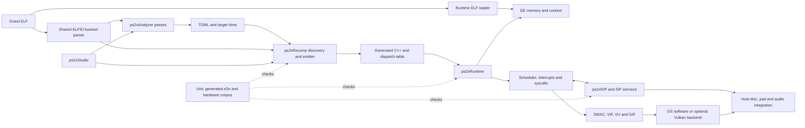

# Architecture and validation baseline

Measured 2026-11-07 from `23cda7fa31d9384afb1157eb9a86f0d9ced846ea` on Windows 11 x64 build 26100, Core i5-10400F (12 logical processors), Visual Studio 2022 MSVC 19.44.35228.0, CMake 4.4.3 and Python 3.10.11. Results for the ELF fix are labeled separately.



Generated code and the runtime share the CPU context, memory and guest dispatch interfaces. Treat changes there as an ABI boundary. The native runtime independently loads guest bytes into RAM and already checks the 32-bit little-endian format. Analysis and recompilation share a different ingestion path. Aligning their admission rule prevents the pipeline from producing C++ for an ELF the runtime already rejects.

## Build and tests

```powershell
cmake -S . -B build -G "Visual Studio 17 2022" -A x64
cmake --build build --config Release --parallel 8
ctest --test-dir build -C Release --output-on-failure
& build/ps2xTest/Release/ps2x_tests.exe

cmake -S ps2xIOP -B build-iop -G "Visual Studio 17 2022" -A x64 -DPS2X_IOP_BUILD_TESTS=ON
cmake --build build-iop --config Release --parallel 4
ctest --test-dir build-iop -C Release --output-on-failure
```

The first default configuration stopped at the toml11 submodule update. The retry manually initialized the pinned checkout and set `-DFETCHCONTENT_SOURCE_DIR_TOML11=D:/Zmbor0/build/_deps/toml11-src`. It configured the desktop build with Studio and FFmpeg enabled in 496.4 s, including dependency fetching. The resulting desktop binaries include the ELF fix. For the independent unmodified CLI baseline, the same toml11 checkout and the downloaded ELFIO source were reused with the following options.

```powershell
cmake -S . -B build-elf -G "Visual Studio 17 2022" -A x64 -DPS2X_BUILD_RUNTIME=OFF -DPS2X_BUILD_TEST=OFF -DPS2X_BUILD_STUDIO=OFF -DFETCHCONTENT_SOURCE_DIR_ELFIO=D:/Zmbor0/build/_deps/elfio-src -DFETCHCONTENT_SOURCE_DIR_TOML11=D:/Zmbor0/build/_deps/toml11-src
cmake --build build-elf --config Release --parallel 8
```

| Scope | Observed result |
| --- | --- |
| Unmodified analyzer and recompiler | Release build passed. CMake reported 182.2 s to configure, including dependency fetching. Warnings included fmt C4834 and Rabbitizer C4005 (`CONST` and `PURE` colliding with Windows SDK headers). |
| Unmodified standalone IOP | Release build passed, CTest 4/4 in 0.58 s on the recorded rerun. |
| Research and semantics checks | 215 research records validated with zero errors. Hardware-probe lab and compatibility self-tests passed on synthetic inputs. Z3 proof suite reported 29/29. |
| Regression against original CLIs | Both CLIs exited 0 on the big-endian ELF32 fixture. Analyzer emitted TOML, and recompiler emitted C++ lacking the fixture's `JR $ra` translation. The new regression fails on the unmodified analyzer. |
| Regression against fixed CLIs | Release rebuild passed. The same test passed. Both tools accept the little-endian fixture and reject its big-endian counterpart without generating analysis or code. The recompiler reports the required format. |
| Independent reference loader | Built the unmodified ps2-web-recomp `recomp/elf.cpp` with MSVC in a separate harness. It returned the expected `JR $ra` word for the little-endian fixture and rejected the big-endian fixture. |
| Desktop Release build with the fix | Build completed with Studio and FFmpeg enabled. The unmodified build evidence is limited to the CLI and standalone IOP configurations above. |
| Desktop CTest with the fix | 56 passed, 1 skipped, 0 failures in 21.15 s, including all six generated ELF-to-native programs. CMake selected Python 3.12, which lacks Z3. The proof suite passed separately under Python 3.10. A restricted execution attempt denied temporary-file writes for two tests. Both passed when rerun with temporary-directory access. |
| Desktop MiniTest with the fix | 697/697 passed with the MSVC and Windows SDK include, library and executable paths configured. The first run from a regular shell had one harness compile failure because the child compiler could not find `<cstdio>`. |
| AddressSanitizer | The ELF regression passed on both instrumented Windows CLIs with `-DPS2X_SANITIZE=address`, `RelWithDebInfo` and the same dependency revisions. No ASan reports. |
| Hardware and platform scope | Full runtime sanitizers, Linux and ARM builds, new hardware captures and commercial titles remain unmeasured in this cycle. Historic evidence remains revision-scoped. |

CLI dependency revisions were ELFIO `8ae6cec5d60495822ecd57d736f66149da9b1830`, toml11 `be08ba2be2a964edcdb3d3e3ea8d100abc26f286`, fmt `407c905e45ad75fc29bf0f9bb7c5c2fd3475976f`, libdwarf `2e088b983562860f497b4fd789a3e61524eb857c`, Rabbitizer `d5804fa488474830a47fbf9f3693048ec1e45589` and nlohmann/json `9cca280a4d0ccf0c08f47a99aa71d1b0e52f8d03`.

The desktop build also resolved Raylib `c1ab645ca298a2801097931d1079b10ff7eb9df8`, rlImGui `118221c8a532501a3c2c236b62950877cbefc2b4`, SDL2 `5d249570393f7a37e037abf22cd6012a4cc56a71`, ImGui `b1bcb12a624af7509894c8e77dd47416997777fa`, ImGui Club `b083116866e05e0d4bccb2c7f28d94a76ee4965e`, ImGuiColorTextEdit `ca2f9f1462e3b60e56351bc466acda448c5ea50d` and ImGuiFileDialog `d0e97b2adc3d3452d72c750c7305dc0291acd052`. The FFmpeg archive passed the hash check configured by the repository. The desktop linker emitted the pre-existing Raylib/Win32 duplicate-symbol warnings (`LNK4006`, `LNK4088`).

## First correction

`ElfParser::parse()` now checks `EI_DATA` before collecting sections or running discovery. ELFIO converts ELF metadata according to the header. Instruction reads use the raw payload on the supported little-endian hosts, so admitting a big-endian payload silently changes instruction semantics. The guard protects both CLI consumers and uses the existing error reporter when attached. [Independent parser comparison](https://github.com/snuri00/ps2-web-recomp/blob/e026b971324068773eed88bf502437de9e581b6b/recomp/elf.cpp#L22-L28)

Run the fixture against either pair of CLI builds.

```powershell
python -I ps2xTest/e2e/elf_byte_order.py "$PWD/build-elf/ps2xAnalyzer/Release/ps2_analyzer.exe" "$PWD/build-elf/ps2xRecomp/Release/ps2_recomp.exe"
```

## CLI performance sample

Generate the in-tree `basic` fixture with `python -I ps2xTest/e2e/e2e_programs.py basic <absolute-work-dir>`. Run both Release `ps2_recomp` binaries against the same generated `basic.toml` in that directory. The recorded run used 22 pairs, alternating which executable ran first, discarded the first two pairs, redirected output, and measured process wall time with Python's `perf_counter`.

| Version | Samples | Median | Standard deviation | Range |
| --- | ---: | ---: | ---: | ---: |
| Original | 20 | 22.27 ms | 2.34 ms | 20.03–28.61 ms |
| Fixed | 20 | 22.10 ms | 1.52 ms | 20.31–25.93 ms |

SHA-256 matched across the four generated source/header files (33,409 bytes total). This sample includes host process startup, covers one ELF, and was collected while desktop configuration was active. The difference is within the observed variation. Guest frame time, CPU utilization, memory, graphics configuration and comparative PCSX2 performance were unmeasured.

## PT_LOAD size follow-up

The shared parser and runtime enforce `p_filesz <= p_memsz` for every loadable segment. The runtime keeps the checked program headers for the copy phase. The two-segment regression reproduced a partial guest write for `p_memsz=4` and acceptance for `p_memsz=0` before the fix. Both cases now fail before any guest write. The analyzer, recompiler and desktop runner also rejected the same single-segment fixture at both sizes.

Windows Release rebuilt successfully. MiniTest passed 698/698 and CTest passed 56 with one Z3 skip, including six end-to-end programs. The expanded CLI test passed under AddressSanitizer on retry with Windows error dialogs disabled. The first run timed out on the valid analyzer fixture. Runtime sanitizers were outside this follow-up.

## Truncated PT_LOAD follow-up

Removing the final byte of the second of two loadable segments caused the desktop loader to reject the ELF after copying the first segment and setting the guest entry PC. The loader now checks every nonempty loadable segment's file extent in the header pass, before either mutation. The regression preserves the prior PC and verifies both guest RAM locations.

ELFIO's eager loading already rejected a one-byte short read, but returned a segment header with a null payload when the declared size exceeded the entire stream. With a 264-byte ELF and a declared 512-byte segment, the analyzer emitted TOML and the recompiler skipped the undecodable function and reported success. The shared parser now rejects a nonzero `PT_LOAD` file size with no payload. Both truncation shapes are covered by the CLI test. [Pinned ELFIO implementation](https://github.com/serge1/ELFIO/blob/8ae6cec5d60495822ecd57d736f66149da9b1830/elfio/elfio_segment.hpp#L193-L218)

Windows Release rebuilt successfully. MiniTest passed 699/699. CTest passed 56, including six end-to-end programs, with Z3 skipped by the configured Python and passing 29/29 separately. The expanded CLI suite passed under AddressSanitizer on retry after a timeout on the valid analyzer fixture. The desktop runner rejected both truncated inputs with the file-bounds diagnostic.

## Sectionless PT_LOAD overlap follow-up

The regression reads the same word through `ElfParser::readWord` and from guest RAM after `PS2Runtime::loadELF`. The original parser selected the first synthesized section and returned zero. The runtime copied in header order and returned `0x24020007` from guest RAM. Agreeing overlaps still pass and return the same word from both paths.

The overlap check sorts file-backed intervals and compares each covered range against disjoint pieces of bytes already validated. The first implementation also checked inputs analyzed from section headers and caused 22 existing test failures. The final check applies where program headers supply the parser's bytes. It rejects disagreement before discovery and retains the runtime loader's existing ordering. Section-backed sources, zero-fill, permissions and EE aliases remain separate cases.

Windows Release built successfully, and MiniTest passed 700/700. CTest passed 56, including six end-to-end programs, with one Z3 skip. Z3 passed 29/29 separately. Both final Release and AddressSanitizer CLIs accepted the agreeing fixture and rejected the conflicting fixture without generating output. The runtime was exercised in Release.

## Sectionless zero-fill and RDRAM alias follow-up

Before the fix the parser accepted conflicts caused by a zero-filled segment, a KSEG1 alias, and zero-fill through an uncached mirror. For the zero-fill cases it read `0x24020007` where the runtime stored zero. For KSEG1 it read zero where the runtime stored `0x24020007`.

The sectionless check maps direct RDRAM aliases to a common comparison address when the entire segment fits in RAM. It checks file-backed bytes against the union of zero-filled intervals. A conflict is rejected even if a different header order could hide it. Analysis and emitted addresses still use ELF virtual addresses.

Windows Release built successfully. MiniTest passed 700/700, including all seven overlap variants in the regression. CTest passed 56, including six end-to-end programs, and skipped Z3. Both CLI tools accepted agreeing partial zero-fill and rejected conflicting partial zero-fill, KSEG1 and uncached-mirror fixtures in Release and AddressSanitizer builds. Runtime checks used Release.

## Scratchpad alias follow-up

Before the fix, the desktop and SIF ELF loaders translated the alias to a scratchpad offset but used it in RDRAM. The desktop loader also copied an earlier segment and changed the entry PC before rejecting a base-address segment that crossed the scratchpad boundary.

Both loaders now use the existing scratchpad address predicate to choose the backing memory and check the entire scratchpad extent before copying. A segment ending exactly at the boundary loads through the base or alias. A segment extending beyond the boundary is rejected with the earlier segment and guest entry state intact in the desktop test. The SIF test checks the guest return value, earlier RDRAM segment and scratchpad destination. The sectionless parser uses the same scratchpad offset for comparing overlapping base and alias segments.

The Windows Release build passed. MiniTest passed 701/701, and CTest passed 56 with one Z3 skip, including all six generated end-to-end programs. Both CLI tools accepted the agreeing scratchpad fixture and rejected its conflicting counterpart in Release and AddressSanitizer builds. Runtime tests used Release.

## SIF load segment preflight

The Windows guest-facing regression uses a valid first load segment followed by a bad one. The old loader copied the first segment before returning an error for a short payload, `p_filesz > p_memsz` or a segment crossing the RDRAM boundary. It also partially copied the truncated second segment and reported success for nonzero `p_filesz` with zero `p_memsz`.

`SifLoadElf` now checks the program table, declared file spans, segment sizes and guest destination ranges in one pass. The copy loop uses those checked headers and destinations in the original order. The regression checks the return code and both guest memory ranges for malformed files, including an undersized program header, and verifies that a valid image still loads. A host read failure or concurrent file change after successful preflight remains outside the no-write guarantee.

Windows Release built successfully. MiniTest passed 702/702 and CTest passed 56, including the six generated end-to-end programs. CTest skipped Z3, which passed 29/29 in a separate run. This follow-up used the Release runtime.

## Section-backed EE code and final load image

The runtime regression compares an executable ELF section with the actual word in guest RAM. Before the fix, a later file payload or zero-fill could change that word while the analyzer still accepted the stale section. The parser now tracks file-backed and zero-filled intervals in program-header order, retaining the final bytes on overlap. EE executable sections are checked wherever this image supplies bytes. Code sections with a declared file payload also require that ELFIO provide it. Existing VU and DVP section classification is used before the EE check.

The first full run exposed 22 fixtures with inconsistent load addresses. An independent reproduction of the old ELFIO generator produced two segments at virtual address zero, with file sizes `0x100008` and `0x200008`. The second segment's padding overwrote the first segment's EE code. The shared fixture helper now explicitly sets each program header's virtual base to that of its first section. Test expectations were retained. Section bytes outside the mapped image and data used during static discovery remain separate checks.

Windows Release built successfully. MiniTest passed 703/703, and CTest passed 56 with one Z3 skip, including six end-to-end programs. Targeted CLI probes accepted the matching final image and rejected stale instruction bytes in both an overwritten middle and a preserved suffix. The final AddressSanitizer CLI suite also rejected the missing payload and the reproduced legacy layout.

## Section-backed data used by discovery

The Phase 14 fixture now includes a later PT_LOAD write at the address of a singleton function pointer. With an agreeing write, the runtime retains `0x00100040` and static discovery finds the same target. With a zero overwrite, the old parser accepted the ELF and still discovered the target from its stale section bytes.

The shared parser now applies the final load-image comparison to allocated file-backed data as well as EE code, before discovery. A section with a missing declared payload is also rejected. The existing check still compares only bytes covered by the initial load image. BSS and nonallocated metadata keep their prior treatment.

Windows Release built successfully. MiniTest passed 704/704 and CTest passed 56 with one Z3 skip, including all six end-to-end programs. Both Release and AddressSanitizer CLI builds accepted the agreeing data fixture and rejected the overwritten pointer and missing data payload. The runtime regression used Release.

## Initial load coverage policy

The section comparison now counts verified bytes as it checks the final load image. File-backed bytes and known zero-fill both count, and overlapping headers contribute only their final, disjoint ranges. The analyzer and recompiler report the section's virtual address and verified byte count when coverage is partial or absent. They continue analysis and generation for these inputs. Covered-byte mismatches still fail.

Before the change, a partially covered executable section produced TOML without a coverage diagnostic. The CLI regression exercises fully covered file data, full coverage including zero-fill, partial code, partial data, an overlapping RDRAM alias, and no initial coverage. These are initial-image checks. They do not establish whether uncovered bytes are populated by a later guest operation.

Windows Release built successfully, MiniTest passed 704/704, and CTest passed 56 with one Z3 skip. The CTest total includes six native execution fixtures and the expanded ELF CLI regression. Z3 passed 29/29 separately. The full CLI admission and coverage suite also passed with both AddressSanitizer tools.

## Observed SIF load ranges

Enable `ZMBOR_TRACE_LOAD=1` before running a native program. The summary records `elf:sif-segment` after each completed SIF segment copy and zero-fill. It records the caller PC, guest virtual start, destination region and offset, file size and memory size. The destination offset distinguishes RDRAM from scratchpad and gives aliases a common coordinate within each region.

Use `ZMBOR_SUMMARY_FILE` to save the summary and `ZMBOR_TRACE_EVENTS` to raise the per-key detail limit from its default of four. The counter still counts all completed segments, and the ordered log has an overall cap. Matching section bytes or completion of the entire SIF request requires separate evidence.

The Windows runtime regression checks the caller PC, both RDRAM ranges, the zero-filled tail size and the normalized scratchpad destination. Rejected preflight cases emit no segment event. A separate native `basic` run enabled only `ZMBOR_TRACE_LOAD`, exited zero and wrote a summary with `enabled_mask=16` and no events, as that guest performs no SIF load.

Windows Release built successfully. MiniTest passed 704/704 and CTest passed 56 with one Z3 skip, including all six native execution fixtures. Z3 passed 29/29 separately.

## Correlating initial gaps and SIF writes

Save the analyzer or recompiler output and the trace summary from the same program. Pass those files to `python tools/compat/correlate_loads.py coverage.log trace.txt`. Each warning carries half-open gap intervals. RDRAM and scratchpad offsets use the same coordinates as SIF segment events. Other addresses remain in the virtual region and receive an unknown observed-byte count.

The JSON report lists intersections and observed bytes for each gap. It unions overlapping writes within each region and flags incomplete detail when the SIF counter exceeds the ordered events retained. A disabled trace leaves its observed-byte counts unknown. Matching bytes and later copies outside SIF require separate evidence.

Windows Release built successfully. MiniTest passed 704/704 and CTest passed 56 with one Z3 skip. The final ELF integration rerun used live analyzer and recompiler diagnostics with a synthetic trace summary, covering overlapping SIF writes, region separation, capped details and disabled tracing.

## Native SIF correlation fixture

`e2e_sif_load` recompiles a guest program with an eight-byte data range outside its initial PT_LOAD. The guest overwrites that range with sentinels, invokes SifLoadElf on a second ELF via `host:`, and reads the resulting data through its base RDRAM address. The second ELF supplies four payload bytes and a four-byte zero-filled tail through a KSEG1 alias. The test checks the guest's success line and correlates the analyzer's gap with the real SIF trace, requiring eight observed bytes and exactly one detailed segment event.

The test also runs a copy of the program with a changed overlay word. The trace records the same destination and extent. The guest detects the wrong value and prints its failure line. This fixture separates range evidence from byte correctness using the same execution path. Run it with `ctest --test-dir build -C Release -R "^e2e_sif_load$" --output-on-failure`.

Windows Release passed the full build, 704/704 unit tests and 57 CTest cases with one Z3 skip. All seven native execution fixtures passed. The SIF fixture is registered in the Linux Release and sanitizer CI test selections. Those CI configurations were not run locally.

## SIF write fingerprints

The ELF warning appends an FNV-1a 64-bit fingerprint to each gap after `@`. The SIF event records the same fingerprint over the bytes actually written, including the zero-filled tail. The correlation report sets `last_sif_write_fingerprint_matches` only when the last overlapping SIF event covers the exact gap and the SIF event details are complete. It returns null for a partial last write, a capped trace, or inputs without fingerprints.

A fingerprint mismatch establishes different content. A match is diagnostic evidence about the recorded write and carries the collision limits of a noncryptographic hash. Writes by DMA, guest stores, and other loaders are outside this observation.

Pass `--elf original.elf` to verify gaps filled by multiple SIF writes. The analyzer records each gap's file offset after the fingerprint. The correlation tool checks the supplied bytes against that fingerprint before comparing the complete, surviving SIF writes with their corresponding slices. The result appears in `sif_gap_fingerprint_matches`. It remains unknown when the write footprints cannot be separated, including when a write only partly survives an overwrite or crosses a gap boundary.

The native fixture checks independently calculated fingerprints for both single-write payloads and verifies the same eight-byte gap using two writes. The correct payload reports a match and the modified payload reports a mismatch in both layouts. The CLI fixtures also check unknown results after a later partial write and when detail is capped, and reject a supplied ELF whose gap bytes disagree with the analysis. Windows Release passed 704/704 unit tests and 57 CTest cases with one Z3 skip.

Z3 passed 29/29 separately. The final AddressSanitizer analyzer and recompiler passed the ELF admission, coverage and correlation fixtures. The native runtime test used Release.
