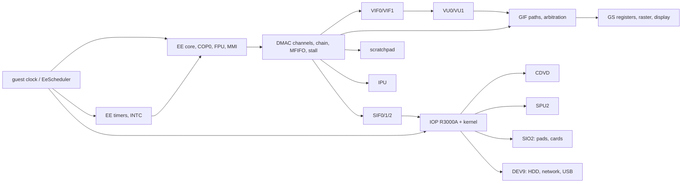

# PS2 hardware dependencies and work order

Which components must be correct before others can be verified, and the order of the engineering waves. Component
ids are those of `docs/status/components.json`; per-component state is in `PS2_COMPONENT_GAP_MATRIX.md` (generated).

## Dependency graph (by data and event flow)

## Rules used to order the work
1. A component is verified only after the components that deliver its inputs are (a GS result depends on GIF, which
   depends on DMAC/VIF/VU).
2. Hardware-blocked components get their implementation, tests and probe specification first; their status stays
   open until the probe runs.
3. Shared infrastructure (guest clock, DMAC model, IOP scheduling) comes before the devices that use it.

## Waves and current position

| wave | content | state |
|---|---|---|
| 0 | inventory, contracts, coverage engine, gap matrix, references | started: coverage engine, 3 contracts, generated gap matrix |
| 1 | guest clock, interrupt delivery, SIF/IOP ordering, DMA events | not started; the current model is described in `PS2_TIMING_ARCHITECTURE.md` |
| 2 | EE/VU: COP0/TLB/cache, unverified instructions, RSQRT.S and EFU probes | not started (probes P3 exist, EFU probe to write) |
| 3 | DMAC/VIF/IPU: missing channels, stall control, MFIFO, IPU | MFIFO implemented (unverified); stall control and IPU next |
| 4 | GIF/GS: missing raster features, GS register model, GPU backend spike | dithering and COLCLAMP implemented (unverified) |
| 5 | SPU2 | not started |
| 6 | peripherals: SIO2, pads, memory cards, CDVD, USB, DEV9, HDD, network, RTC | not started |
| 7 | system integration tests | not started |
| 8 | homebrew compatibility stages 5-9 | not started |
| 9 | release readiness | per batch: gate, CI, sanitizers, fuzz, dashboard |

Next unblocked items in category D/C after this batch: DMAC stall control (`dma.stall`, STS/STD/STADR, both references
implement it), antialiasing (`gs.aa`, needs a reference model), mipmapping coverage in `gs.tex`.
