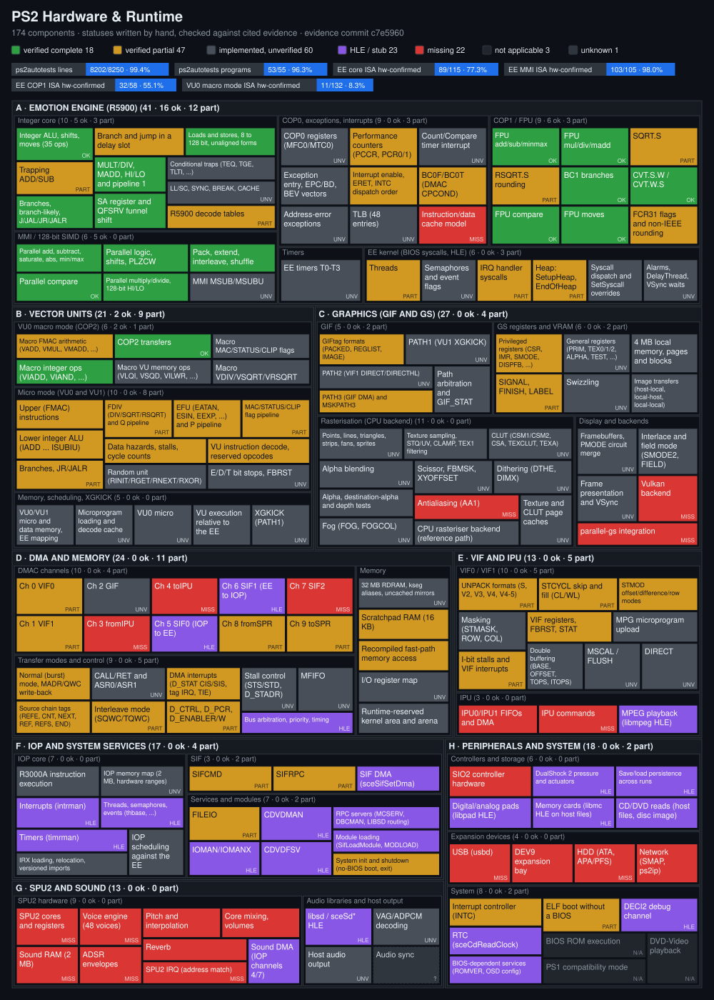
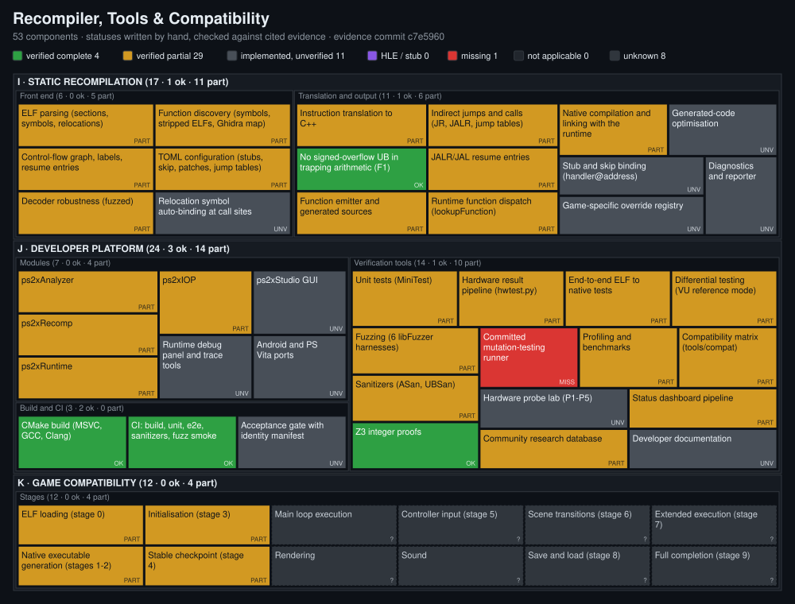

<!-- Generated by tools/status/generate_dashboard.py from docs/status/components.json. Do not edit. -->
# Zmbor component status

Every PS2 subsystem and every significant part of Zmbor, with a status written by hand and checked by `tools/status/validate_dashboard.py` against the evidence it cites. The two diagrams are generated from `docs/status/components.json` by `tools/status/generate_dashboard.py`. A component's colour says how far its behaviour is known to be correct, not how much code exists.

## Methodology

- Hardware evidence means a ps2autotests program whose output matches the `.expected` file printed by a real PS2, a unit test whose expected values are real-PS2 results (`hwvec`), or a formal proof (Z3). Unit tests written from documentation, PCSX2 or the GS manual are tests, not hardware evidence.
- A hardware component is `VERIFIED_COMPLETE` only if its scope is enumerated in a form the validator checks (an instruction list against the hardware-confirmed set, or a proof) and every item is covered by a matching hardware program, with no mismatching program touching it. One passing program without an enumerated scope gives `VERIFIED_PARTIAL`.
- A framework component (recompiler, tools) is `VERIFIED_COMPLETE` when its stated scope is fully covered by tests or proofs that run in CI.
- HLE components (`implementation: hle`) replace a library or IOP module at call level. They are `HLE_OR_STUB` unless hardware programs exercise them, in which case they are `VERIFIED_PARTIAL`, never complete.
- Group and section states are not stored: they are the counts of their components. Passing tests never upgrade a status automatically; a status change is an edit of components.json with matching evidence.
- Percentages appear only where a numerator and a denominator are enumerated: ps2autotests output lines and programs, and hardware-confirmed instructions per decoded instruction class. Each is truncated, never rounded up.
- `NOT_APPLICABLE` entries are scope proposals that the owner must confirm; `UNKNOWN` means no measurement exists.

| status | colour | meaning |
|---|---|---|
| `VERIFIED_COMPLETE` | verified complete (`#2ea043`) | defined scope fully implemented and independently verified (rules above) |
| `VERIFIED_PARTIAL` | verified partial (`#d29922`) | some behaviour verified, relevant gaps remain |
| `IMPLEMENTED_UNVERIFIED` | implemented, unverified (`#484f58`) | implementation exists without sufficient correctness evidence |
| `HLE_OR_STUB` | HLE / stub (`#8957e5`) | approximate or placeholder behaviour (high-level emulation or stub) |
| `MISSING` | missing (`#da3633`) | required feature has no functional implementation |
| `NOT_APPLICABLE` | not applicable (`#21262d`) | deliberately outside the declared scope (proposed; owner confirms) |
| `UNKNOWN` | unknown (`#30363d`) | insufficient information to classify |

## Measurements

Hardware results: `docs/hwtest/dashboard.json` (sha256 `dd5ee3003c6ab14a…`), the hardware matrix of the acceptance gate run on c7e5960 (p7_gate4); main a13b47a (merge of PR #5) has the identical tree b79613e.

| measurement | numerator / denominator | value |
|---|---|---|
| ps2autotests output lines matching real-PS2 `.expected` | 8202 / 8250 | 99.4% |
| ps2autotests programs matching exactly | 53 / 55 | 96.3% |
| `cpu/ee` lines | 1798 / 1798 (6/6 programs) | 100.0% |
| `cpu/ee_cop0` lines | 13 / 13 (1/1 programs) | 100.0% |
| `cpu/ee_fpu` lines | 1061 / 1068 (8/9 programs) | 99.3% |
| `cpu/ee_simd` lines | 2768 / 2768 (6/6 programs) | 100.0% |
| `cpu/vu0_macro` lines | 154 / 154 (2/2 programs) | 100.0% |
| `dma/dmac` lines | 18 / 18 (2/2 programs) | 100.0% |
| `dma/spr` lines | 690 / 690 (3/3 programs) | 100.0% |
| `dma/vif` lines | 735 / 735 (6/6 programs) | 100.0% |
| `gs` lines | 8 / 8 (2/2 programs) | 100.0% |
| `kernel/ee` lines | 151 / 151 (10/10 programs) | 100.0% |
| `memory/ee` lines | 13 / 13 (1/1 programs) | 100.0% |
| `vu/games` lines | 5 / 5 (1/1 programs) | 100.0% |
| `vu/lower` lines | 756 / 797 (4/5 programs) | 94.8% |
| `vu/upper` lines | 32 / 32 (1/1 programs) | 100.0% |

IOP programs (a separate measurement, not part of the counts above): `docs/hwtest/iop-dashboard.json` (sha256 `5fbea66ec92eaa8e…`), the 23 ps2autotests IOP programs (.irx, real-PS2 .expected) run on ps2xIOP by tools/hwtest/iop_hwtest.py at 1b55608 (IRX relocation 2318aad, printf 878f01a, JALR 00e1498, IOP kernel c3e9553, intrman/sysclib 3696d34)

| measurement | numerator / denominator | value |
|---|---|---|
| IOP output lines matching real-PS2 `.expected` | 1306 / 1306 | 100.0% |
| IOP programs matching exactly | 23 / 23 | 100.0% |
| `cpu/iop` lines | 981 / 981 (7/7 programs) | 100.0% |
| `kernel/iop` lines | 325 / 325 (16/16 programs) | 100.0% |

Instruction coverage: the denominator is every mnemonic the recompiler's decode tables name for a class (`ps2xRecomp/include/ps2recomp/instructions.h`; it includes MIPS encodings the EE does not implement, which can only lower the value). An instruction counts as hardware-confirmed when a ps2autotests program that matches real-PS2 output exactly names it in its output and no mismatching program does. Instructions a program executes without naming them (for example SYNC) are not counted. VU micro-mode and COP0 programs do not name instructions, so those classes are not measured.

| instruction class | hardware-confirmed / decoded | value | exercised only by a mismatching program | not exercised by any program |
|---|---|---|---|---|
| EE core (R5900 base ISA) | 89 / 115 | 77.3% | — | 26 |
| EE MMI (128-bit SIMD) | 103 / 105 | 98.0% | — | 2 |
| EE COP1 (FPU) | 32 / 58 | 55.1% | rsqrt, sqrt | 24 |
| VU0 macro mode (COP2) | 11 / 132 | 8.3% | — | 121 |

EE core (R5900 base ISA): 26 decoded mnemonics with no hardware program

`add`, `addi`, `break`, `cache`, `dadd`, `daddi`, `dsub`, `ll`, `lld`, `sc`, `scd`, `sub`, `sync`, `syscall`, `teq`, `teqi`, `tge`, `tgei`, `tgeiu`, `tgeu`, `tlt`, `tlti`, `tltiu`, `tltu`, `tne`, `tnei`

EE MMI (128-bit SIMD): 2 decoded mnemonics with no hardware program

`msub`, `msubu`

EE COP1 (FPU): 24 decoded mnemonics with no hardware program

`c.nge`, `c.ngl`, `c.ngle`, `c.ngt`, `c.ole`, `c.olt`, `c.seq`, `c.sf`, `c.ueq`, `c.ule`, `c.ult`, `c.un`, `ceil.l.s`, `ceil.w.s`, `cvt.d.s`, `cvt.l.s`, `floor.l.s`, `floor.w.s`, `ldc1`, `round.l.s`, `round.w.s`, `sdc1`, `trunc.l.s`, `trunc.w.s`

VU0 macro mode (COP2): 121 decoded mnemonics with no hardware program

`bc2f`, `bc2fl`, `bc2t`, `bc2tl`, `lwc2`, `swc2`, `vabs`, `vadd`, `vadda`, `vaddai`, `vaddaq`, `vaddaw`, `vaddax`, `vadday`, `vaddaz`, `vaddi`, `vaddq`, `vaddw`, `vaddx`, `vaddy`, `vaddz`, `vcallms`, `vcallmsr`, `vclipw`, `vdiv`, `vftoi0`, `vftoi12`, `vftoi15`, `vftoi4`, `vilwr`, `viswr`, `vitof0`, `vitof12`, `vitof15`, `vitof4`, `vlqd`, `vlqi`, `vmadd`, `vmadda`, `vmaddai`, `vmaddaq`, `vmaddaw`, `vmaddax`, `vmadday`, `vmaddaz`, `vmaddi`, `vmaddq`, `vmaddw`, `vmaddx`, `vmaddy`, `vmaddz`, `vmax`, `vmaxi`, `vmaxw`, `vmaxx`, `vmaxy`, `vmaxz`, `vmfir`, `vmini`, `vminii`, `vminiw`, `vminix`, `vminiy`, `vminiz`, `vmove`, `vmr32`, `vmsub`, `vmsuba`, `vmsubai`, `vmsubaq`, `vmsubaw`, `vmsubax`, `vmsubay`, `vmsubaz`, `vmsubi`, `vmsubq`, `vmsubw`, `vmsubx`, `vmsuby`, `vmsubz`, `vmtir`, `vmul`, `vmula`, `vmulai`, `vmulaq`, `vmulaw`, `vmulax`, `vmulay`, `vmulaz`, `vmuli`, `vmulq`, `vmulw`, `vmulx`, `vmuly`, `vmulz`, `vnop`, `vopmsub`, `vopmula`, `vrget`, `vrinit`, `vrnext`, `vrsqrt`, `vrxor`, `vsqd`, `vsqi`, `vsqrt`, `vsub`, `vsuba`, `vsubai`, `vsubaq`, `vsubaw`, `vsubax`, `vsubay`, `vsubaz`, `vsubi`, `vsubq`, `vsubw`, `vsubx`, `vsuby`, `vsubz`, `vwaitq`

No overall completeness percentage is shown: the requirements of most components are not enumerated precisely enough to count, and a percentage over unlike components would not measure anything.

## Totals

| section | components | `VERIFIED_COMPLETE` | `VERIFIED_PARTIAL` | `IMPLEMENTED_UNVERIFIED` | `HLE_OR_STUB` | `MISSING` | `NOT_APPLICABLE` | `UNKNOWN` |
|---|---|---|---|---|---|---|---|---|
| PS2 Hardware & Runtime | 174 | 18 | 52 | 61 | 20 | 19 | 3 | 1 |
| Recompiler, Tools & Compatibility | 53 | 4 | 29 | 11 | 0 | 1 | 0 | 8 |
| **all** | **227** | **22** | **81** | **72** | **20** | **20** | **3** | **9** |

## PS2 Hardware & Runtime

### A. Emotion Engine (R5900)

The R5900 core as the recompiled code sees it: the base ISA, MMI, COP0 and COP1. Instruction groups are VERIFIED_COMPLETE only when every mnemonic in the group is named by a ps2autotests program that matches real-PS2 output exactly and by no program that mismatches.

| id | component | status | implemented | missing / blocker | evidence | target |
|---|---|---|---|---|---|---|
| `ee.alu` | Integer ALU, shifts, moves (35 ops) | `VERIFIED_COMPLETE` | Emitted as C++ on the 64-bit GPR file; 32-bit results sign-extended | — | hw: `cpu_ee_alu` 787/787; isa: 35 mnemonics (ee_core); 2 test ref(s) |  |
| `ee.trap_arith` | Overflow-trapping ADD/ADDI/SUB/DADD/DADDI/DSUB | `VERIFIED_PARTIAL` | Unsigned arithmetic + sign-bit overflow predicate; overflow raises EXCEPTION_INTEGER_OVERFLOW | No hardware program names these; exception delivery on overflow only unit-tested | proof: `tools/semantics/z3_int_semantics.py::ADD`, `tools/semantics/z3_int_semantics.py::DADDI flag with sign-extended imm16`; 1 test ref(s) | 8 |
| `ee.branch` | Branches, branch-likely, J/JAL/JR/JALR | `VERIFIED_COMPLETE` | Exact 64-bit compares, likely-branch delay slots, link registers | — | hw: `cpu_ee_branch` 326/326; isa: 20 mnemonics (ee_core); 2 test ref(s) |  |
| `ee.branchdelay` | Branch and jump in a delay slot | `VERIFIED_PARTIAL` | The seven cases ps2autotests measures on hardware | Architecturally undefined; only the measured combinations are known | hw: `cpu_ee_branchdelay` 13/13, `cpu_ee_fpu_branchdelay` 4/4 |  |
| `ee.lsu` | Loads and stores, 8 to 128 bit, unaligned forms | `VERIFIED_COMPLETE` | LWL/LWR/LDL/LDR/SWL/SWR/SDL/SDR, LQ/SQ alignment, PREF | — | hw: `cpu_ee_lsu` 171/171, `cpu_ee_lsudelay` 3/3; isa: 22 mnemonics (ee_core); 2 test ref(s) |  |
| `ee.muldiv` | MULT/DIV, MADD, HI/LO and pipeline 1 | `VERIFIED_COMPLETE` | Both pipelines (MULT1, DIV1, ...), rd write rules, DIV by zero and INT_MIN/-1 | — | hw: `cpu_ee_muldiv` 498/498; isa: 20 mnemonics (ee_core+mmi); proof: `tools/semantics/z3_int_semantics.py::DIV: C`; 1 test ref(s) |  |
| `ee.sa` | SA register and QFSRV funnel shift | `VERIFIED_COMPLETE` | MTSA/MTSAB/MTSAH/MFSA byte counts; QFSRV helper | — | hw: `cpu_ee_simd_funnel` 46/46; isa: 5 mnemonics (ee_core+mmi); 1 test ref(s) |  |
| `ee.traps` | Conditional traps (TEQ, TGE, TLTI, ...) | `IMPLEMENTED_UNVERIFIED` | Decoded and translated | No test and no hardware program | — | 8 |
| `ee.llsc` | LL/SC, SYNC, BREAK, CACHE | `IMPLEMENTED_UNVERIFIED` | Translated; SC checks the LL reservation; CACHE optionally patched by config | No hardware program names them | 1 test ref(s) |  |
| `ee.decode` | R5900 decode tables | `VERIFIED_PARTIAL` | All 55 ps2autotests ELFs decode and recompile; decoder fuzzed | Most decoded mnemonics outside MMI are not named by a hardware program (see Measurements) | hw: `cpu_ee_alu` 787/787, `cpu_ee_lsu` 171/171, `cpu_ee_simd_shuffle` 626/626, `cpu_ee_fpu_arithmetic` 293/293, `cpu_vu0_macro_transfer` 36/36; 2 test ref(s) |  |
| `mmi.arith` | Parallel add, subtract, saturate, abs, min/max | `VERIFIED_COMPLETE` |  | — | hw: `cpu_ee_simd_arithmetic` 744/744; isa: 25 mnemonics (mmi); 1 test ref(s) |  |
| `mmi.compare` | Parallel compare | `VERIFIED_COMPLETE` |  | — | hw: `cpu_ee_simd_compare` 182/182; isa: 6 mnemonics (mmi) |  |
| `mmi.logic` | Parallel logic, shifts, PLZCW | `VERIFIED_COMPLETE` |  | — | hw: `cpu_ee_simd_logic` 400/400; isa: 14 mnemonics (mmi); proof: `tools/semantics/z3_int_semantics.py::ps2_plzcw32 == leading sign-bit copies` |  |
| `mmi.muldiv` | Parallel multiply/divide, 128-bit HI/LO | `VERIFIED_COMPLETE` | PMULTH family, PMADD/PMSUB accumulators, PDIV*, PMFHL/PMTHL forms | — | hw: `cpu_ee_simd_muldiv` 770/770; 2 real-PS2 vector test(s); isa: 23 mnemonics (mmi); 1 test ref(s) |  |
| `mmi.shuffle` | Pack, extend, interleave, shuffle | `VERIFIED_COMPLETE` |  | — | hw: `cpu_ee_simd_shuffle` 626/626; isa: 22 mnemonics (mmi); 1 test ref(s) |  |
| `mmi.unexercised` | MMI MSUB/MSUBU | `IMPLEMENTED_UNVERIFIED` | Decoded and translated | Not named by any hardware program | — |  |
| `cop0.regs` | COP0 registers (MFC0/MTC0) | `IMPLEMENTED_UNVERIFIED` | Status, Cause, EPC, Count, Compare, BadVAddr, Config, ... | No hardware program for the register file | 1 test ref(s) |  |
| `cop0.perf` | Performance counters (PCCR, PCR0/1) | `VERIFIED_PARTIAL` | Masks, CTE, events and modes as the hardware program reads them | Event counts are derived from the runtime's cycle model, not measured hardware timing | hw: `cpu_ee_cop0_performance` 13/13; 1 test ref(s) |  |
| `cop0.count` | Count/Compare timer interrupt | `IMPLEMENTED_UNVERIFIED` |  | No test of the Compare interrupt | — |  |
| `cop0.exc` | Exception entry, EPC/BD, BEV vectors | `IMPLEMENTED_UNVERIFIED` | raiseCop0Exception sets Cause, EPC (branch PC + BD in delay slots), vectors | No hardware program for exception entry | 1 test ref(s) |  |
| `cop0.adderr` | Address-error exceptions | `IMPLEMENTED_UNVERIFIED` | Misaligned runtime loads raise EXCEPTION_ADDRESS_ERROR_LOAD/STORE | Fast-path memory helpers do not check alignment; no hardware program | 1 test ref(s) |  |
| `cop0.intr` | Interrupt enable, ERET, INTC dispatch order | `VERIFIED_PARTIAL` | EI/DI/ERET; INTC and DMAC handler chains in kernel order | — | hw: `kernel_ee_interrupt_intc_order` 10/10, `kernel_ee_interrupt_dmac_order` 9/9; 1 test ref(s) |  |
| `cop0.bc0` | BC0F/BC0T (DMAC CPCOND) | `VERIFIED_PARTIAL` |  | COP0 instructions are not in the automated measurement; branch-likely forms not shown to be exercised | hw: `dma_dmac_cpcond` 8/8; 2 test ref(s) |  |
| `cop0.tlb` | TLB (48 entries) | `IMPLEMENTED_UNVERIFIED` | TLBR/TLBWI/TLBWR/TLBP read and write the entry table | No TLB-mapped address translation or refill/invalid exceptions; no test | — | unscheduled |
| `cop0.cache` | Instruction/data cache model | `MISSING` |  | CACHE ops are translated without a cache model; coherency effects are not emulated | — | unscheduled |
| `fpu.arith` | ADD/SUB/ABS/NEG/MOV/MAX/MIN, ADDA/SUBA | `VERIFIED_COMPLETE` | PS2 float format: exponent 255 is a number, saturation to 0x7FFFFFFF, flush below 2^-126 | — | hw: `cpu_ee_fpu_arithmetic` 293/293; 1 real-PS2 vector test(s); isa: 9 mnemonics (cop1) |  |
| `fpu.muldiv` | MUL/DIV, MADD/MSUB, MULA/MADDA/MSUBA | `VERIFIED_COMPLETE` |  | — | hw: `cpu_ee_fpu_muldiv` 360/360; isa: 7 mnemonics (cop1); 1 test ref(s) |  |
| `fpu.sqrt` | SQRT.S | `VERIFIED_PARTIAL` | SQRT.S rows of the program match | Its program also contains the RSQRT.S rows that mismatch | hw: `cpu_ee_fpu_sqrt` 59/66; 1 test ref(s) | 8 |
| `fpu.rsqrt` | RSQRT.S rounding | `VERIFIED_PARTIAL` | Sign and special cases as hardware; most rows exact | 7 of 66 program lines differ by 1 ulp; no pre-registered datapath model fits; **blocker:** Needs new hardware rows: probe P3 run on a physical PS2 | hw: `cpu_ee_fpu_sqrt` 59/66 | 8 |
| `fpu.compare` | C.F/C.EQ/C.LT/C.LE | `VERIFIED_COMPLETE` |  | — | hw: `cpu_ee_fpu_compare` 170/170; isa: 4 mnemonics (cop1); 1 test ref(s) |  |
| `fpu.branch` | BC1F/BC1T/BC1FL/BC1TL | `VERIFIED_COMPLETE` |  | — | hw: `cpu_ee_fpu_branch` 26/26, `cpu_ee_fpu_branchdelay` 4/4; isa: 4 mnemonics (cop1) |  |
| `fpu.convert` | CVT.S.W / CVT.W.S | `VERIFIED_COMPLETE` |  | — | hw: `cpu_ee_fpu_convert` 70/70; isa: 2 mnemonics (cop1); 1 test ref(s) |  |
| `fpu.transfer` | MFC1/MTC1/CFC1/CTC1/LWC1/SWC1 | `VERIFIED_COMPLETE` |  | — | hw: `cpu_ee_fpu_transfer` 26/26; isa: 6 mnemonics (cop1); 1 test ref(s) |  |
| `fpu.flags` | FCR31 flags and non-IEEE rounding | `VERIFIED_PARTIAL` | Reset value, writable bits, O/U/D/I flag situations as measured | RSQRT.S rounding unknown (fpu.rsqrt) | hw: `cpu_ee_fpu_fcr` 53/53; 1 test ref(s) |  |
| `ee.timer03` | EE timers T0-T3 (COUNT/MODE/COMP/HOLD) | `IMPLEMENTED_UNVERIFIED` | Counters advance from scheduler cycles; compare/overflow raise INTC | No hardware program; host-time driven | 2 test ref(s) |  |
| `k.threads` | Threads: create, start, sleep, suspend, terminate | `VERIFIED_PARTIAL` | Cooperative scheduler with absolute priority and FIFO; all tested syscalls match hardware | Preemption timing is not cycle-exact | hw: `kernel_ee_thread_delete` 21/21, `kernel_ee_thread_exit` 11/11, `kernel_ee_thread_resume` 17/17, `kernel_ee_thread_sleep` 4/4, `kernel_ee_thread_stat` 23/23, `kernel_ee_thread_suspend` 18/18, `kernel_ee_thread_terminate` 20/20, `kernel_ee_thread_wakeup` 18/18; 1 test ref(s) |  |
| `k.sync` | Semaphores and event flags | `IMPLEMENTED_UNVERIFIED` |  | No hardware program for semaphores or event flags | 1 test ref(s) |  |
| `k.irqh` | Interrupt handler syscalls (AddIntcHandler, ...) | `VERIFIED_PARTIAL` |  | — | hw: `kernel_ee_interrupt_intc_order` 10/10, `kernel_ee_interrupt_dmac_order` 9/9; 1 test ref(s) |  |
| `k.heap` | Heap: SetupHeap, EndOfHeap | `VERIFIED_PARTIAL` |  | — | hw: `memory_ee_default` 13/13; 1 test ref(s) |  |
| `k.syscalltab` | Syscall dispatch and SetSyscall overrides | `IMPLEMENTED_UNVERIFIED` |  | — | 1 test ref(s) |  |
| `k.alarm` | Alarms, DelayThread, VSync waits | `IMPLEMENTED_UNVERIFIED` |  | — | 1 test ref(s) |  |

### B. Vector Units

| id | component | status | implemented | missing / blocker | evidence | target |
|---|---|---|---|---|---|---|
| `vu0.fmac` | Macro FMAC arithmetic (VADD, VMUL, VMADD, ...) | `VERIFIED_PARTIAL` | Shared FMAC contract with micro mode, anchored on real-PS2 results | Most macro FMAC mnemonics are not named by a hardware program (9 of 128 confirmed) | 1 real-PS2 vector test(s); 1 test ref(s) |  |
| `vu0.int` | Macro integer ops (VIADD, VIAND, ...) | `VERIFIED_COMPLETE` |  | — | hw: `cpu_vu0_macro_integer` 118/118; isa: 5 mnemonics (cop2_macro); 1 test ref(s) |  |
| `vu0.xfer` | QMFC2/QMTC2/CFC2/CTC2/LQC2/SQC2 | `VERIFIED_COMPLETE` |  | — | hw: `cpu_vu0_macro_transfer` 36/36; isa: 6 mnemonics (cop2_macro); 1 test ref(s) |  |
| `vu0.mem` | Macro VU memory ops (VLQI, VSQD, VILWR, ...) | `IMPLEMENTED_UNVERIFIED` |  | — | 1 test ref(s) |  |
| `vu0.flags` | Macro MAC/STATUS/CLIP flags | `IMPLEMENTED_UNVERIFIED` |  | Probe P5 prepared, never run on hardware; **blocker:** Physical PS2 + ps2sdk to run probe P5 | — | 8 |
| `vu0.fdiv` | Macro VDIV/VSQRT/VRSQRT | `IMPLEMENTED_UNVERIFIED` |  | No hardware program in macro mode | 1 test ref(s) |  |
| `vu.upper` | Upper (FMAC) instructions | `VERIFIED_PARTIAL` | FMAC contract, broadcast/Q/I/ACC/OPMULA forms, flags | — | hw: `vu_upper_clip` 32/32, `vu_lower_random` 53/53; 1 test ref(s) |  |
| `vu.lowerint` | Lower integer ALU (IADD ... ISUBIU) | `VERIFIED_PARTIAL` |  | The program names all seven ops (checked by hand); VU micro instructions are not in the automated measurement | hw: `vu_lower_integer` 167/167; 1 test ref(s) |  |
| `vu.branch` | Branches, JR/JALR | `VERIFIED_PARTIAL` | Delay slot, VI forwarding to branches | Hardware program covers JALR only | hw: `vu_lower_branch` 4/4; 1 test ref(s) |  |
| `vu.fdiv` | FDIV (DIV/SQRT/RSQRT) and Q pipeline | `VERIFIED_PARTIAL` |  | — | hw: `vu_lower_fdivdelay` 350/350; 1 test ref(s) |  |
| `vu.efu` | EFU (EATAN, ESIN, EEXP, ...) and P pipeline | `VERIFIED_PARTIAL` | Series model fitted to 208 hardware vectors; latencies | 41 of 223 program lines differ in the last bit; **blocker:** Exact term rounding unknown; needs an EFU probe run on hardware | hw: `vu_lower_efu` 182/223; 1 real-PS2 vector test(s) | 8 |
| `vu.flags` | MAC/STATUS/CLIP flag pipeline | `VERIFIED_PARTIAL` | Four-cycle flag pipeline, FSSET, CLIP history | — | hw: `vu_upper_clip` 32/32; 1 test ref(s) |  |
| `vu.hazards` | Data hazards, stalls, cycle counts | `VERIFIED_PARTIAL` | Per-pipeline commit index; lane-precise FMAC stalls | Only the random program checks cycle-level results on hardware | hw: `vu_lower_random` 53/53; 2 test ref(s) |  |
| `vu.rng` | Random unit (RINIT/RGET/RNEXT/RXOR) | `IMPLEMENTED_UNVERIFIED` |  | — | 1 test ref(s) |  |
| `vu.decode` | VU instruction decode, reserved opcodes | `VERIFIED_PARTIAL` |  | — | hw: `vu_games_triace` 5/5, `vu_lower_random` 53/53; 1 test ref(s) |  |
| `vu.ebit` | E/D/T bit stops, FBRST | `IMPLEMENTED_UNVERIFIED` |  | — | 1 test ref(s) |  |
| `vu.mem` | VU0/VU1 micro and data memory, EE mapping | `IMPLEMENTED_UNVERIFIED` |  | — | 1 test ref(s) |  |
| `vu.load` | Microprogram loading and decode cache | `IMPLEMENTED_UNVERIFIED` |  | — | 1 test ref(s) |  |
| `vu0.micro` | VU0 micro mode (VCALLMS/VCALLMSR) | `IMPLEMENTED_UNVERIFIED` |  | No hardware program runs VU0 micro code | 1 test ref(s) |  |
| `vu.sched` | VU execution relative to the EE | `IMPLEMENTED_UNVERIFIED` | Microprograms run when started by MSCAL/VCALLMS | Concurrency timing against the EE is not measured | — |  |
| `vu.xgkick` | XGKICK (PATH1) | `IMPLEMENTED_UNVERIFIED` | Incremental transfer, stall of a second XGKICK, buffer reuse | No hardware program | 2 test ref(s) |  |

### C. Graphics (GIF and GS)

Only GS SIGNAL/LABEL behaviour has hardware results (ps2autotests gs/*). Everything else is checked by unit tests written from the GS manual and by an e2e frame painted from the program's own geometry.

| id | component | status | implemented | missing / blocker | evidence | target |
|---|---|---|---|---|---|---|
| `gif.tags` | GIFtag formats (PACKED, REGLIST, IMAGE) | `VERIFIED_PARTIAL` |  | — | hw: `gs_signal` 4/4, `gs_label` 4/4; 2 test ref(s) |  |
| `gif.path1` | PATH1 (VU1 XGKICK) | `IMPLEMENTED_UNVERIFIED` |  | — | 1 test ref(s) |  |
| `gif.path2` | PATH2 (VIF1 DIRECT/DIRECTHL) | `IMPLEMENTED_UNVERIFIED` |  | — | 1 test ref(s) |  |
| `gif.path3` | PATH3 (GIF DMA) and MSKPATH3 | `VERIFIED_PARTIAL` |  | — | hw: `dma_vif_mskpath3` 5/5; 1 test ref(s) |  |
| `gif.arb` | Path arbitration and GIF_STAT | `IMPLEMENTED_UNVERIFIED` |  | Priority and IMAGE-packet interleaving not measured on hardware | 1 test ref(s) |  |
| `gs.priv` | Privileged registers (CSR, IMR, SMODE, DISPFB, ...) | `VERIFIED_PARTIAL` |  | — | hw: `gs_signal` 4/4, `gs_label` 4/4; 1 test ref(s) |  |
| `gs.events` | SIGNAL, FINISH, LABEL | `VERIFIED_PARTIAL` |  | FINISH has no hardware program | hw: `gs_signal` 4/4, `gs_label` 4/4; 1 test ref(s) |  |
| `gs.genregs` | General registers (PRIM, TEX0/1/2, ALPHA, TEST, ...) | `IMPLEMENTED_UNVERIFIED` |  | — | 1 test ref(s) |  |
| `gs.vram` | 4 MB local memory, pages and blocks | `IMPLEMENTED_UNVERIFIED` |  | — | 1 test ref(s) |  |
| `gs.swizzle` | Swizzling (PSMCT32/24/16/16S, PSMT8/4/8H/4HL/4HH, PSMZ) | `IMPLEMENTED_UNVERIFIED` |  | — | 2 test ref(s) |  |
| `gs.xfer` | Image transfers (host-local, local-host, local-local) | `IMPLEMENTED_UNVERIFIED` |  | — | 2 test ref(s) |  |
| `gs.prims` | Points, lines, triangles, strips, fans, sprites | `IMPLEMENTED_UNVERIFIED` |  | — | 3 test ref(s) |  |
| `gs.tex` | Texture sampling, STQ/UV, CLAMP, TEX1 filtering | `IMPLEMENTED_UNVERIFIED` |  | Mipmapping (LOD, MIPTBP) has no test | 3 test ref(s) |  |
| `gs.clut` | CLUT (CSM1/CSM2, CSA, TEXCLUT, TEXA) | `IMPLEMENTED_UNVERIFIED` |  | — | 2 test ref(s) |  |
| `gs.alpha` | Alpha blending and COLCLAMP (ALPHA, PABE, FBA, COLCLAMP) | `IMPLEMENTED_UNVERIFIED` | Blend equation on signed values; COLCLAMP saturates (1) or wraps to 8 bits (0) | — | 3 test ref(s) |  |
| `gs.tests` | Alpha, destination-alpha and depth tests | `IMPLEMENTED_UNVERIFIED` | ATST/AFAIL, DATE/DATM, ZTST, ZMSK (the GS has no stencil buffer) | — | 3 test ref(s) |  |
| `gs.fog` | Fog (FOG, FOGCOL) | `IMPLEMENTED_UNVERIFIED` |  | — | 1 test ref(s) |  |
| `gs.mask` | Scissor, FBMSK, XYOFFSET | `IMPLEMENTED_UNVERIFIED` |  | — | 1 test ref(s) |  |
| `gs.dither` | Dithering (DTHE, DIMX) | `IMPLEMENTED_UNVERIFIED` | DIMX[y&3][x&3] (3-bit two's complement) added to RGB after blending and before COLCLAMP, for 16-bit frame buffers (PCSX2 model) | No hardware capture; PCSX2 and DobieStation disagree on the DIMX encoding and on dithering 32-bit buffers (decision D-GS-1); **blocker:** GS output capture on a physical PS2 (dither probe, docs/engineering/PS2_HARDWARE_VERIFICATION.md) | 1 test ref(s) | 8 |
| `gs.aa` | Antialiasing (AA1) | `MISSING` |  | Not implemented | — | unscheduled |
| `gs.cpu` | CPU rasteriser backend (reference path) | `IMPLEMENTED_UNVERIFIED` |  | — | 1 test ref(s) |  |
| `gs.cache` | Texture and CLUT page caches | `IMPLEMENTED_UNVERIFIED` |  | — | 2 test ref(s) |  |
| `gs.fb` | Framebuffers, PMODE circuit merge | `IMPLEMENTED_UNVERIFIED` |  | — | 1 test ref(s) |  |
| `gs.interlace` | Interlace and field mode (SMODE2, FIELD) | `IMPLEMENTED_UNVERIFIED` |  | — | 1 test ref(s) |  |
| `gs.present` | Frame presentation and VSync | `IMPLEMENTED_UNVERIFIED` |  | — | 2 test ref(s) |  |
| `gs.vulkan` | Vulkan backend | `MISSING` |  | No GPU backend exists | — | 8 |
| `gs.pgs` | parallel-gs integration | `MISSING` |  | Spike planned (docs/architecture/phase8-roadmap.md, item 2); **blocker:** Vulkan-capable test host and GS trace capture | — | 8 |

### D. DMA and memory

| id | component | status | implemented | missing / blocker | evidence | target |
|---|---|---|---|---|---|---|
| `dma.c0` | Ch 0 VIF0 | `VERIFIED_PARTIAL` |  | — | hw: `dma_vif_basic` 12/12, `dma_vif_unpack` 56/56; 1 test ref(s) |  |
| `dma.c1` | Ch 1 VIF1 | `VERIFIED_PARTIAL` |  | — | hw: `dma_vif_basic` 12/12, `dma_vif_unpack` 56/56, `dma_vif_intstall` 18/18, `dma_vif_stcycl` 510/510, `dma_vif_stmod` 134/134; 1 test ref(s) |  |
| `dma.c2` | Ch 2 GIF | `IMPLEMENTED_UNVERIFIED` |  | No hardware program checks GIF-channel DMA directly | 2 test ref(s) |  |
| `dma.c3` | Ch 3 fromIPU | `IMPLEMENTED_UNVERIFIED` | fromIPU normal mode: IPU output FIFO qwords to MADR as they are produced, STR held while waiting, CIS3 at QWC = 0 | Destination-chain mode; no hardware program; transfer timing; STS = fromIPU stall source; **blocker:** IPU probe on a physical PS2 | 2 test ref(s) | 8 |
| `dma.c4` | Ch 4 toIPU | `IMPLEMENTED_UNVERIFIED` | toIPU normal mode: MADR/QWC qwords into the 8-qword IPU input FIFO with flow control (STR held while the FIFO is full), CIS4 when all data is in | Source-chain mode; no hardware program; transfer timing; **blocker:** IPU probe on a physical PS2 | 2 test ref(s) | 8 |
| `dma.c5` | Ch 5 SIF0 (IOP to EE) | `HLE_OR_STUB` | Served by the SIF HLE (sceSifGetOtherData, RPC replies) | No DMAC channel model | 1 test ref(s) |  |
| `dma.c6` | Ch 6 SIF1 (EE to IOP) | `IMPLEMENTED_UNVERIFIED` | Register-level channel 6: normal and source-chain mode with TTE, stall-control drain (STD=3), stream split into IOP packets (16-byte IOP tag, address bits 0-23, end bits 31/30, word count & 0xFFFFC) written into IOP memory with a SIF transfer notification, CIS6; sceSifSetDma (HLE syscall) still copies descriptors directly | No hardware program drives channel 6; SIF FIFO depth and transfer timing are not modelled; IOP channel 10 interrupt is not raised; **blocker:** SIF1 probe on a physical PS2 (channel 6 programmed directly, IOP buffer read back) | 5 test ref(s) | 8 |
| `dma.c7` | Ch 7 SIF2 | `MISSING` |  | Not modelled | — | unscheduled |
| `dma.c8` | Ch 8 fromSPR | `VERIFIED_PARTIAL` |  | — | hw: `dma_spr_normal` 36/36, `dma_spr_chain` 25/25, `dma_spr_interleave` 629/629; 1 test ref(s) |  |
| `dma.c9` | Ch 9 toSPR | `VERIFIED_PARTIAL` |  | — | hw: `dma_spr_normal` 36/36, `dma_spr_chain` 25/25, `dma_spr_interleave` 629/629, `dma_dmac_tagintr` 10/10; 1 test ref(s) |  |
| `dma.normal` | Normal (burst) mode, MADR/QWC write-back | `VERIFIED_PARTIAL` |  | — | hw: `dma_spr_normal` 36/36; 1 test ref(s) |  |
| `dma.chain` | Source chain tags (REFE, CNT, NEXT, REF, REFS, END) | `VERIFIED_PARTIAL` | Tag walk, TTE, terminal-tag latching, cycle detection (F2) | — | hw: `dma_spr_chain` 25/25, `dma_dmac_tagintr` 10/10; 2 test ref(s) |  |
| `dma.callret` | CALL/RET and ASR0/ASR1 | `IMPLEMENTED_UNVERIFIED` |  | No hardware program uses CALL/RET | 3 test ref(s) |  |
| `dma.interleave` | Interleave mode (SQWC/TQWC) | `VERIFIED_PARTIAL` | Skip/transfer qword counts for both scratchpad directions | Scope not enumerated by the automated measurement; one matching program, coverage of every case not checked | hw: `dma_spr_interleave` 629/629; 1 test ref(s) |  |
| `dma.irq` | DMA interrupts (D_STAT CIS/SIS, tag IRQ, TIE) | `VERIFIED_PARTIAL` | CIS0-9, SIS, MEIS, BEIS clear on write-one; CIM, SIM, MEIM toggle; INT1 when a masked status bit is set; tag IRQ and TIE | — | hw: `dma_dmac_tagintr` 10/10, `kernel_ee_interrupt_dmac_order` 9/9; 4 test ref(s) |  |
| `dma.ctrl` | D_CTRL, D_PCR, D_ENABLER/W | `VERIFIED_PARTIAL` |  | — | hw: `dma_dmac_cpcond` 8/8; 2 test ref(s) |  |
| `dma.stall` | Stall control (STS/STD, D_STADR) | `IMPLEMENTED_UNVERIFIED` | fromSPR (STS=2) leaves its MADR in D_STADR after normal or interleave transfers; the VIF1 (STD=1) or GIF (STD=2) drain waits before a REFS tag or a normal-mode transfer that would read past D_STADR, stays active (STR, no CIS), raises SIS once per stall and resumes when D_STADR or D_CTRL changes | No hardware program; whole-tag/whole-transfer granularity (the references differ, D-DMA-4); SIF0 and fromIPU sources and fromSPR destination-chain CNTS are not modelled (the SIF1 drain is, 0ad6e4b); **blocker:** Stall-control probe on a physical PS2 (docs/engineering/PS2_HARDWARE_VERIFICATION.md); SIF0/SIF1/fromIPU channel models | 6 test ref(s) | 8 |
| `dma.mfifo` | MFIFO ring (D_RBOR/D_RBSR) | `IMPLEMENTED_UNVERIFIED` | fromSPR writes into the D_RBOR/D_RBSR ring; the GIF (MFD=3) or VIF1 (MFD=2) source chain drains it with wrapping, stalls at the write position with D_STAT.MEIS and resumes when fromSPR adds data | No hardware program; stall granularity is one tag (the hardware can stop inside the data, D-DMA-2); fromSPR interleave and chain modes into the ring are not wrapped; **blocker:** MFIFO probe on a physical PS2 (docs/engineering/PS2_HARDWARE_VERIFICATION.md) | 4 test ref(s) | 8 |
| `dma.timing` | Bus arbitration, priority, timing | `HLE_OR_STUB` | Transfers complete synchronously when started | No bus arbitration or transfer timing | — |  |
| `mem.rdram` | 32 MB RDRAM, kseg aliases, uncached mirrors | `IMPLEMENTED_UNVERIFIED` |  | — | 2 test ref(s) |  |
| `mem.spr` | Scratchpad RAM (16 KB) | `VERIFIED_PARTIAL` |  | — | hw: `dma_spr_normal` 36/36, `dma_spr_chain` 25/25; 1 test ref(s) |  |
| `mem.fast` | Recompiled fast-path memory access | `VERIFIED_PARTIAL` | Masked RDRAM access with wrap-around paths | — | proof: `tools/semantics/z3_int_semantics.py::contiguous => offset`; 1 test ref(s) |  |
| `mem.io` | I/O register map | `IMPLEMENTED_UNVERIFIED` |  | — | 1 test ref(s) |  |
| `mem.reserved` | Runtime-reserved kernel area and arena | `IMPLEMENTED_UNVERIFIED` |  | — | 1 test ref(s) |  |

### E. VIF and IPU

| id | component | status | implemented | missing / blocker | evidence | target |
|---|---|---|---|---|---|---|
| `vif.unpack` | UNPACK formats (S, V2, V3, V4, V4-5) | `VERIFIED_PARTIAL` |  | — | hw: `dma_vif_unpack` 56/56; 2 test ref(s) |  |
| `vif.stcycl` | STCYCL skip and fill (CL/WL) | `VERIFIED_PARTIAL` |  | Scope not enumerated by the automated measurement; one matching program, coverage of every case not checked | hw: `dma_vif_stcycl` 510/510; 2 test ref(s) |  |
| `vif.stmod` | STMOD offset/difference/row modes | `VERIFIED_PARTIAL` |  | Scope not enumerated by the automated measurement; one matching program, coverage of every case not checked | hw: `dma_vif_stmod` 134/134; 1 test ref(s) |  |
| `vif.mask` | Masking (STMASK, ROW, COL) | `IMPLEMENTED_UNVERIFIED` |  | — | 1 test ref(s) |  |
| `vif.stall` | I-bit stalls and VIF interrupts | `VERIFIED_PARTIAL` |  | — | hw: `dma_vif_intstall` 18/18; 2 test ref(s) |  |
| `vif.regs` | VIF registers, FBRST, STAT | `VERIFIED_PARTIAL` |  | — | hw: `dma_vif_basic` 12/12; 1 test ref(s) |  |
| `vif.mpg` | MPG microprogram upload | `IMPLEMENTED_UNVERIFIED` |  | — | 1 test ref(s) |  |
| `vif.dbf` | Double buffering (BASE, OFFSET, TOPS, ITOPS) | `IMPLEMENTED_UNVERIFIED` |  | — | 1 test ref(s) |  |
| `vif.mscal` | MSCAL, MSCALF, MSCNT, FLUSH, FLUSHE, FLUSHA | `IMPLEMENTED_UNVERIFIED` |  | — | 1 test ref(s) |  |
| `vif.direct` | DIRECT/DIRECTHL to PATH2 | `IMPLEMENTED_UNVERIFIED` |  | — | 1 test ref(s) |  |
| `ipu.dma` | IPU0/IPU1 FIFOs and DMA | `IMPLEMENTED_UNVERIFIED` | Input FIFO (8 qwords, bit pointer) fed by toIPU and IPU_in_FIFO; output FIFO (8 qwords) refilled from the converted macroblock, drained by fromIPU and IPU_out_FIFO; both channels in normal mode with flow control | Chain modes of channels 3/4; no hardware program; transfer timing; **blocker:** IPU probe on a physical PS2 | 3 test ref(s) | 8 |
| `ipu.cmd` | IPU commands (BCLR, IDEC, BDEC, VDEC, FDEC, CSC, ...) | `MISSING` | IPU register file (CMD/CTRL/BP/TOP) and the non-decoding commands BCLR, FDEC, SETIQ, SETVQ, SETTH, CTRL.RST (6ecc5f3) and CSC with integer BT.601, dither and alpha thresholds (0828791, D-IPU-1); sceIpu* HLE still returns without decoding | IDEC, BDEC, VDEC and PACK are not implemented (they complete without output and are reported as unimplemented) | 4 test ref(s) | unscheduled |
| `ipu.mpeg` | MPEG playback (libmpeg HLE) | `HLE_OR_STUB` | sceMpeg* replaced; optional FFmpeg decode (PS2X_ENABLE_FFMPEG) | — | 1 test ref(s) |  |

### F. IOP and system services

The IOP runs physical IRX modules on an R3000A interpreter with an HLE kernel, or replaces them with HLE services. ps2autotests has IOP CPU programs (cpu/iop/*) that are not yet run.

| id | component | status | implemented | missing / blocker | evidence | target |
|---|---|---|---|---|---|---|
| `iop.cpu` | R3000A instruction execution | `VERIFIED_PARTIAL` | R3000A interpreter with load and branch delay slots; the seven ps2autotests cpu/iop programs (ALU, branches, branch delay, HI/LO delay, loads/stores, load delay, mul/div) match their real-PS2 output exactly | Instruction scope not enumerated; exceptions, interrupts and COP0 are not exercised by a hardware program | hw: `cpu_iop_alu` 467/467, `cpu_iop_branch` 170/170, `cpu_iop_branchdelay` 11/11, `cpu_iop_hilodelay` 6/6, `cpu_iop_lsu` 114/114, `cpu_iop_lsudelay` 11/11, `cpu_iop_muldiv` 202/202; 2 test ref(s) | 8 |
| `iop.mem` | IOP memory map (2 MB, hardware ranges) | `VERIFIED_PARTIAL` | 2 MB IOP RAM with byte/half/word loads and stores and load delays; the ps2autotests cpu/iop lsu and lsudelay programs match their real-PS2 output exactly | Hardware register ranges (0x1F801000.., SPU2, CDVD) and mirrors/aliases are not exercised by a hardware program | hw: `cpu_iop_lsu` 114/114, `cpu_iop_lsudelay` 11/11; 1 test ref(s) |  |
| `iop.intr` | Interrupts (intrman) | `VERIFIED_PARTIAL` | HLE intrman: handler registration codes and line validation as on a real PS2, NULL handlers, VBLANK (line 0) raised at every field of guest time; the ps2autotests kernel/iop/interrupt register and release programs match their real-PS2 output exactly | HLE; interrupt lines other than VBLANK and DMA completion are not raised; nesting and exception-level timing are not modelled | hw: `kernel_iop_interrupt_register` 15/15, `kernel_iop_interrupt_release` 9/9; 1 test ref(s) |  |
| `iop.kernel` | Threads, semaphores, events (thbase, ...) | `VERIFIED_PARTIAL` | HLE kernel at system-call level (thbase, thsemap, thevent, thmsgbx, thvpool): thread checks and states, priority ready queue with preemption, typed waits with FIFO/priority queues, message boxes, variable pools; module start runs in a priority-8 kernel thread; the 12 ps2autotests kernel/iop thread, event flag, message box and vpool programs match their real-PS2 output exactly | HLE (not the Sony IOP kernel binary); semaphores, alarms, fixed pools and suspend/resume are not exercised by a hardware program; thread switch timing is not cycle-accurate | hw: `kernel_iop_eventflag_delete` 11/11, `kernel_iop_eventflag_poll` 18/18, `kernel_iop_messagebox_poll` 9/9, `kernel_iop_messagebox_receive` 10/10, `kernel_iop_messagebox_send` 14/14, `kernel_iop_thread_cancelwakeup` 11/11, `kernel_iop_thread_create` 26/26, `kernel_iop_thread_delete` 15/15, `kernel_iop_thread_releasewait` 23/23, `kernel_iop_thread_stat` 17/17, `kernel_iop_vpool_create` 14/14, `kernel_iop_vpool_pallocate` 104/104; 2 test ref(s) |  |
| `iop.timers` | Timers (timrman) | `HLE_OR_STUB` |  | — | 1 test ref(s) |  |
| `iop.irx` | IRX loading, relocation, versioned imports | `VERIFIED_PARTIAL` | IRX (ELF type 0xFF80) loading, relocation by load base (HI16/LO16/26/32 against section symbols), import resolution by library and version; all 23 ps2autotests IOP programs load, link and match their real-PS2 output exactly | Only ps2sdk-built test modules are exercised (no Sony ROM modules or resident-library exports between real modules); module stop/unload is not exercised by a hardware program | hw: `cpu_iop_alu` 467/467, `cpu_iop_branch` 170/170, `cpu_iop_branchdelay` 11/11, `cpu_iop_hilodelay` 6/6, `cpu_iop_lsu` 114/114, `cpu_iop_lsudelay` 11/11, `cpu_iop_muldiv` 202/202, `kernel_iop_eventflag_delete` 11/11, `kernel_iop_eventflag_poll` 18/18, `kernel_iop_interrupt_register` 15/15, `kernel_iop_interrupt_release` 9/9, `kernel_iop_libc_sprintf` 19/19, `kernel_iop_libc_strtok` 10/10, `kernel_iop_messagebox_poll` 9/9, `kernel_iop_messagebox_receive` 10/10, `kernel_iop_messagebox_send` 14/14, `kernel_iop_thread_cancelwakeup` 11/11, `kernel_iop_thread_create` 26/26, `kernel_iop_thread_delete` 15/15, `kernel_iop_thread_releasewait` 23/23, `kernel_iop_thread_stat` 17/17, `kernel_iop_vpool_create` 14/14, `kernel_iop_vpool_pallocate` 104/104; 1 test ref(s) |  |
| `iop.sched` | IOP scheduling against the EE | `IMPLEMENTED_UNVERIFIED` |  | No ordering tests between IOP and EE progress (roadmap item 4) | — | 8 |
| `sif.cmd` | SIFCMD | `VERIFIED_PARTIAL` | Packet-level IOP SIFCMD responder | Hardware evidence is indirect: every program's printf travels this path | hw: `kernel_ee_thread_stat` 23/23, `cpu_ee_alu` 787/787; 1 test ref(s) |  |
| `sif.rpc` | SIFRPC | `VERIFIED_PARTIAL` |  | Hardware evidence is indirect (tty output path) | hw: `kernel_ee_thread_stat` 23/23, `cpu_ee_alu` 787/787; 1 test ref(s) |  |
| `sif.dma` | SIF DMA (sceSifSetDma) | `HLE_OR_STUB` |  | — | 1 test ref(s) |  |
| `svc.fileio` | FILEIO | `VERIFIED_PARTIAL` |  | Only the tty write path has hardware evidence | hw: `cpu_ee_alu` 787/787; 1 test ref(s) |  |
| `svc.ioman` | IOMAN/IOMANX | `HLE_OR_STUB` |  | — | — |  |
| `svc.cdvdman` | CDVDMAN | `HLE_OR_STUB` |  | — | 1 test ref(s) |  |
| `svc.cdvdfsv` | CDVDFSV | `HLE_OR_STUB` | Module load accepted; EE sceCd* calls served by HLE | — | — |  |
| `svc.rpcsrv` | RPC servers (MCSERV, DBCMAN, LIBSD routing) | `HLE_OR_STUB` |  | — | 1 test ref(s) |  |
| `svc.modload` | Module loading (SifLoadModule, MODLOAD) | `HLE_OR_STUB` |  | — | 1 test ref(s) |  |
| `sys.boot` | System init and shutdown (no-BIOS boot, exit) | `VERIFIED_PARTIAL` | ELF load into a no-BIOS environment, IOP reset, ExitDeleteThread | — | hw: `kernel_ee_thread_exit` 11/11; 1 test ref(s) |  |

### G. SPU2 and sound

There is no SPU2 hardware model. Audio libraries (libsd, audsrv) are replaced at call level and VAG data is decoded for host playback.

| id | component | status | implemented | missing / blocker | evidence | target |
|---|---|---|---|---|---|---|
| `spu.cores` | SPU2 cores and registers | `MISSING` |  | Register range mapped on the IOP side, no register model | — | 8 |
| `spu.ram` | Sound RAM (2 MB) | `MISSING` |  | No sound RAM model | — | 8 |
| `spu.voices` | Voice engine (48 voices) | `MISSING` |  | No voice engine; libsd calls play decoded clips | — | 8 |
| `spu.adsr` | ADSR envelopes | `MISSING` |  | No envelope generator | — | 8 |
| `spu.pitch` | Pitch and interpolation | `MISSING` |  | No pitch counter or interpolation | — | 8 |
| `spu.mix` | Core mixing, volumes | `MISSING` |  | No SPU2 mixer | — | 8 |
| `spu.reverb` | Reverb | `MISSING` |  | No reverb | — | unscheduled |
| `spu.irq` | SPU2 IRQ (address match) | `MISSING` |  | No SPU2 interrupts | — | 8 |
| `spu.dma` | Sound DMA (IOP channels 4/7) | `HLE_OR_STUB` | sceSdVoiceTrans/BlockTrans return byte counts | — | 1 test ref(s) |  |
| `spu.libsd` | libsd / sceSd* HLE | `HLE_OR_STUB` |  | Many sceSd*/sceSSyn* entries are TODO_NAMED placeholders | 1 test ref(s) |  |
| `spu.adpcm` | VAG/ADPCM decoding | `IMPLEMENTED_UNVERIFIED` |  | No test | — |  |
| `spu.host` | Host audio output | `IMPLEMENTED_UNVERIFIED` |  | No test; plays decoded clips through raylib | — |  |
| `spu.sync` | Audio synchronisation with emulated time | `UNKNOWN` |  | Not characterised | — |  |

### H. Peripherals and system

Out-of-scope entries (NOT_APPLICABLE) are proposed by this inventory and need the owner's confirmation.

| id | component | status | implemented | missing / blocker | evidence | target |
|---|---|---|---|---|---|---|
| `per.sio2` | SIO2 controller hardware | `MISSING` |  | Pads and cards are served at library level | — | unscheduled |
| `per.pad` | Digital/analog pads (libpad HLE) | `HLE_OR_STUB` |  | — | 1 test ref(s) |  |
| `per.ds2` | DualShock 2 pressure and actuators | `HLE_OR_STUB` |  | Actuator (vibration) output not tested | 1 test ref(s) |  |
| `per.mc` | Memory cards (libmc HLE on host files) | `HLE_OR_STUB` |  | — | 1 test ref(s) |  |
| `per.save` | Save/load persistence across runs | `HLE_OR_STUB` | mc0 maps to a host directory | No restart-and-read-back test | 1 test ref(s) |  |
| `per.cdvd` | CD/DVD reads (host files, disc image) | `HLE_OR_STUB` |  | — | 1 test ref(s) |  |
| `per.usb` | USB (usbd) | `MISSING` | Module load accepted | No USB device emulation | — | unscheduled |
| `per.dev9` | DEV9 expansion bay | `MISSING` | Module load accepted | No DEV9 emulation | — | unscheduled |
| `per.hdd` | HDD (ATA, APA/PFS) | `MISSING` |  | Not implemented | — | unscheduled |
| `per.netif` | Network (SMAP, ps2ip) | `MISSING` | Module load accepted | No network adapter emulation | — | unscheduled |
| `per.intc` | Interrupt controller (INTC) | `VERIFIED_PARTIAL` |  | — | hw: `kernel_ee_interrupt_intc_order` 10/10; 1 test ref(s) |  |
| `per.rtc` | RTC (sceCdReadClock) | `HLE_OR_STUB` |  | — | — |  |
| `per.biossvc` | BIOS-dependent services (ROMVER, OSD config) | `HLE_OR_STUB` |  | — | 2 test ref(s) |  |
| `per.boot` | ELF boot without a BIOS | `VERIFIED_PARTIAL` | All 55 ps2autotests programs boot this way | — | hw: `cpu_ee_alu` 787/787, `kernel_ee_thread_exit` 11/11 |  |
| `per.deci2` | DECI2 debug channel | `HLE_OR_STUB` |  | — | — |  |
| `per.bios` | BIOS ROM execution | `NOT_APPLICABLE` | Declared design: Zmbor ships and needs no BIOS (README); ROM modules are provided by HLE | — | — |  |
| `per.ps1` | PS1 compatibility mode | `NOT_APPLICABLE` | Proposed out of scope: PS2 software only | — | — |  |
| `per.dvdv` | DVD-Video playback | `NOT_APPLICABLE` | Proposed out of scope: not PS2 software | — | — |  |

## Recompiler, Tools & Compatibility

### I. Static recompilation

| id | component | status | implemented | missing / blocker | evidence | target |
|---|---|---|---|---|---|---|
| `rc.elf` | ELF parsing (sections, symbols, relocations) | `VERIFIED_PARTIAL` | 55/55 ps2autotests ELFs parsed; malformed tables skipped (F3) | No commercial ELF parsed in tests | 2 test ref(s) |  |
| `rc.discovery` | Function discovery (symbols, stripped ELFs, Ghidra map) | `VERIFIED_PARTIAL` |  | — | 2 test ref(s) |  |
| `rc.cfg` | Control-flow graph, labels, resume entries | `VERIFIED_PARTIAL` |  | — | hw: `cpu_ee_branch` 326/326, `cpu_ee_branchdelay` 13/13; 2 test ref(s) |  |
| `rc.decoder` | Decoder robustness (fuzzed) | `VERIFIED_PARTIAL` |  | Smoke-length fuzzing only | 2 test ref(s) |  |
| `rc.config` | TOML configuration (stubs, skip, patches, jump tables) | `VERIFIED_PARTIAL` |  | — | 1 test ref(s) |  |
| `rc.relocs` | Relocation symbol auto-binding at call sites | `IMPLEMENTED_UNVERIFIED` |  | No test of the auto-binding | — |  |
| `rc.translate` | Instruction translation to C++ | `VERIFIED_PARTIAL` | 53/55 hardware programs match exactly when recompiled | — | hw: `cpu_ee_alu` 787/787, `cpu_ee_simd_muldiv` 770/770; 1 test ref(s) |  |
| `rc.ub` | No signed-overflow UB in trapping arithmetic (F1) | `VERIFIED_COMPLETE` | Emitted forms proved, mutation-checked, run under UBSan in CI | — | proof: `tools/semantics/z3_int_semantics.py::ADD`, `tools/semantics/z3_int_semantics.py::DADDIU wraps as rs + sign_extend(imm16)`; 1 test ref(s) |  |
| `rc.emitter` | Function emitter and generated sources | `VERIFIED_PARTIAL` |  | — | 2 test ref(s) |  |
| `rc.indirect` | Indirect jumps and calls (JR, JALR, jump tables) | `VERIFIED_PARTIAL` |  | — | 2 test ref(s) |  |
| `rc.resume` | JALR/JAL resume entries | `VERIFIED_PARTIAL` |  | JALR-wide promotion measured and rejected (docs/architecture/indirect-call-entry-analysis.md) | 1 test ref(s) |  |
| `rc.dispatch` | Runtime function dispatch (lookupFunction) | `VERIFIED_PARTIAL` |  | — | 1 test ref(s) |  |
| `rc.native` | Native compilation and linking with the runtime | `VERIFIED_PARTIAL` | 55 hardware programs and 4 e2e programs built (MSVC local; e2e also GCC/Clang in CI) | — | hw: `cpu_ee_alu` 787/787 |  |
| `rc.opt` | Generated-code optimisation | `IMPLEMENTED_UNVERIFIED` | Fast memory paths, native GIF DMA kick helper | Hardware programs build at /Od by default; no optimised-build gate | 1 test ref(s) |  |
| `rc.stubs` | Stub and skip binding (handler@address) | `IMPLEMENTED_UNVERIFIED` |  | — | 1 test ref(s) |  |
| `rc.overrides` | Game-specific override registry | `IMPLEMENTED_UNVERIFIED` |  | No test | — |  |
| `rc.diag` | Diagnostics and reporter | `IMPLEMENTED_UNVERIFIED` |  | — | — |  |

### J. Developer platform

| id | component | status | implemented | missing / blocker | evidence | target |
|---|---|---|---|---|---|---|
| `dv.analyzer` | ps2xAnalyzer | `VERIFIED_PARTIAL` |  | — | 1 test ref(s) |  |
| `dv.recomp` | ps2xRecomp | `VERIFIED_PARTIAL` |  | — | 1 test ref(s) |  |
| `dv.runtime` | ps2xRuntime | `VERIFIED_PARTIAL` |  | — | 1 test ref(s) |  |
| `dv.iop` | ps2xIOP | `VERIFIED_PARTIAL` |  | — | 1 test ref(s) |  |
| `dv.studio` | ps2xStudio GUI | `IMPLEMENTED_UNVERIFIED` |  | Built by the Windows CI job; no tests | — |  |
| `dv.debug` | Runtime debug panel and trace tools | `IMPLEMENTED_UNVERIFIED` |  | No tests | — |  |
| `dv.ports` | Android and PS Vita ports | `IMPLEMENTED_UNVERIFIED` |  | Not built in CI | — |  |
| `dv.cmake` | CMake build (MSVC, GCC, Clang) | `VERIFIED_COMPLETE` | Scope: the three compiler jobs of .github/workflows/build.yml build cleanly (runs 40257464815 and 40257466538 on c7e5960) | — | — |  |
| `dv.ci` | CI: build, unit, e2e, sanitizers, fuzz smoke | `VERIFIED_COMPLETE` | Scope: every job in build.yml passes on the PR head (runs 40257464815 and 40257466538 on c7e5960: 10/10) | — | — |  |
| `dv.gate` | Acceptance gate with identity manifest | `IMPLEMENTED_UNVERIFIED` | Used for every Phase 6-7 release decision | No automated test of the gate itself; Windows/PowerShell only; needs local ps2autotests | — |  |
| `dv.unit` | Unit tests (MiniTest) | `VERIFIED_PARTIAL` |  | — | 1 test ref(s) |  |
| `dv.hwtest` | Hardware result pipeline (hwtest.py) | `VERIFIED_PARTIAL` |  | Not run in CI (ps2autotests not vendored) | hw: `cpu_ee_alu` 787/787 |  |
| `dv.e2e` | End-to-end ELF to native tests | `VERIFIED_PARTIAL` |  | Not run on the Windows CI runner (no OpenGL) | 1 test ref(s) |  |
| `dv.diff` | Differential testing (VU reference mode) | `VERIFIED_PARTIAL` |  | — | 1 test ref(s) |  |
| `dv.fuzz` | Fuzzing (6 libFuzzer harnesses) | `VERIFIED_PARTIAL` |  | Smoke runs only (60 s per target in CI) | 2 test ref(s) |  |
| `dv.san` | Sanitizers (ASan, UBSan) | `VERIFIED_PARTIAL` |  | UBSan only with Clang/GCC; MSVC ASan run locally | 1 test ref(s) |  |
| `dv.z3` | Z3 integer proofs | `VERIFIED_COMPLETE` | Scope: the 29 properties of z3_int_semantics.py, each with a negative control | — | proof: `tools/semantics/z3_int_semantics.py::hold` |  |
| `dv.mutation` | Committed mutation-testing runner | `MISSING` |  | Mutation checks were run by hand; no runner in the repository | — | 8 |
| `dv.prof` | Profiling and benchmarks | `VERIFIED_PARTIAL` |  | No performance gate (roadmap item 6) | 1 test ref(s) |  |
| `dv.compat` | Compatibility matrix (tools/compat) | `VERIFIED_PARTIAL` |  | — | 1 test ref(s) |  |
| `dv.probes` | Hardware probe lab (P1-P5) | `IMPLEMENTED_UNVERIFIED` |  | No probe has run on hardware; **blocker:** Physical PS2 and ps2sdk | — | 8 |
| `dv.research` | Community research database | `VERIFIED_PARTIAL` |  | — | 1 test ref(s) |  |
| `dv.status` | Status dashboard pipeline | `VERIFIED_PARTIAL` |  | Statuses are reviewed by hand; the validator checks evidence links, not semantics | 1 test ref(s) |  |
| `dv.docs` | Developer documentation | `IMPLEMENTED_UNVERIFIED` |  | — | — |  |

### K. Game compatibility

Stages of tools/compat. Evidence exists only for the 55 ps2autotests programs and 4 synthetic e2e programs; no commercial game and no homebrew game has been run, so every game-level stage is UNKNOWN.

| id | component | status | implemented | missing / blocker | evidence | target |
|---|---|---|---|---|---|---|
| `c.elf` | ELF loading (stage 0) | `VERIFIED_PARTIAL` | 55/55 test programs | No game ELF | hw: `cpu_ee_alu` 787/787 |  |
| `c.native` | Native executable generation (stages 1-2) | `VERIFIED_PARTIAL` | 55/55 test programs | No game ELF | hw: `cpu_ee_alu` 787/787 |  |
| `c.init` | Initialisation (stage 3) | `VERIFIED_PARTIAL` | 55/55 test programs produce output | No game | hw: `cpu_ee_alu` 787/787 |  |
| `c.checkpoint` | Stable checkpoint (stage 4) | `VERIFIED_PARTIAL` | 55/55 test programs reach their end marker | Test programs, not games | hw: `cpu_ee_alu` 787/787 |  |
| `c.mainloop` | Main loop execution | `UNKNOWN` |  | No game run | — |  |
| `c.render` | Rendering | `UNKNOWN` |  | Only a synthetic e2e frame is checked | — |  |
| `c.input` | Controller input (stage 5) | `UNKNOWN` |  | No scripted input runs | — |  |
| `c.sound` | Sound | `UNKNOWN` |  | No game run | — |  |
| `c.scenes` | Scene transitions (stage 6) | `UNKNOWN` |  | No game run | — |  |
| `c.save` | Save and load (stage 8) | `UNKNOWN` |  | No game run | — |  |
| `c.extended` | Extended execution (stage 7) | `UNKNOWN` |  | No game run | — |  |
| `c.complete` | Full completion (stage 9) | `UNKNOWN` |  | No game run | — |  |

## Source and test references

Every reference cited by the inventory (checked to exist by the validator)

| id | sources | tests |
|---|---|---|
| `ee.alu` | `ps2xRecomp/src/lib/special_translator.cpp` `ps2xRecomp/src/lib/instruction_translator.cpp` `ps2xRuntime/include/ps2_runtime_macros.h` | `ps2xTest/src/code_generator_tests.cpp::scalar logical register ops emit low64 operations` `ps2xTest/src/code_generator_tests.cpp::MOVZ and MOVN move only the low doubleword` |
| `ee.trap_arith` | `ps2xRuntime/include/ps2_runtime_macros.h` `ps2xRecomp/src/lib/special_translator.cpp` | `ps2xTest/src/ps2_runtime_expansion_tests.cpp::integer overflow helpers` `tools/semantics/z3_int_semantics.py::ADD` `tools/semantics/z3_int_semantics.py::DADDI flag with sign-extended imm16` |
| `ee.branch` | `ps2xRecomp/src/lib/control_flow_emitter.cpp` `ps2xRecomp/src/lib/regimm_translator.cpp` | `ps2xTest/src/code_generator_tests.cpp::signed branches compare the full 64-bit EE register` `ps2xTest/src/code_generator_tests.cpp::branch-likely places delay slot only in taken path` |
| `ee.branchdelay` | `ps2xRecomp/src/lib/control_flow_emitter.cpp` | — |
| `ee.lsu` | `ps2xRecomp/src/lib/instruction_translator.cpp` `ps2xRuntime/include/ps2_runtime_macros.h` | `ps2xTest/src/ps2_runtime_expansion_tests.cpp::quadword loads and stores ignore the low four address bits` `ps2xTest/src/code_generator_tests.cpp::unsigned integer loads use explicit zero extension` |
| `ee.muldiv` | `ps2xRecomp/src/lib/special_translator.cpp` `ps2xRecomp/src/lib/mmi_translator.cpp` | `ps2xTest/src/ps2_runtime_expansion_tests.cpp::differential decoder/codegen gpr-write contract for MULT and DIV families` `tools/semantics/z3_int_semantics.py::DIV: C` |
| `ee.sa` | `ps2xRuntime/include/ps2_runtime_macros.h` `ps2xRecomp/src/lib/mmi_translation_helpers.cpp` | `ps2xTest/src/code_generator_tests.cpp::SA holds a byte count for MTSA, MTSAB, MTSAH and MFSA` |
| `ee.traps` | `ps2xRecomp/src/lib/special_translator.cpp` `ps2xRecomp/src/lib/regimm_translator.cpp` | — |
| `ee.llsc` | `ps2xRecomp/src/lib/special_translator.cpp` `ps2xRecomp/src/lib/instruction_translator.cpp` | `ps2xTest/src/code_generator_tests.cpp::SC requires matching LL reservation address` |
| `ee.decode` | `ps2xRecomp/src/lib/r5900_decoder.cpp` `ps2xRecomp/include/ps2recomp/instructions.h` | `ps2xTest/src/r5900_decoder_tests.cpp::decodes JAL with jump target and call flag` `tools/fuzz/fuzz_recompiler.cpp` |
| `mmi.arith` | `ps2xRecomp/src/lib/mmi_translation_helpers.cpp` `ps2xRuntime/include/ps2_runtime_macros.h` | `ps2xTest/src/ps2_runtime_expansion_tests.cpp::MMI shuffles, absolutes, saturating adds` |
| `mmi.compare` | `ps2xRecomp/src/lib/mmi_translation_helpers.cpp` | — |
| `mmi.logic` | `ps2xRecomp/src/lib/mmi_translation_helpers.cpp` `ps2xRuntime/include/ps2_runtime_macros.h` | `tools/semantics/z3_int_semantics.py::ps2_plzcw32 == leading sign-bit copies` |
| `mmi.muldiv` | `ps2xRecomp/src/lib/mmi_translation_helpers.cpp` `ps2xRecomp/src/lib/mmi_translator.cpp` | `ps2xTest/src/ps2_runtime_expansion_tests.cpp::PMFHL/PMTHL and PMTHI/PMTLO use all four HI/LO words` `ps2xTest/src/ps2_runtime_expansion_tests.cpp::MMI halfword and word multiplies match real-PS2 results` `ps2xTest/src/ps2_runtime_expansion_tests.cpp::PDIVW, PDIVUW and PDIVBW match real-PS2 results` |
| `mmi.shuffle` | `ps2xRecomp/src/lib/mmi_translation_helpers.cpp` | `ps2xTest/src/ps2_runtime_expansion_tests.cpp::PEXEW swaps words 0 and 2` |
| `mmi.unexercised` | `ps2xRecomp/src/lib/mmi_translator.cpp` | — |
| `cop0.regs` | `ps2xRecomp/src/lib/cop0_translator.cpp` `ps2xRuntime/include/ps2_runtime.h` | `ps2xTest/src/code_generator_tests.cpp::COP0 MFC0/MTC0 translate to COP0 register access` |
| `cop0.perf` | `ps2xRuntime/src/lib/ps2_runtime.cpp` | `ps2xTest/src/ps2_runtime_kernel_tests.cpp::COP0 performance counters follow PCCR masks` |
| `cop0.count` | `ps2xRecomp/src/lib/cop0_translator.cpp` | — |
| `cop0.exc` | `ps2xRuntime/src/lib/ps2_runtime.cpp` | `ps2xTest/src/ps2_runtime_expansion_tests.cpp::SignalException marks EPC and BD for delay-slot exceptions` |
| `cop0.adderr` | `ps2xRuntime/src/lib/ps2_runtime.cpp` | `ps2xTest/src/ps2_memory_tests.cpp::unaligned accesses throw` |
| `cop0.intr` | `ps2xRuntime/src/lib/Kernel/Syscalls/Interrupt.cpp` `ps2xRecomp/src/lib/cop0_translator.cpp` | `ps2xTest/src/ps2_runtime_interrupt_tests.cpp::interrupt handlers are ordered by AddDmacHandler` |
| `cop0.bc0` | `ps2xRecomp/src/lib/control_flow_emitter.cpp` `ps2xRuntime/include/runtime/ps2_memory.h` | `ps2xTest/src/code_generator_tests.cpp::BC0T and BC0F test the DMAC CPCOND0` `ps2xTest/src/ps2_memory_tests.cpp::COP0 condition follows D_PCR.CPC and D_STAT.CIS` |
| `cop0.tlb` | `ps2xRuntime/src/lib/ps2_runtime.cpp` `ps2xRuntime/src/lib/ps2_memory.cpp` | — |
| `cop0.cache` | `ps2xRecomp/src/lib/instruction_translator.cpp` | — |
| `fpu.arith` | `ps2xRuntime/include/ps2_runtime_macros.h` `ps2xRecomp/src/lib/fpu_translator.cpp` | `ps2xTest/src/ps2_float_semantics_tests.cpp::FPU results match the PS2 hardware results from ps2autotests` |
| `fpu.muldiv` | `ps2xRuntime/include/ps2_runtime_macros.h` | `ps2xTest/src/ps2_float_semantics_tests.cpp::EE FPU MUL.S truncates and is not commutative` |
| `fpu.sqrt` | `ps2xRuntime/include/ps2_runtime_macros.h` | `ps2xTest/src/ps2_float_semantics_tests.cpp::FPU SQRT.S takes the square root of the magnitude` |
| `fpu.rsqrt` | `ps2xRuntime/include/ps2_runtime_macros.h` `tools/semantics/ee_rsqrt_models.py` | — |
| `fpu.compare` | `ps2xRecomp/src/lib/fpu_translator.cpp` | `ps2xTest/src/ps2_float_semantics_tests.cpp::C.EQ/C.LT/C.LE and MAX/MIN compare encodings like the EE` |
| `fpu.branch` | `ps2xRecomp/src/lib/control_flow_emitter.cpp` | — |
| `fpu.convert` | `ps2xRecomp/src/lib/fpu_translator.cpp` | `ps2xTest/src/ps2_runtime_expansion_tests.cpp::CVT.W.S truncates toward zero and saturates by sign` |
| `fpu.transfer` | `ps2xRecomp/src/lib/fpu_translator.cpp` | `ps2xTest/src/code_generator_tests.cpp::CFC1 and CTC1 follow the EE FPU control registers` |
| `fpu.flags` | `ps2xRuntime/include/ps2_runtime_macros.h` | `ps2xTest/src/ps2_float_semantics_tests.cpp::COP1 arithmetic sets the FCR31 flags real hardware sets` |
| `ee.timer03` | `ps2xRuntime/src/lib/ps2_memory.cpp` | `ps2xTest/src/ps2_memory_tests.cpp::EE timers 0 through 3 expose independent COUNT MODE and COMP registers` `ps2xTest/src/ps2_runtime_interrupt_tests.cpp::EE Timer2 compare IRQ wakes a DelayThread-style semaphore wait` |
| `k.threads` | `ps2xRuntime/src/lib/Kernel/EeScheduler.cpp` `ps2xRuntime/src/lib/Kernel/Syscalls/Thread.cpp` | `ps2xTest/src/ps2_runtime_kernel_tests.cpp::EE scheduler selects absolute priority then FIFO` |
| `k.sync` | `ps2xRuntime/src/lib/Kernel/Syscalls/Sync.cpp` | `ps2xTest/src/ps2_runtime_kernel_tests.cpp::semaphore waiters are FIFO` |
| `k.irqh` | `ps2xRuntime/src/lib/Kernel/Syscalls/Interrupt.cpp` | `ps2xTest/src/ps2_runtime_interrupt_tests.cpp::a negative handler result ends the interrupt's handler chain` |
| `k.heap` | `ps2xRuntime/src/lib/Kernel/Syscalls/System.cpp` | `ps2xTest/src/ps2_runtime_kernel_tests.cpp::setup heap and allocator primitives track end-of-heap` |
| `k.syscalltab` | `ps2xRuntime/src/lib/Kernel/Syscalls/Dispatcher.cpp` | `ps2xTest/src/ps2_runtime_kernel_tests.cpp::SetSyscall override runs as a scheduler invocation` |
| `k.alarm` | `ps2xRuntime/src/lib/Kernel/Syscalls/Thread.cpp` `ps2xRuntime/src/lib/Kernel/EeScheduler.cpp` | `ps2xTest/src/ps2_runtime_interrupt_tests.cpp::VBlank deadline resumes the waiter` |
| `vu0.fmac` | `ps2xRecomp/src/lib/vu_translation_helpers.cpp` `ps2xRuntime/include/ps2_vu_fmac.h` | `ps2xTest/src/ps2_vu_fmac_tests.cpp::COP2 macro VADD/VSUB/VMUL use the FMAC contract in every lane` `ps2xTest/src/ps2_vu_fmac_tests.cpp::FMAC contract anchors from real-PS2 results` |
| `vu0.int` | `ps2xRecomp/src/lib/vu_translator.cpp` | `ps2xTest/src/code_generator_tests.cpp::VU0 macro integer ops discard writes to vi0` |
| `vu0.xfer` | `ps2xRecomp/src/lib/vu_translator.cpp` | `ps2xTest/src/code_generator_tests.cpp::CTC2/CFC2 vi24 keep the written bits 0x0C0C` |
| `vu0.mem` | `ps2xRecomp/src/lib/vu_translator.cpp` | `ps2xTest/src/code_generator_tests.cpp::VU0 LQI/LQD/SQI/SQD decode fields and use VU0 data memory` |
| `vu0.flags` | `ps2xRecomp/src/lib/vu_translation_helpers.cpp` | — |
| `vu0.fdiv` | `ps2xRecomp/src/lib/vu_translation_helpers.cpp` | `ps2xTest/src/ps2_runtime_expansion_tests.cpp::VU0 macro DIV/SQRT/RSQRT follow the FDIV-unit rules` |
| `vu.upper` | `ps2xRuntime/src/lib/vu/ps2_vu1_upper.cpp` | `ps2xTest/src/ps2_vu1_tests.cpp::VU micro FMAC broadcast/Q/I/accumulator/outer-product forms follow the FMAC contract` |
| `vu.lowerint` | `ps2xRuntime/src/lib/vu/ps2_vu1_lower.cpp` | `ps2xTest/src/ps2_vu1_tests.cpp::integer lower ops keep VI0 hardwired to zero` |
| `vu.branch` | `ps2xRuntime/src/lib/vu/ps2_vu1_lower.cpp` | `ps2xTest/src/ps2_vu1_tests.cpp::conditional branch sees the previous VI value for one instruction` |
| `vu.fdiv` | `ps2xRuntime/src/lib/vu/ps2_vu1_lower.cpp` `ps2xRuntime/src/lib/vu/ps2_vu1_core.cpp` | `ps2xTest/src/ps2_vu1_tests.cpp::FDIV resource serializes back-to-back scalar operations` |
| `vu.efu` | `ps2xRuntime/src/lib/vu/ps2_vu1_lower.cpp` | `ps2xTest/src/ps2_vu1_tests.cpp::EFU results match real-PS2 results` |
| `vu.flags` | `ps2xRuntime/src/lib/vu/ps2_vu1_core.cpp` | `ps2xTest/src/ps2_vu1_tests.cpp::VU1 CLIP and FCGET share the four-cycle flag timeline` |
| `vu.hazards` | `ps2xRuntime/src/lib/vu/ps2_vu1_core.cpp` | `ps2xTest/src/ps2_vu1_tests.cpp::FMAC dependency stalls only the lanes that are read` `ps2xTest/src/ps2_vu1_tests.cpp::VU1 commit index matches the reference cycle by cycle` |
| `vu.rng` | `ps2xRuntime/src/lib/vu/ps2_vu1_lower.cpp` | `ps2xTest/src/ps2_vu1_tests.cpp::EFU WAITP and RNG execute with architectural latency and state` |
| `vu.decode` | `ps2xRuntime/src/lib/vu/ps2_vu1_core.cpp` | `ps2xTest/src/ps2_vu1_tests.cpp::reserved opcodes stop before executing or corrupting state` |
| `vu.ebit` | `ps2xRuntime/src/lib/vu/ps2_vu1_core.cpp` | `ps2xTest/src/ps2_vu1_tests.cpp::E and enabled D/T stop with their architectural delay rules` |
| `vu.mem` | `ps2xRuntime/src/lib/ps2_memory.cpp` | `ps2xTest/src/ps2_memory_tests.cpp::VU0 code and data windows map through EE addresses` |
| `vu.load` | `ps2xRuntime/src/lib/vu/ps2_vu1_core.cpp` `ps2xRuntime/src/lib/ps2_vif1_interpreter.cpp` | `ps2xTest/src/ps2_vu1_tests.cpp::MPG upload invalidates cached VU1 decode before MSCAL` |
| `vu0.micro` | `ps2xRuntime/src/lib/ps2_runtime.cpp` | `ps2xTest/src/ps2_runtime_expansion_tests.cpp::VU0 microprogram executes against VU0 code and data memory` |
| `vu.sched` | `ps2xRuntime/src/lib/ps2_runtime.cpp` `ps2xRuntime/src/lib/vu/ps2_vu1_core.cpp` | — |
| `vu.xgkick` | `ps2xRuntime/src/lib/vu/ps2_vu1_core.cpp` | `ps2xTest/src/ps2_vu1_tests.cpp::XGKICK sends a VU memory GIF packet through PATH1` `ps2xTest/src/ps2_vu1_tests.cpp::a second XGKICK stalls until the active PATH1 transfer completes` |
| `gif.tags` | `ps2xRuntime/src/lib/gs/gs_frontend.cpp` | `ps2xTest/src/ps2_gs_tests.cpp::GIF REGLIST with odd register count consumes 128-bit padding before next tag` `ps2xTest/src/ps2_gs_tests.cpp::GIF FLG=3 (IMAGE2) packet writes host-to-local data like IMAGE` |
| `gif.path1` | `ps2xRuntime/src/lib/vu/ps2_vu1_core.cpp` | `ps2xTest/src/ps2_vu1_tests.cpp::XGKICK sends a VU memory GIF packet through PATH1` |
| `gif.path2` | `ps2xRuntime/src/lib/ps2_vif1_interpreter.cpp` | `ps2xTest/src/ps2_memory_tests.cpp::VIF1 DMA DIRECT forwards payload to GIF callback and clears channel` |
| `gif.path3` | `ps2xRuntime/src/lib/ps2_memory.cpp` | `ps2xTest/src/ps2_memory_tests.cpp::PATH3 mask queues packets until unmask` |
| `gif.arb` | `ps2xRuntime/src/lib/gs/ps2_gif_arbiter.cpp` | `ps2xTest/src/ps2_memory_tests.cpp::GIF arbiter prioritizes PATH1 then PATH2 then PATH3` |
| `gs.priv` | `ps2xRuntime/src/lib/gs/gs_frontend.cpp` `ps2xRuntime/src/lib/ps2_memory.cpp` | `ps2xTest/src/ps2_gs_tests.cpp::GS CSR/IMR support coherent 64-bit and 32-bit access` |
| `gs.events` | `ps2xRuntime/src/lib/gs/gs_frontend.cpp` | `ps2xTest/src/ps2_gs_tests.cpp::GS SIGNAL and FINISH set CSR bits that clear by CSR write-one acknowledge` |
| `gs.genregs` | `ps2xRuntime/src/lib/gs/gs_frontend.cpp` `ps2xRuntime/include/runtime/gs/gs_types.h` | `ps2xTest/src/ps2_gs_tests.cpp::PRMODE supplies primitive attributes while PRMODECONT AC is clear` |
| `gs.vram` | `ps2xRuntime/src/lib/gs/ps2_gs_memory.cpp` | `ps2xTest/gs_cache/gs_memory_cache_tests.cpp` |
| `gs.swizzle` | `ps2xRuntime/include/runtime/gs/ps2_gs_psmt4.h` `ps2xRuntime/include/runtime/gs/ps2_gs_psmct16.h` | `ps2xTest/src/ps2_gs_tests.cpp::PSMT4 address mapping matches GS manual layout` `ps2xTest/src/ps2_gs_tests.cpp::GS T4HL/T4HH shared-plane upload preserves both index planes via RMW` |
| `gs.xfer` | `ps2xRuntime/src/lib/gs/gs_cpu_backend.cpp` | `ps2xTest/src/ps2_gs_tests.cpp::GS local-to-host transfer supports partial incremental reads` `ps2xTest/src/ps2_gs_tests.cpp::GS PSMT4 local-local copy respects swizzled page layout` |
| `gs.prims` | `ps2xRuntime/src/lib/gs/gs_cpu_backend.cpp` | `ps2xTest/src/ps2_gs_tests.cpp::GS triangle fan subpixel quad fills rows without interior holes` `ps2xTest/src/ps2_gs_tests.cpp::XYZ3 culls a triangle strip primitive without desynchronizing the vertex queue` `ps2xTest/e2e/e2e_programs.py` |
| `gs.tex` | `ps2xRuntime/src/lib/gs/gs_cpu_backend.cpp` | `ps2xTest/src/ps2_gs_tests.cpp::GS STQ triangle interpolation divides homogeneous coordinates after DDA` `ps2xTest/src/ps2_gs_tests.cpp::GS TEX1 linear filter blends T4 STQ triangle samples` `ps2xTest/src/ps2_gs_tests.cpp::GS CLAMP modes transform texture coordinates before sampling` |
| `gs.clut` | `ps2xRuntime/src/lib/gs/gs_cpu_backend.cpp` | `ps2xTest/src/ps2_gs_tests.cpp::GS T8 CSM1 applies CSA and masks CSA bit 4 for CT32 CLUTs` `ps2xTest/gs_cache/gs_clut_cache_tests.cpp` |
| `gs.alpha` | `ps2xRuntime/src/lib/gs/gs_cpu_backend.cpp` | `ps2xTest/src/ps2_gs_tests.cpp::PABE bypasses alpha blend for low-alpha source pixels` `ps2xTest/src/ps2_runtime_expansion_tests.cpp::GS alpha blend uses ALPHA register FIX factor` `ps2xTest/src/ps2_gs_tests.cpp::GS COLCLAMP=1 saturates and COLCLAMP=0 keeps the low 8 bits of the blended colour` |
| `gs.tests` | `ps2xRuntime/src/lib/gs/gs_cpu_backend.cpp` | `ps2xTest/src/ps2_gs_tests.cpp::GS alpha-test AFAIL independently masks framebuffer and depth` `ps2xTest/src/ps2_gs_tests.cpp::GS DATE and DATM inspect the framebuffer-format alpha bit` `ps2xTest/src/ps2_gs_tests.cpp::GS ZMSK suppresses depth without suppressing framebuffer writes` |
| `gs.fog` | `ps2xRuntime/src/lib/gs/gs_cpu_backend.cpp` | `ps2xTest/src/ps2_gs_tests.cpp::GS fog blends the shaded color toward FOGCOL before framebuffer blending` |
| `gs.mask` | `ps2xRuntime/src/lib/gs/gs_cpu_backend.cpp` | `ps2xTest/src/ps2_runtime_expansion_tests.cpp::GS sprite draw applies XYOFFSET and fully-outside scissor should not render` |
| `gs.dither` | `ps2xRuntime/src/lib/gs/gs_cpu_backend.cpp` `ps2xRuntime/src/lib/gs/gs_frontend.cpp` | `ps2xTest/src/ps2_gs_tests.cpp::GS dithering adds DIMX[y&3][x&3] to RGB for 16-bit frame buffers only` |
| `gs.aa` | — | — |
| `gs.cpu` | `ps2xRuntime/src/lib/gs/gs_cpu_backend.cpp` `ps2xRuntime/include/runtime/gs/gs_backend.h` | `ps2xTest/src/ps2_gs_tests.cpp::GS backend replacement preserves canonical local memory` |
| `gs.cache` | `ps2xRuntime/include/runtime/gs/gs_texture_page_cache.h` | `ps2xTest/gs_cache/gs_texture_cache_tests.cpp` `ps2xTest/gs_cache/gs_clut_cache_tests.cpp` |
| `gs.fb` | `ps2xRuntime/src/lib/gs/gs_cpu_backend.cpp` | `ps2xTest/src/ps2_gs_tests.cpp::latched host presentation merges both enabled PMODE circuits` |
| `gs.interlace` | `ps2xRuntime/src/lib/gs/gs_cpu_backend.cpp` `ps2xRuntime/src/lib/Kernel/EeScheduler.cpp` | `ps2xTest/src/ps2_gs_tests.cpp::latched host presentation line-doubles interlaced field output` |
| `gs.present` | `ps2xRuntime/src/lib/gs/gs_frontend.cpp` `ps2xRuntime/src/lib/ps2_runtime.cpp` | `ps2xTest/src/ps2_gs_tests.cpp::latched host presentation frame stays stable until the next latch` `ps2xTest/src/ps2_gs_tests.cpp::sceGsSyncV resumes through the scheduler with deterministic field parity` |
| `gs.vulkan` | — | — |
| `gs.pgs` | — | — |
| `dma.c0` | `ps2xRuntime/src/lib/ps2_memory.cpp` | `ps2xTest/src/ps2_memory_tests.cpp::VIF0 I bit stalls until VIF0_FBRST.STC` |
| `dma.c1` | `ps2xRuntime/src/lib/ps2_memory.cpp` | `ps2xTest/src/ps2_memory_tests.cpp::VIF1 DMA DIRECT forwards payload to GIF callback and clears channel` |
| `dma.c2` | `ps2xRuntime/src/lib/ps2_memory.cpp` | `ps2xTest/src/ps2_memory_tests.cpp::GIF DMA mode0 copies RDRAM packet and clears channel` `ps2xTest/src/ps2_memory_tests.cpp::GIF DMA chain longer than 4096 tags` |
| `dma.c3` | `ps2xRuntime/src/lib/ps2_memory.cpp` `ps2xRuntime/src/lib/ps2_ipu.cpp` | `ps2xTest/src/ps2_memory_tests.cpp::IPU CSC converts a macroblock through toIPU and fromIPU DMA (RGB32, RGB16, dither, alpha thresholds)` `ps2xTest/src/ps2_memory_tests.cpp::IPU CSC rounds the half-scale result and maps each 2x2 pixel group to its chroma sample` |
| `dma.c4` | `ps2xRuntime/src/lib/ps2_memory.cpp` `ps2xRuntime/src/lib/ps2_ipu.cpp` | `ps2xTest/src/ps2_memory_tests.cpp::IPU SETIQ loads a quantizer matrix through toIPU DMA, which completes with CIS4` `ps2xTest/src/ps2_memory_tests.cpp::IPU toIPU stays active while the input FIFO is full and completes when a command frees it` |
| `dma.c5` | `ps2xRuntime/src/lib/Kernel/Stubs/SIF.cpp` | `ps2xTest/src/ps2_sif_dma_tests.cpp::sceSifGetOtherData copies payload` |
| `dma.c6` | `ps2xRuntime/src/lib/ps2_memory.cpp` `ps2xRuntime/src/lib/ps2_runtime.cpp` `ps2xRuntime/src/lib/Kernel/Stubs/SIF.cpp` | `ps2xTest/src/ps2_sif_dma_tests.cpp::sceSifSetDma copies payload` `ps2xTest/src/ps2_memory_tests.cpp::SIF1 normal mode delivers each IOP packet to the sink and completes with CIS6` `ps2xTest/src/ps2_memory_tests.cpp::SIF1 chain stalled at a REFS tag delivers the packet whole once D_STADR moves (STD=3)` `ps2xTest/src/ps2_memory_tests.cpp::SIF1 without an IOP sink does not transfer or raise CIS6` `ps2xTest/src/ps2_sif_dma_tests.cpp::DMAC channel 6 (SIF1) programmed directly writes its IOP packet into IOP memory` |
| `dma.c7` | — | — |
| `dma.c8` | `ps2xRuntime/src/lib/ps2_memory.cpp` | `ps2xTest/src/ps2_memory_tests.cpp::DMAC SPR_FROM copies scratchpad to RDRAM and completes channel 8` |
| `dma.c9` | `ps2xRuntime/src/lib/ps2_memory.cpp` | `ps2xTest/src/ps2_memory_tests.cpp::toSPR chain stops at a tag IRQ under TIE and still raises CIS9` |
| `dma.normal` | `ps2xRuntime/src/lib/ps2_memory.cpp` | `ps2xTest/src/ps2_memory_tests.cpp::normal-mode GIF and VIF1 DMA leave MADR past the data and QWC at zero` |
| `dma.chain` | `ps2xRuntime/src/lib/ps2_memory.cpp` | `ps2xTest/src/ps2_memory_tests.cpp::a source chain that loops without an end tag stops after one lap` `ps2xTest/src/ps2_memory_tests.cpp::chain cycle detection does not stop finite chains that transfer the same data repeatedly` |
| `dma.callret` | `ps2xRuntime/src/lib/ps2_memory.cpp` | `ps2xTest/src/ps2_memory_tests.cpp::GIF DMA chain CALL sources payload from TADR+16` `ps2xTest/src/ps2_memory_tests.cpp::GIF DMA chain RET transfers payload and resumes after CALL` `ps2xTest/src/ps2_memory_tests.cpp::chain cycle detection does not stop a chain that CALLs the same subroutine twice` |
| `dma.interleave` | `ps2xRuntime/src/lib/ps2_memory.cpp` | `ps2xTest/src/ps2_memory_tests.cpp::toSPR interleave skips SQWC memory qwords after every TQWC` |
| `dma.irq` | `ps2xRuntime/src/lib/ps2_memory.cpp` | `ps2xTest/src/ps2_memory_tests.cpp::DMAC D_STAT toggles masks and clears channel status on write-one` `ps2xTest/src/ps2_memory_tests.cpp::GIF DMA chain IRQ stops only when TIE is set` `ps2xTest/src/ps2_memory_tests.cpp::D_STAT MEIS clears on write-one and raises the INT1 line only when MEIM is set` `ps2xTest/src/ps2_memory_tests.cpp::stall control: a VIF1 normal-mode drain resumes on an EE write to D_STADR; SIS reaches INT1 only with SIM` |
| `dma.ctrl` | `ps2xRuntime/src/lib/ps2_memory.cpp` | `ps2xTest/src/ps2_memory_tests.cpp::DMAC D_ENABLEW writes are visible at D_ENABLER` `ps2xTest/src/ps2_memory_tests.cpp::DMAC D_CTRL DMAE gates GIF DMA start` |
| `dma.stall` | `ps2xRuntime/src/lib/ps2_memory.cpp` `ps2xRuntime/src/lib/ps2_vif1_interpreter.cpp` | `ps2xTest/src/ps2_memory_tests.cpp::stall control: a GIF REFS drain waits with SIS until fromSPR (STS) moves D_STADR past its data` `ps2xTest/src/ps2_memory_tests.cpp::stall control applies only to the STD drain's REFS tags, up to and including D_STADR` `ps2xTest/src/ps2_memory_tests.cpp::stall control: a VIF1 normal-mode drain resumes on an EE write to D_STADR; SIS reaches INT1 only with SIM` `ps2xTest/src/ps2_memory_tests.cpp::stall control: a GIF drain held after delivering earlier tags stays active; SIS with SIM queues cause 13 once` `ps2xTest/src/ps2_memory_tests.cpp::stall control: changing D_CTRL.STD releases a waiting drain` `ps2xTest/src/ps2_memory_tests.cpp::SIF1 chain stalled at a REFS tag delivers the packet whole once D_STADR moves (STD=3)` |
| `dma.mfifo` | `ps2xRuntime/src/lib/ps2_memory.cpp` `ps2xRuntime/src/lib/ps2_vif1_interpreter.cpp` | `ps2xTest/src/ps2_memory_tests.cpp::MFIFO GIF drain stalls on an empty ring with MEIS and resumes when fromSPR adds data` `ps2xTest/src/ps2_memory_tests.cpp::MFIFO VIF1 drain (MFD=2) waits for fromSPR and then executes the VIF codes it drains` `ps2xTest/src/ps2_memory_tests.cpp::MFIFO tags and following data wrap at the ring end; REF data is read in place` `ps2xTest/src/ps2_memory_tests.cpp::fromSPR writes linearly when MFD selects no drain or MADR is outside the ring` |
| `dma.timing` | `ps2xRuntime/src/lib/ps2_memory.cpp` | — |
| `mem.rdram` | `ps2xRuntime/src/lib/ps2_memory.cpp` `ps2xRuntime/include/runtime/ps2_address.h` | `ps2xTest/src/ps2_memory_tests.cpp::uncached aliases map to same RDRAM bytes` `ps2xTest/src/ps2_memory_tests.cpp::translateAddress handles kseg and uncached aliases` |
| `mem.spr` | `ps2xRuntime/src/lib/ps2_memory.cpp` | `ps2xTest/src/ps2_memory_tests.cpp::scratchpad alias accesses the same bytes as base` |
| `mem.fast` | `ps2xRuntime/include/ps2_runtime_macros.h` | `ps2xTest/src/ps2_memory_tests.cpp::fast memory helpers wrap safely at RAM boundary` `tools/semantics/z3_int_semantics.py::contiguous => offset` |
| `mem.io` | `ps2xRuntime/src/lib/ps2_memory.cpp` | `ps2xTest/src/ps2_gs_tests.cpp::unknown GS privileged offsets are no-op and read as zero` |
| `mem.reserved` | `ps2xRuntime/src/lib/Kernel/Syscalls/System.cpp` | `ps2xTest/src/ps2_runtime_kernel_tests.cpp::runtime-owned allocations never come from the guest heap` |
| `vif.unpack` | `ps2xRuntime/src/lib/ps2_vif1_interpreter.cpp` | `ps2xTest/src/ps2_memory_tests.cpp::VIF UNPACK V4-16 sign and zero extension follow immediate bit14` `ps2xTest/src/ps2_memory_tests.cpp::VIF UNPACK V2 repeats x and y into z and w` |
| `vif.stcycl` | `ps2xRuntime/src/lib/ps2_vif1_interpreter.cpp` | `ps2xTest/src/ps2_memory_tests.cpp::VIF STCYCL skip mode advances destination by CL when CL>=WL` `ps2xTest/src/ps2_memory_tests.cpp::VIF fill write uses STMASK and STROW when WL>CL` |
| `vif.stmod` | `ps2xRuntime/src/lib/ps2_vif1_interpreter.cpp` | `ps2xTest/src/ps2_memory_tests.cpp::VIF STMOD offset and difference modes apply to UNPACK data` |
| `vif.mask` | `ps2xRuntime/src/lib/ps2_vif1_interpreter.cpp` | `ps2xTest/src/ps2_memory_tests.cpp::VIF masked UNPACK uses data row col and protect selectors` |
| `vif.stall` | `ps2xRuntime/src/lib/ps2_vif1_interpreter.cpp` | `ps2xTest/src/ps2_memory_tests.cpp::VIF1 I bit stalls the VIF after its command until FBRST.STC` `ps2xTest/src/ps2_runtime_interrupt_tests.cpp::VIF1 I-bit IRQ runs the INTC_VIF1 handler and wakes its waiter` |
| `vif.regs` | `ps2xRuntime/src/lib/ps2_vif1_interpreter.cpp` | `ps2xTest/src/ps2_memory_tests.cpp::VIF FBRST RST clears VIF1 command state` |
| `vif.mpg` | `ps2xRuntime/src/lib/ps2_vif1_interpreter.cpp` | `ps2xTest/src/ps2_memory_tests.cpp::VIF MPG num zero uploads 256 instructions` |
| `vif.dbf` | `ps2xRuntime/src/lib/ps2_vif1_interpreter.cpp` | `ps2xTest/src/ps2_memory_tests.cpp::VIF double-buffer OFFSET BASE and MSCAL update TOPS and ITOPS` |
| `vif.mscal` | `ps2xRuntime/src/lib/ps2_vif1_interpreter.cpp` | `ps2xTest/src/ps2_runtime_expansion_tests.cpp::VIF MSCAL and MSCNT toggle DBF and keep TOPS/ITOPS coherent` |
| `vif.direct` | `ps2xRuntime/src/lib/ps2_vif1_interpreter.cpp` | `ps2xTest/src/ps2_memory_tests.cpp::VIF DIRECTHL stalls behind queued PATH3 IMAGE packets` |
| `ipu.dma` | `ps2xRuntime/src/lib/ps2_ipu.cpp` `ps2xRuntime/src/lib/ps2_memory.cpp` | `ps2xTest/src/ps2_memory_tests.cpp::IPU toIPU stays active while the input FIFO is full and completes when a command frees it` `ps2xTest/src/ps2_memory_tests.cpp::IPU CSC converts a macroblock through toIPU and fromIPU DMA (RGB32, RGB16, dither, alpha thresholds)` `ps2xTest/src/ps2_memory_tests.cpp::IPU CSC rounds the half-scale result and maps each 2x2 pixel group to its chroma sample` |
| `ipu.cmd` | `ps2xRuntime/src/lib/ps2_ipu.cpp` `ps2xRuntime/src/lib/Kernel/Stubs/IPU.cpp` | `ps2xTest/src/ps2_memory_tests.cpp::IPU FDEC returns the next 32 bits after its skip without consuming them; BCLR sets BP` `ps2xTest/src/ps2_memory_tests.cpp::IPU SETIQ loads a quantizer matrix through toIPU DMA, which completes with CIS4` `ps2xTest/src/ps2_memory_tests.cpp::IPU CSC converts a macroblock through toIPU and fromIPU DMA (RGB32, RGB16, dither, alpha thresholds)` `ps2xTest/src/ps2_memory_tests.cpp::IPU CSC rounds the half-scale result and maps each 2x2 pixel group to its chroma sample` |
| `ipu.mpeg` | `ps2xRuntime/src/lib/Kernel/Stubs/MPEG.cpp` | `ps2xTest/src/ps2_runtime_expansion_tests.cpp::sceMpegDemuxPssRing dispatches registered video and audio stream callbacks` |
| `iop.cpu` | `ps2xIOP/src/emulator/core/iop_cpu.cpp` | `ps2xIOP/tests/iop_emulator_tests.cpp` `ps2xIOP/tests/iop_import_tests.cpp` |
| `iop.mem` | `ps2xIOP/src/emulator/core/iop_memory.cpp` | `ps2xTest/src/ps2_sif_dma_tests.cpp::IOP heap DMA uses private backing instead of aliasing EE RDRAM` |
| `iop.intr` | `ps2xIOP/src/emulator/imports/iop_intrman.cpp` | `ps2xIOP/tests/iop_import_tests.cpp` |
| `iop.kernel` | `ps2xIOP/src/emulator/core/iop_kernel.cpp` | `ps2xIOP/tests/iop_import_tests.cpp` `ps2xIOP/tests/iop_emulator_tests.cpp` |
| `iop.timers` | `ps2xIOP/src/emulator/imports/iop_timrman.cpp` | `ps2xIOP/tests/iop_import_tests.cpp` |
| `iop.irx` | `ps2xIOP/src/emulator/services/iop_module_loader.cpp` `ps2xIOP/src/emulator/imports/iop_imports.cpp` | `ps2xIOP/tests/iop_import_version_tests.cpp::Physical IRX consumer links correct version end to end` |
| `iop.sched` | `ps2xIOP/src/emulator/iop_emulator.cpp` | — |
| `sif.cmd` | `ps2xRuntime/src/lib/Kernel/Stubs/SIF.cpp` | `ps2xTest/src/ps2_sif_dma_tests.cpp::IOP SIFCMD publishes a command buffer` |
| `sif.rpc` | `ps2xRuntime/src/lib/Kernel/Syscalls/RPC.cpp` `ps2xRuntime/src/lib/Kernel/Stubs/SIF.cpp` | `ps2xTest/src/ps2_sif_rpc_tests.cpp::emulated RPC bind waits for a registered IOP server` |
| `sif.dma` | `ps2xRuntime/src/lib/Kernel/Stubs/SIF.cpp` | `ps2xTest/src/ps2_sif_dma_tests.cpp::sceSifSetDma rejects invalid descriptors without partial writes` |
| `svc.fileio` | `ps2xRuntime/src/lib/Kernel/Syscalls/FileIO.cpp` | `ps2xTest/src/ps2_sif_dma_tests.cpp::IOP SIFRPC binds the ROM FILEIO server` |
| `svc.ioman` | `ps2xIOP/src/emulator/imports/iop_ioman.cpp` | — |
| `svc.cdvdman` | `ps2xIOP/src/emulator/imports/iop_cdvd.cpp` | `ps2xIOP/tests/iop_import_tests.cpp` |
| `svc.cdvdfsv` | `ps2xIOP/src/iop_module_manager.cpp` `ps2xRuntime/src/lib/Kernel/Stubs/CD.cpp` | — |
| `svc.rpcsrv` | `ps2xIOP/src/modules/mcserv.cpp` `ps2xIOP/src/modules/dbcman.cpp` | `ps2xIOP/tests/iop_compatibility_tests.cpp::MCSERV response bounds for both dialects` |
| `svc.modload` | `ps2xIOP/src/iop_module_manager.cpp` | `ps2xTest/src/ps2_sif_rpc_tests.cpp::SifLoadModule validates ROM modules and activates their HLE service` |
| `sys.boot` | `ps2xRuntime/src/lib/ps2_runtime.cpp` | `ps2xTest/src/ps2_runtime_expansion_tests.cpp::EE scheduler ends the run once every thread is dormant` |
| `spu.cores` | `ps2xIOP/src/emulator/core/iop_memory.h` | — |
| `spu.ram` | — | — |
| `spu.voices` | — | — |
| `spu.adsr` | — | — |
| `spu.pitch` | — | — |
| `spu.mix` | — | — |
| `spu.reverb` | — | — |
| `spu.irq` | — | — |
| `spu.dma` | `ps2xRuntime/src/lib/Kernel/Stubs/Audio.cpp` | `ps2xTest/src/ps2_runtime_expansion_tests.cpp::sceSdRemote isolates voice transfers from block streaming state` |
| `spu.libsd` | `ps2xRuntime/src/lib/Kernel/Stubs/Audio.cpp` `ps2xIOP/src/modules/libsd.cpp` | `ps2xTest/src/ps2_sif_rpc_tests.cpp::LIBSD RPC routes through the IOP audio service` |
| `spu.adpcm` | `ps2xRuntime/src/lib/ps2_audio_vag.cpp` | — |
| `spu.host` | `ps2xRuntime/src/lib/ps2_audio.cpp` | — |
| `spu.sync` | — | — |
| `per.sio2` | — | — |
| `per.pad` | `ps2xRuntime/src/lib/Kernel/Stubs/Pad.cpp` | `ps2xTest/src/pad_input_tests.cpp::pads open in digital mode and switch to analog on scePadSetMainMode` |
| `per.ds2` | `ps2xRuntime/src/lib/Kernel/Stubs/Pad.cpp` | `ps2xTest/src/pad_input_tests.cpp::scePadRead fills pressure bytes and honors button info mask` |
| `per.mc` | `ps2xRuntime/src/lib/Kernel/Stubs/MemoryCard.cpp` | `ps2xTest/src/ps2_runtime_io_tests.cpp::sceMc open write read and close roundtrip through sync` |
| `per.save` | `ps2xRuntime/src/lib/ps2_vfs.cpp` | `ps2xTest/src/ps2_runtime_io_tests.cpp::mc0 file write operations` |
| `per.cdvd` | `ps2xRuntime/src/lib/Kernel/Stubs/CD.cpp` | `ps2xTest/src/ps2_runtime_io_tests.cpp::sceCdRead reads from explicit cdImage path` |
| `per.usb` | `ps2xIOP/src/iop_module_manager.cpp` | — |
| `per.dev9` | `ps2xIOP/src/iop_module_manager.cpp` | — |
| `per.hdd` | — | — |
| `per.netif` | `ps2xIOP/src/iop_module_manager.cpp` | — |
| `per.intc` | `ps2xRuntime/src/lib/ps2_memory.cpp` | `ps2xTest/src/ps2_runtime_interrupt_tests.cpp::a VIFcode with the I bit latches INTC VIF0/VIF1 only for its own VIF` |
| `per.rtc` | `ps2xRuntime/src/lib/Kernel/Stubs/CD.cpp` | — |
| `per.biossvc` | `ps2xRuntime/src/lib/ps2_rom_device.cpp` | `ps2xTest/src/ps2_runtime_io_tests.cpp::ROM0 ROMVER is exposed as the 14-byte firmware pseudo-file` `ps2xTest/src/ps2_runtime_kernel_tests.cpp::OSD config2 syscalls round-trip extended config` |
| `per.boot` | `ps2xRuntime/src/lib/ps2_runtime.cpp` | — |
| `per.deci2` | `ps2xRuntime/src/lib/Kernel/Syscalls/Deci2.cpp` | — |
| `per.bios` | `ps2xIOP/src/iop_module_manager.cpp` | — |
| `per.ps1` | — | — |
| `per.dvdv` | — | — |
| `rc.elf` | `ps2xRecomp/src/lib/elf_parser.cpp` | `ps2xTest/src/ps2_recompiler_tests.cpp::elf parser skips relocation sections whose data did not load` `tools/fuzz/fuzz_recompiler.cpp` |
| `rc.discovery` | `ps2xRecomp/src/lib/elf_parser.cpp` `ps2xRecomp/src/lib/ps2_recompiler.cpp` | `ps2xTest/src/ps2_recompiler_tests.cpp::elf parser discovers address-taken callbacks in stripped ELFs` `ps2xTest/src/ps2_recompiler_tests.cpp::ghidra map replaces JAL fallback-only auto starts` |
| `rc.cfg` | `ps2xRecomp/src/lib/control_flow_analyzer.cpp` `ps2xRecomp/src/lib/control_flow_emitter.cpp` | `ps2xTest/src/code_generator_tests.cpp::control-flow analysis promotes JALR fallthrough as a resumable entry` `ps2xTest/src/code_generator_tests.cpp::emits labels and gotos for internal branches` |
| `rc.decoder` | `ps2xRecomp/src/lib/r5900_decoder.cpp` | `tools/fuzz/fuzz_recompiler.cpp` `ps2xTest/src/r5900_decoder_tests.cpp::decodes BEQ sets branch flags and target` |
| `rc.config` | `ps2xRecomp/src/lib/config_manager.cpp` | `ps2xTest/src/ps2_recompiler_tests.cpp::config manager parses jump_tables table entries` |
| `rc.relocs` | `ps2xRecomp/src/lib/ps2_recompiler.cpp` | — |
| `rc.translate` | `ps2xRecomp/src/lib/instruction_translator.cpp` `ps2xRecomp/src/lib/code_generator.cpp` | `ps2xTest/src/code_generator_tests.cpp::R5900 MULT writes rd when rd is non-zero` |
| `rc.ub` | `ps2xRecomp/src/lib/special_translator.cpp` | `ps2xTest/src/code_generator_tests.cpp::overflow-trapping adds and subtracts emit unsigned arithmetic` `tools/semantics/z3_int_semantics.py::ADD` `tools/semantics/z3_int_semantics.py::DADDIU wraps as rs + sign_extend(imm16)` |
| `rc.emitter` | `ps2xRecomp/src/lib/function_emitter.cpp` `ps2xRecomp/src/lib/function_table_emitter.cpp` | `ps2xTest/src/code_generator_tests.cpp::Generated sources cannot be shadowed by stale local declaration headers` `tools/fuzz/fuzz_recompiler.cpp` |
| `rc.indirect` | `ps2xRecomp/src/lib/control_flow_emitter.cpp` `ps2xRecomp/src/lib/jump_table_switch_emitter.cpp` | `ps2xTest/src/code_generator_tests.cpp::unresolved JALR uses runtime dispatch without broad local switch` `ps2xTest/src/code_generator_tests.cpp::configured jump table addresses drive JR dispatch targets` |
| `rc.resume` | `ps2xRecomp/src/lib/control_flow_analyzer.cpp` | `ps2xTest/src/ps2_recompiler_tests.cpp::JAL return addresses get resumable entry wrappers` |
| `rc.dispatch` | `ps2xRuntime/src/lib/ps2_runtime.cpp` | `ps2xTest/src/ps2_runtime_expansion_tests.cpp::lookupFunction rejects internal resume PCs without exact registration` |
| `rc.native` | `ps2xTest/e2e/CMakeLists.txt` `tools/hwtest/hwtest.py` | — |
| `rc.opt` | `ps2xRecomp/src/lib/gif_dma_kick_analyzer.cpp` | `ps2xTest/src/code_generator_tests.cpp::known GIF DMA MMIO sequence emits native kick helper` |
| `rc.stubs` | `ps2xRecomp/src/lib/ps2_recompiler.cpp` | `ps2xTest/src/code_generator_tests.cpp::resolveStubTarget allows leading underscore alias` |
| `rc.overrides` | `ps2xRuntime/src/lib/game_overrides.cpp` | — |
| `rc.diag` | `ps2xRecomp/src/lib/recompiler_reporter.cpp` | — |
| `dv.analyzer` | `ps2xAnalyzer/src/elf_analyzer.cpp` | `ps2xTest/src/elf_analyzer_tests.cpp::jump-table detection finds canonical sltiu/bne/lw/jr pattern` |
| `dv.recomp` | `ps2xRecomp/src/lib/ps2_recompiler.cpp` | `ps2xTest/src/ps2_recompiler_tests.cpp` |
| `dv.runtime` | `ps2xRuntime/src/lib/ps2_runtime.cpp` | `ps2xTest/src/ps2_runtime_kernel_tests.cpp` |
| `dv.iop` | `ps2xIOP/src/emulator/iop_emulator.cpp` | `ps2xIOP/tests/iop_emulator_tests.cpp` |
| `dv.studio` | `ps2xStudio/src/GUI.cpp` | — |
| `dv.debug` | `ps2xRuntime/src/lib/ps2_debug_panel.cpp` | — |
| `dv.ports` | `ps2xRuntime/src/lib/ps2_android_runtime.cpp` `ps2xRuntime/src/lib/ps2_vita_runtime.cpp` | — |
| `dv.cmake` | `CMakeLists.txt` `.github/workflows/build.yml` | — |
| `dv.ci` | `.github/workflows/build.yml` | — |
| `dv.gate` | `tools/acceptance/gate.ps1` | — |
| `dv.unit` | `ps2xTest/src/main.cpp` | `ps2xTest/src/ps2_memory_tests.cpp` |
| `dv.hwtest` | `tools/hwtest/hwtest.py` | — |
| `dv.e2e` | `ps2xTest/e2e/e2e_programs.py` | `ps2xTest/e2e/e2e_programs.py` |
| `dv.diff` | `ps2xRuntime/src/lib/vu/ps2_vu1_core.cpp` | `ps2xTest/src/ps2_vu1_tests.cpp::VU1 commit index matches the full-scan reference on random programs` |
| `dv.fuzz` | `tools/fuzz/fuzz_runtime.cpp` `tools/fuzz/fuzz_recompiler.cpp` | `tools/fuzz/regressions/dma/cyclic_next_chain.bin` `tools/fuzz/regressions/elf/null_reloc_data.bin` |
| `dv.san` | `CMakeLists.txt` | `.github/workflows/build.yml` |
| `dv.z3` | `tools/semantics/z3_int_semantics.py` | `tools/semantics/z3_int_semantics.py::hold` |
| `dv.mutation` | — | — |
| `dv.prof` | `tools/bench/sampling_profiler.cpp` | `.github/workflows/build.yml` |
| `dv.compat` | `tools/compat/compat.py` | `ps2xTest/CMakeLists.txt` |
| `dv.probes` | `tools/hwprobes/probe_lab.py` | — |
| `dv.research` | `tools/research/validate_research.py` | `ps2xTest/CMakeLists.txt` |
| `dv.status` | `tools/status/generate_dashboard.py` `tools/status/validate_dashboard.py` | `tools/status/validate_dashboard.py::def selftest` |
| `dv.docs` | `TESTING.md` `docs/architecture/acceptance-gate.md` | — |
| `c.elf` | `tools/compat/compat.py` | — |
| `c.native` | `tools/compat/compat.py` | — |
| `c.init` | `tools/compat/compat.py` | — |
| `c.checkpoint` | `tools/compat/compat.py` | — |
| `c.mainloop` | — | — |
| `c.render` | — | — |
| `c.input` | — | — |
| `c.sound` | — | — |
| `c.scenes` | — | — |
| `c.save` | — | — |
| `c.extended` | — | — |
| `c.complete` | — | — |

